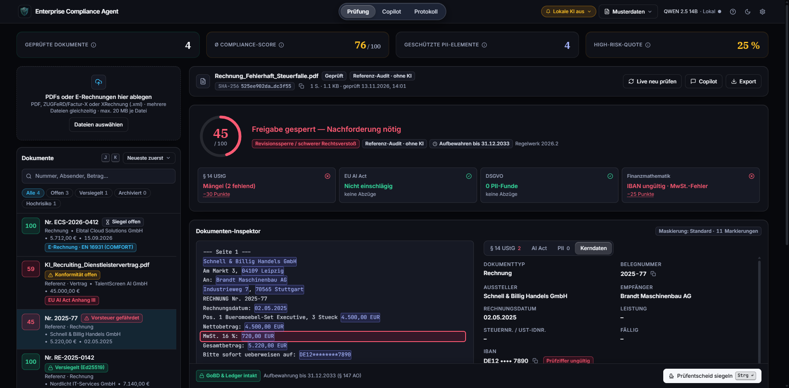
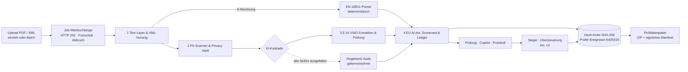
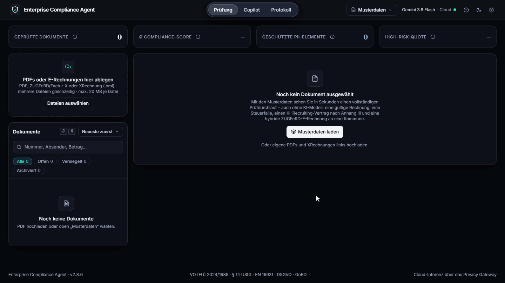
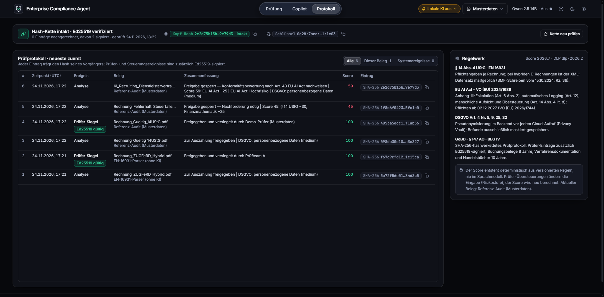
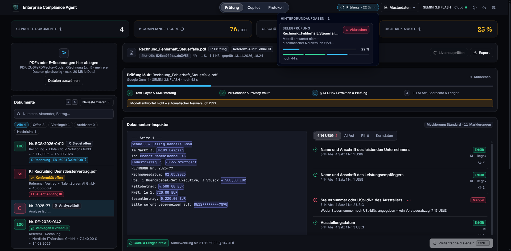
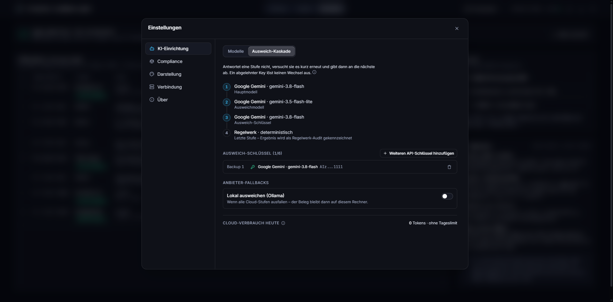

# Enterprise Compliance Agent

[](https://github.com/lutz-zarske/enterprise-compliance-agent/actions/workflows/ci.yml)


[](LICENSE)

**Revisionssichere Vorprüfung von Rechnungen und Verträgen** nach § 14 UStG,
E-Rechnung (EN 16931), EU AI Act und DSGVO. Ein deterministisches Regelwerk
berechnet den Compliance-Score. Jede Analyse und jeder Stufenwechsel steht
unveränderbar in einer SHA-256-Hash-Kette; Prüfer-Siegel, Übersteuerungen und
Modellwechsel sind darin zusätzlich Ed25519-signiert. Eine ausfallsichere
KI-Kaskade (lokal über Ollama oder Cloud über ein Privacy Gateway) sorgt dafür,
dass keine Prüfung an einer überlasteten KI scheitert.
Läuft ohne GPU: Musterdaten und das Regelwerk-Audit funktionieren sofort, mit
eigenem Cloud-Key oder lokalem Modell kommt die KI-Prüfung hinzu.

> **Prüfumfang:** Prüft Pflichtangaben nach § 14 UStG und Rechenwerte, bei
> E-Rechnungen zusätzlich Profil, XRechnung-Version und ausgewählte
> Geschäftsregeln. Eine vollständige Schematron-Validierung nach EN 16931 bzw.
> XRechnung ersetzt das nicht (dafür z. B. den KoSIT-Validator nutzen).

> **English summary:** Audit-proof pre-screening of invoices and contracts
> under German VAT law (§ 14 UStG), EU e-invoicing (EN 16931), the EU AI Act
> and the GDPR. A deterministic rule engine computes the compliance score,
> every result lands in a SHA-256 hash chain with Ed25519-signed reviewer
> events, and a fail-safe AI cascade (local Ollama or cloud LLMs behind a
> pseudonymizing privacy gateway) ends in a clearly labelled rule-based audit.
> Checks mandatory invoice details and arithmetic; it does not replace full
> EN 16931 / XRechnung Schematron validation (use e.g. the KoSIT validator).
> FastAPI · Next.js 15 · 545 offline tests · runs without GPU or API key.
> UI & reports in DE / EN / ES · technical documentation in German.



| Problem in der Praxis | Lösung im Agent |
|---|---|
| Fehlende Pflichtangaben kosten den Vorsteuerabzug (§ 15 UStG) | Alle Angaben nach § 14 Abs. 4 UStG einzeln geprüft, Abzug mit Rechtsfolge je Mangel, Korrekturanforderung an den Lieferanten per Klick |
| Hybride E-Rechnungen: PDF und XML weichen ab | XML-Datensatz ist maßgeblich (BMF 15.10.2024, Rz. 36) – deterministisch geparst, Abgleich mit dem Bildteil, ohne Sprachmodell |
| KI-Beschaffung kann Hochrisiko-Pflichten auslösen (Anhang III) | Einstufung nach Art. 5/6/50 mit automatischer Anhang-III-Eskalation; begründete Übersteuerung durch die Prüfperson (Art. 14) |
| Cloud-KI und personenbezogene Daten | Pseudonymisierung im Backend vor jedem Cloud-Aufruf; das Mapping verlässt den Server nie |
| Prüfungen müssen auch Jahre später nachvollziehbar sein (GoBD) | Hash-verkettetes Prüfprotokoll mit Ed25519-signierten Prüfer-Einträgen und Prüfdatenpaket (ZIP) mit offline prüfbarem, signiertem Manifest |
| KI-Anbieter sind überlastet oder offline | Wiederholung mit Backoff, Ausweichmodell, Ausweich-Schlüssel, lokales Modell – zuletzt das Regelwerk, gekennzeichnet in UI und Ledger |

**Inhalt:** [Schnellstart](#schnellstart) · [Architektur](#architektur) ·
[Oberfläche](#oberfläche) · [Rechtsnormen](#rechtsnormen-im-überblick) ·
[Funktionsumfang](#funktionsumfang) · [KI-Kaskade](#ausfallsichere-ki-kaskade) ·
[Scorecard](#compliance-scorecard-0100) · [Datenschutz](#datenschutz-und-privacy-gateway) ·
[API](#api-referenz) · [Konfiguration](#konfiguration) · [Tests](#tests) ·
[Entwicklung](#entwicklung) · [Docker](#docker) · [Abgrenzung](#abgrenzung-und-architektur-scope) ·
[Changelog](CHANGELOG.md)

---

## Schnellstart

```bash
git clone https://github.com/lutz-zarske/enterprise-compliance-agent.git && cd enterprise-compliance-agent
```

**Docker (alle Plattformen):**

```bash
docker compose up --build
```

Danach <http://127.0.0.1:3001> öffnen, oben rechts **Musterdaten** wählen – vier
Referenzbelege sind in Sekunden vollständig geprüft, ohne GPU und ohne API-Key
(alle Angaben darin sind frei erfunden).
Für die KI-Prüfung eigener Belege einen Cloud-Key unter **Einstellungen › KI-Einrichtung**
hinterlegen oder mit `docker compose --profile full up --build` zusätzlich einen
Ollama-Container starten.

**Windows (Ein-Klick):** `Start_Compliance_Agent.bat` doppelklicken. Der Starter
legt bei Bedarf die Python-Umgebung an (prüft Python 3.11+ und erkennt den
Windows-Store-Platzhalter), installiert Laufzeit- und Testpakete aus
`requirements-dev.txt`, hält Python- und npm-Abhängigkeiten sowie
einen gecachten Next.js-Production-Build (`.run/frontend-build.sha256`) über
Datei-Hashes aktuell, startet Backend (`:8001`) und Frontend (`:3001`) parallel
und öffnet den Browser ohne Wartezeit, sobald beide antworten. Beenden mit
`Stop_Compliance_Agent.bat`. Voraussetzung: Python 3.11+ und Node.js 20+.

**macOS / Linux:**

```bash
python3 -m venv .venv && source .venv/bin/activate
pip install -r requirements-dev.txt
cp .env.example .env
uvicorn app.main:app --host 127.0.0.1 --port 8001   # API + Swagger: http://127.0.0.1:8001/docs
```

```bash
cd frontend
npm ci
npm run build && npm run start                     # http://127.0.0.1:3001
```

> **Hinweise:** Für flüssige Demos und den Dauerbetrieb `npm run build && npm run start`
> (oder Docker) statt `npm run dev` verwenden – der Entwicklungsserver kompiliert
> jede Seite beim ersten Aufruf. Unter Windows `127.0.0.1` statt `localhost`
> nutzen: Windows löst `localhost` bevorzugt nach `::1` (IPv6) auf, was je Anfrage
> rund zwei Sekunden kosten kann; das Backend normalisiert `OLLAMA_BASE_URL`
> deshalb automatisch.

Lokales Modell (optional – Musterdaten, E-Rechnungs-Parser und Regelwerk laufen
auch ohne KI): Standard ist `ollama pull qwen2.5:14b-instruct` (ab 16 GB RAM
bzw. dedizierter GPU). Für normale Laptops ohne dedizierte Grafikkarte empfiehlt
sich ein leichteres Modell wie `ollama pull qwen2.5:7b-instruct` oder
`qwen2.5:3b` (unter **Einstellungen › KI-Einrichtung** wählbar). Läuft Ollama nicht,
bietet die Oberfläche einen **„Lokale KI starten“**-Knopf an.

---

## Architektur



| Ebene | Technik |
|---|---|
| **Backend** | Python 3.12 · FastAPI · Pydantic v2 · SQLAlchemy 2.0 Core · httpx · pdfplumber/pypdfium2 · defusedxml · ReportLab · cryptography (Fernet, Ed25519) |
| **Frontend** | Next.js 15 · React 19 · Tailwind CSS 4 · TypeScript (strict) · Schriften lokal über `@fontsource` |
| **Inferenz** | Ollama (`qwen2.5:14b-instruct`, auf Geräten ohne GPU z. B. `7b`/`3b`) · Google Gemini · Anthropic Claude · OpenAI – reines HTTP, kein SDK, kein Agenten-Framework |
| **Persistenz** | SQLite (Default) · PostgreSQL über `DATABASE_URL` |
| **Qualität** | pytest ohne LLM und ohne Netz (Provider und VIES über `httpx.MockTransport`) · ESLint · `next build` · CI für Backend, Frontend und Docker |
| **Betrieb** | Ein-Klick-Starter für Windows · Docker Compose · Non-Root-Container mit Healthchecks · JSON-Logs mit `request_id` |

Details zu Pipeline, Kaskade, Jobs und Ledger: [`docs/ARCHITECTURE.md`](docs/ARCHITECTURE.md).

---

## Oberfläche

Drei fokussierte Ansichten in der Kopfzeile; alle bleiben eingehängt, ein
Wechsel bricht weder eine Prüfung noch ein Gespräch ab.

**Rundgang in 70 Sekunden** (Musterbeleg, ohne KI-Modell): Upload einer hybriden
ZUGFeRD-Rechnung → Score mit Erklärung → Kerndaten und XML-Datensatz →
Protokoll → Export mit Prüfbefehl → Freigabe und Siegel.



| Copilot | Protokoll |
|---|---|
|  |  |
| **Laufende Prüfung mit Job-Monitor** | **Einstellungen: Ausweich-Kaskade** |
|  |  |

**Prüfzertifikat (Seite 1, als PDF gespeichert):** Ergebnis, Kurzbefund je Bereich und Siegel der Prüfperson; ab Seite 2 alle Prüfpunkte und der Prüfpfad, mit Kopf- und Fußzeile und „Seite x von y“.


* **Prüfung:** KPI-Leiste, Belegliste (Suche, Filter, Batch-Prüfung,
  `J`/`K`), Scorecard mit vier Kacheln und Rechtsfolgen-Tooltips, Inspektor mit
  Fundstellen-Kopplung (Kriterium ↔ Belegzeile) im 4-Farben-Schema: Grün
  konform, Gelb Prüfhinweis, Rot Verstoß, Indigo PII.
* **Copilot:** Fragen zum Beleg mit Live-Arbeitsschritten und
  Laufzeit, Denkstufe (knapp/standard/gründlich), Markdown-Antworten mit
  klickbaren Zeilenverweisen `[Z. 4]`, Hinweise bei Neuversuch oder Wechsel
  auf ein Ausweichmodell. Prominent: die **Korrekturanforderung nach § 14 UStG**
  an den Lieferanten als editierbarer Entwurf, ohne Sprachmodell.
* **Protokoll:** vollständige Hash-Kette mit Filtern (alle, dieser
  Beleg, Systemereignisse), Kopf-Hash und Schlüssel-Fingerabdruck,
  GoBD-Prüfdatenpaket, Verfahrensdokumentation als Word-Datei zum Ergänzen
  und das Regelwerk.
* **Kopfzeile & Darstellung:** Job-Monitor nur während einer Prüfung, Hinweise nur bei
  Handlungsbedarf (z. B. „Lokale KI aus“ mit Start-Knopf, wenn lokal das
  Hauptmodell ist; für Ollama als reine Cloud-Reserve zeigt die Ausweich-Kaskade
  den Zustand), Offline-Hinweis, Modellname mit Zustand (Lokal, Cloud, Aus)
  und Statuspunkt; Dark, Light oder System sowie **DE / EN / ES**-Sprachschalter
  unter **Einstellungen › Darstellung** (inkl. `?lang=de|en|es` für
  Berichte, GoBD-Verfahrensdokumentation und Copilot).

| Taste | Wirkung |
|---|---|
| `J` / `K`, `↓` / `↑` | Nächstes / vorheriges Dokument |
| `1` – `5` | Inspektor-Reiter § 14 UStG · AI Act · PII · Kerndaten · XML (nur E-Rechnung) |
| `Strg` + `Enter` (macOS `⌘` + `Enter`) | Siegel-Dialog öffnen; im Dialog versiegeln |
| `?` | Übersicht der Tastaturkürzel |
| `Esc` | Dialog, Menü oder Tour schließen; laufende Copilot-Anfrage stoppen |

Kürzel greifen nie, solange ein Eingabefeld den Fokus hat oder ein Dialog offen
ist. Designprinzipien: ruhige, statische Flächen (Karten reagieren nicht auf den
Zeiger), semantische Farbtokens, WCAG-AA-Kontraste in beiden Themes, Inter mit
Tabellenziffern für alle Zahlen, JetBrains Mono nur für Hashes, XML und
Beleg-Rohtext. Ist das Backend nicht erreichbar, erscheint ein Hinweis mit
Handlungsanweisung – **es werden nie Ersatzdaten angezeigt.**

---

## Rechtsnormen im Überblick

| Rechtsgrundlage | Was das System prüft bzw. umsetzt | Stand |
|---|---|---|
| **EU AI Act** – VO (EU) 2024/1689 | Risikoklassen (Art. 5, Art. 6 Abs. 2 i. V. m. Anhang III, Art. 50), Anhang-III-Eskalation, Hinweis auf Art. 6 Abs. 3, Betreiberpflichten (Art. 26), Logging (Art. 12), menschliche Aufsicht (Art. 14) inkl. begründeter Übersteuerung (Art. 14 Abs. 4 lit. d) | Anhang-III-Pflichten ab **02.12.2027**, Anhang I ab 02.08.2028 nach **VO (EU) 2026/1744** (Digital Omnibus) |
| **§ 14 Abs. 4 UStG** | Pflichtangaben Nr. 1–8 einzeln, Kleinbetragsrechnung (§ 33 UStDV), Vorsteuerrisiko (§ 15 UStG) | gültig |
| **USt-IdNr.** – VIES, § 18e UStG | Live-Abfrage der USt-IdNr. des Ausstellers (BT-31) auf Klick; Momentaufnahme ohne Score-Einfluss. Die qualifizierte Bestätigung erteilt das BZSt | VIES-REST-Schnittstelle |
| **E-Rechnung** – § 14 Abs. 1 UStG, EN 16931 | XML aus ZUGFeRD/Factur-X-PDFs und reine XRechnung (CII/UBL); Profil aus BT-24; XRechnung-Version; Pflichtfelder, Leistungszeitraum (BT-72, BG-14, BG-26) und Geschäftsregeln (BR-CO-10/13/14/15, BR-DE-2, BR-DE-15, BR-DE-TMP-32) | Empfangspflicht seit 01.01.2025; Ausstellungspflicht 2027/2028 |
| **XML-Vorrang** – BMF-Schreiben vom 15.10.2024, Rz. 36 | Bei hybriden Rechnungen ist der XML-Teil maßgeblich; Abgleich von acht Kernwerten mit dem Bildteil | präzisiert durch BMF-Schreiben vom 15.10.2025 |
| **B2G** – § 5 Abs. 1 Nr. 1 ERechV, BR-DE-15 | Leitweg-ID bei öffentlichen Auftraggebern: Aufbau und Prüfziffer (ISO/IEC 7064, MOD 97-10) | KoSIT-Formatspezifikation 2.0.2 |
| **§ 12 / § 14c UStG** | Zulässige Steuersätze, Steuerberechnung, Hinweis auf EuGH C-378/21 | BMF-Schreiben vom 27.02.2024 |
| **DSGVO** – Art. 4 Nr. 5, 9, 25, 32 | Pseudonymisierung vor Cloud-Aufrufen, Art.-9/10-Erkennung, maskierte Speicherung, drei Schwärzungsstufen | – |
| **GoBD / § 147 AO, § 14b UStG** | Unveränderbares, hash-verkettetes Prüfprotokoll; Prüfdatenpaket je Beleg; Aufbewahrungsende je Rechnung | Rechnungen 8 Jahre (BEG IV, Finanzsektor 10); Verfahrensdokumentation 10 Jahre |
| **GoBD Rz. 151–155** | Verfahrensdokumentation in vier Teilen (Rz. 153) als Entwurf aus dem Systemzustand | BMF-Schreiben vom 28.11.2019 in der jeweils geltenden Fassung |

Quellen: [`docs/RECHTSQUELLEN.md`](docs/RECHTSQUELLEN.md) ·
Einordnung: [`docs/RECHTLICHE_ANALYSE_2026.md`](docs/RECHTLICHE_ANALYSE_2026.md).

---

## Funktionsumfang

| Bereich | Umsetzung |
|---|---|
| **Extraktion** | Zwei fokussierte Modellaufrufe (Extraktion, Compliance-Audit) mit striktem Pydantic-Vertrag und Reparaturrunde bei Schemaverletzung |
| **§ 14 Abs. 4 UStG** | Alle Pflichtangaben (Nr. 1–8) einzeln, doppelt belegt (Modell bzw. XML und Regex), inkl. Kleinbetragsrechnung nach § 33 UStDV |
| **E-Rechnung (EN 16931)** | ZUGFeRD-/Factur-X-Anhang und reine XRechnung (CII, UBL); Profil-Erkennung; Business Terms; Abgleich XML ↔ Bildteil; Leitweg-ID. **Deterministisch, ohne Sprachmodell** |
| **Finanzmathematik** | IBAN-Prüfziffer (ISO 13616, MOD-97-10), zulässiger Steuersatz, Netto + USt = Brutto, USt = Netto × Satz |
| **EU AI Act** | Risikostufe, automatische Eskalation bei belegter Anhang-III-Kategorie, Pflichtenliste; Übersteuerung durch die Prüfperson mit Begründung, Rechtsnorm und neu berechnetem Score |
| **DSGVO** | Modellbefund plus Regex-Zweitmeinung, Art.-9/10-Erkennung, Maskierungszwang vor dem Speichern, drei Schwärzungsstufen |
| **Compliance-Score** | Deterministisch 0–100, vier Kacheln, Deckelung bei Hochrisiko, Freigabeempfehlung, Ein-Satz-Risikoerklärung je Abzug |
| **KI-Kaskade** | Retries mit Backoff, Ausweichmodell, bis zu sechs Ausweich-Schlüssel (auch mehrere Keys eines Anbieters), Anbieter-Fallbacks, lokales Modell, Regelwerk; jeder Wechsel als `provider_failover` in der Hash-Kette |
| **Hintergrund-Jobs** | Sofortige Annahme, Warteschlange, vier Phasen, Fortschritt und geglättete Restzeit, Abbruch, Batch-Prüfung, Erkennung hängender Jobs |
| **Lokale KI** | Ollama und LM Studio erkennen; Ollama per Klick starten (Flash Attention, 8-Bit-KV-Cache) und stoppen – nur direkt am Server |
| **Compliance Copilot** | Dokumentbezogene Fragen mit Zeilen- und Normverweisen, Live-Arbeitsschritten und Denkstufe; Regelwerk-Antwort, wenn keine KI erreichbar ist; Korrekturanforderung an den Lieferanten |
| **Prüfprotokoll** | Append-only mit SHA-256-Hash-Kette für alle Einträge (auch `analysis` und `provider_failover`), DB-Trigger gegen UPDATE/DELETE, zusätzlich Ed25519-Signaturen für Prüfer- und Steuerungsereignisse (`sign_off`, `human_override`, `model_change`, `archive`/`unarchive`, `release_update`), Kettenprüfung per API |
| **Prüfzertifikat & Prüfdatenpaket** | Direktes A4-PDF (Ergebnis, Kennzahlen und Siegel auf Seite 1, laufende Seitenzahlen), A4-HTML-Druckansicht, Markdown-Memo, JSON; ZIP mit Original, XML, Ledger-Auszug, Zertifikat (PDF + HTML), Verfahrensdokumentation (PDF + HTML) und signiertem Manifest; Offline-Prüfung mit `scripts/verify_pruefpaket.py` |
| **Verfahrensdokumentation** | Entwurf nach GoBD Rz. 153 aus dem echten Systemzustand plus Anhang je Beleg; als Word-Datei (.docx) mit gelb markierten Platzhaltern zum Ergänzen oder direkt als A4-PDF |
| **DLP-Gateway** | `POST /api/v1/redact`: endgültige Schwärzung für andere Anwendungen vor jedem Cloud-LLM-Aufruf |
| **Release-Assistent** | Neue Version per `git fetch --tags` prüfen und per Klick installieren – mit automatischer Datenbanksicherung, Erhalt aller lokalen Daten und Ledger-Eintrag |
| **Musterdaten** | Vier Referenzbelege (gültig, Steuerfalle, KI-Recruiting nach Anhang III, ZUGFeRD an eine Kommune), sofort nutzbar ohne Modell. Alle Firmen, Personen, Adressen, Steuernummern und IBANs darin sind frei erfunden. |

---

## Ausfallsichere KI-Kaskade

Eine Dokumentprüfung bricht nie mit einem `503` ab. Jede Stufe wiederholt bei
HTTP 408, 429, 500, 502, 503, 504, Verbindungsfehler oder Zeitüberschreitung
zuerst selbst (Standard nach 2 s und 5 s), dann übernimmt die nächste:

| Stufe | Was passiert | Konfiguration |
|---|---|---|
| 1 | Hauptmodell des aktiven Anbieters | Einstellungen › KI-Einrichtung |
| 2 | Ausweichmodell desselben Anbieters (z. B. `gemini-3.5-flash-lite`) | „Ausweichmodell bei Überlast“ |
| 3 | Ausweich-Schlüssel der Reihe nach – auch ein zweiter Gemini-Key | Einstellungen › KI-Einrichtung › Ausweich-Kaskade, bis zu 6 |
| 4 | Anbieter-Fallbacks, z. B. lokales Ollama | „Lokal ausweichen“ |
| 5 | Deterministisches Regelwerk (§ 14 UStG, IBAN-Prüfsumme, Regex-PII, konservative AI-Act-Einstufung) | `HEURISTIC_FALLBACK=true` |

* Alle Cloud-Stufen laufen durch **denselben Privacy Vault**; jeder Wechsel
  steht als `provider_failover` unveränderbar in der SHA-256-Hash-Kette.
* **Abgelehnte Keys (401/403) und Schemafehler** lösen bewusst keinen Wechsel
  aus – eine Fehlkonfiguration bleibt sichtbar.
* Eine lokal eingestellte Prüfung geht nie automatisch in die Cloud.
* Ein Regelwerk-Audit ist überall gekennzeichnet („Regelbasiertes
  Referenz-Audit – KI nicht verfügbar“) und lässt sich mit erreichbarem
  Modell über „Neu prüfen“ wiederholen.
* Ein Cloud-Tageslimit (Einstellungen › KI-Einrichtung › Ausweich-Kaskade)
  begrenzt die Tokens je Tag; danach übernehmen lokale Stufen bzw. das
  Regelwerk. Setzt der Server `CLOUD_DAILY_TOKEN_LIMIT`, ist das die
  Obergrenze für den Wert aus der Oberfläche.
* Neuere Modelle zeigt die Live-Modell-Liste des Anbieters als Vorschlag;
  gewechselt wird nur per Klick, dokumentiert als `model_change`.

---

## Compliance-Scorecard (0–100)

Der Score entsteht **nicht im Sprachmodell**, sondern in `app/scoring.py` aus
festen, versionierten Regeln (Regelwerk 2026.7).

| Kachel | Regel | Abzug |
|---|---|---|
| **Formelle Gültigkeit** (§ 14 Abs. 4 UStG, EN 16931) | Steuernummer/USt-IdNr. fehlt (Nr. 2) | −20 |
| | jede weitere fehlende Pflichtangabe (Nr. 1, 3–8) | −10 |
| | Kleinbetragsrechnung ≤ 250 € brutto: reduzierter Katalog (§ 33 UStDV) | – |
| | Hybride Rechnung: Bildteil weicht vom maßgeblichen XML ab | −10 |
| | Öffentlicher Auftraggeber ohne gültige Leitweg-ID (§ 5 ERechV) | −10 |
| **Mathematische Validität** | IBAN-Prüfziffer ungültig | −15 |
| | Netto + USt ≠ Brutto | −15 |
| | USt ≠ Netto × Satz | −10 |
| | Steuersatz nicht 19/7/0 % (07–12/2020 zusätzlich 16/5 %) | −10 |
| **Regulatorisches Risiko** (EU AI Act) | Hochrisiko ohne Konformitätsnachweis | −25, **Deckel 59** |
| | Hochrisiko mit Hinweis auf Konformitätsbewertung | −10 |
| | Begrenztes Risiko (Art. 50) | −5 |
| | Verbotene Praktik (Art. 5) | **Deckel 20** |
| **Datenschutz** (DSGVO) | Besondere Kategorien (Art. 9/10) | −10 |
| | Amtliche Kennnummern natürlicher Personen | −5 |

Bänder: **≥ 85 grün** (verkehrsfähig) · **60–84 gelb** (Nachbesserung) ·
**< 60 rot** (Revisionssperre). **Der Score misst Pflichtangaben und
Rechenwerte, die Ampel bildet die Freigabeentscheidung ab:** Grün gibt es nur
ohne Mangel und ohne Vorbehalt; eine gesperrte Freigabe („Nachforderung nötig“)
oder ein Vorbehalt zeigt höchstens Gelb, auch bei Score 100. Weist sich ein
Beleg als XRechnung aus und verletzt eine BR-DE-Regel oder nutzt eine nicht
mehr gültige XRechnung-Version, lautet die Empfehlung „Freigabe unter
Vorbehalt“ ohne Punktabzug – Eingangsplattformen öffentlicher Auftraggeber
prüfen gegen diese Regeln. Für reine EN-16931-/ZUGFeRD-Profile gilt das nicht.
Musterdaten: gültige Rechnung 100, Steuerfalle 45, KI-Recruiting-Vertrag 59
(gedeckelt), ZUGFeRD-Rechnung 100.

---

## Prüfprotokoll und Prüfdatenpaket

* Append-only-Tabelle `audit_trails`; `entry_hash = SHA-256(kanonisches JSON inkl. previous_hash)`.
* DB-Trigger (SQLite und PostgreSQL) verweigern `UPDATE` und `DELETE`;
  `GET /api/audit/verify` rechnet die Kette nach und prüft jede Signatur.
* Ereignisse: `analysis`, `sign_off`, `human_override`, `provider_failover`,
  `model_change`, `archive`/`unarchive`, `release_update`; ohne Beleg mit
  `document_id = "system"`.
* `GET /api/documents/{id}/export/gobd` liefert ein ZIP mit Originalbeleg,
  XML-Datensatz, Ledger-Auszug, Zertifikat, Verfahrensdokumentation und
  `manifest.json` (SHA-256 je Datei, Ed25519-Signatur). Downloads tragen
  Beleg und Datum im Namen, z. B. `Pruefdatenpaket_<Beleg>_2026-11-17.zip`.
  `python scripts/verify_pruefpaket.py paket.zip --fingerprint <fp>` prüft es
  ohne Server; den Fingerabdruck liefert `GET /api/audit/signing-key`.
* Ehrliche Einordnung: lineare Hash-Kette, kein Merkle-Baum. Den Kopf-Hash
  (`GET /api/audit/head`) regelmäßig außerhalb des Systems ablegen.

## Datenschutz und Privacy Gateway

* **Lokal als Standard.** Im Modus `local` verlässt kein Dokumentinhalt den Rechner.
* **Cloud nur mit Vault.** Jeder Cloud-Client ist vom `VaultedClient` umhüllt;
  ersetzt werden Personen (mit Anrede wie „Herr“, „Herrn“, „Frau“, „Familie“, auch mit Titel, oder mit Rolle wie
  „Ansprechpartner“, „z. Hd.“, „zu Händen“), Firmen, IBAN, EU-USt-IdNr.,
  Steuernummer, 11-stellige Steuer-ID, Ausweis-/Passnummer, SV-Nr.,
  Geburtsdatum, E-Mail, Telefon, Adressen und Beträge. Das Mapping lebt nur im
  Speicher und nur für einen Auftrag.
* **Beträge kommen aus dem Regelwerk.** Weil das Gateway im Cloud-Betrieb auch
  Beträge mit Währungsangabe durch Platzhalter ersetzt, liefert ein Modell dafür
  oft keinen Wert. Netto, Umsatzsteuer (je Steuersatz) und Gesamtbetrag ermittelt
  das Regelwerk deshalb deterministisch aus dem Belegtext hinter eindeutigen
  Summen-Bezeichnern, füllt fehlende Werte auf und gleicht widersprüchliche ab –
  jede Übernahme steht als Hinweis beim Beleg. Rechenprüfung und Score hängen
  nicht von der KI ab.
* **Rechtlich nüchtern:** Pseudonymisierte Daten bleiben personenbezogen; für
  jeden Anbieter der Kaskade sind AV-Vertrag und Transfergrundlage nötig.
* **API-Keys** Fernet-verschlüsselt, nach außen nur maskiert.
* **DLP-Gateway** (`POST /api/v1/redact`): endgültige Schwärzung von
  Zugangsdaten, vertraulichen Dateinamen, geschützten Parametern,
  Sperrbegriffen (`DLP_TERMS`, `extra_terms`) und PII für andere Anwendungen –
  kein Mapping, nichts wird gespeichert oder geloggt.

---

## API-Referenz

Vollständig und interaktiv unter `/docs` (Swagger).

| Methode | Pfad | Zweck |
|---|---|---|
| `GET` | `/health` | DB, Ollama (inkl. Modellvorschlag), aktive Kaskade |
| `POST` | `/documents/upload` · `/documents/upload-batch` | Upload (PDF oder XML) mit Validierung; Batch ohne Abbruch bei Einzelfehlern |
| `POST` | `/documents/{id}/extract` | Prüfung als Hintergrund-Job (HTTP 202 mit `job_id`); `?wait=true` für Skripte |
| `POST` | `/api/v1/jobs` | Mehrere Belege einreihen (Batch) |
| `GET` | `/api/v1/jobs` · `/api/v1/jobs/{id}` | Warteschlange · Zustand (Phase, Fortschritt, Restzeit, Ergebnis) |
| `POST` | `/api/v1/jobs/{id}/cancel` | Abbrechen; der Beleg behält sein vorheriges Ergebnis |
| `GET` | `/documents` · `/documents/{id}` | Liste · Detail inkl. geschwärzter Textansicht |
| `PUT` | `/documents/{id}/pin` · `/documents/{id}/archive` | Anpinnen · Archivieren (nur ausblenden, signiert) |
| `POST` | `/documents/{id}/sign-off` | Prüfer-Siegel (Art. 14), Ed25519-signiert |
| `POST` | `/api/documents/{id}/override` | Übersteuerung der KI-Einstufung (Art. 14 Abs. 4 lit. d), Score neu |
| `GET` | `/documents/{id}/report?format=pdf\|html\|markdown\|json&lang=de\|en\|es` | Prüfzertifikat (A4-PDF, HTML, Markdown, JSON) |
| `GET` | `/api/documents/{id}/export/gobd?lang=de\|en\|es` · `…/export/procedural-doc?format=pdf\|docx\|html\|markdown&lang=de\|en\|es` | Prüfdatenpaket (ZIP) · Verfahrensdokumentation |
| `POST` | `/documents/{id}/copilot` | Frage zum Beleg (`thinking`, `progress_id`) |
| `GET` · `POST` | `/api/v1/copilot/progress/{id}` · `/api/v1/copilot/cancel/{id}` | Live-Arbeitsschritte bzw. Abbruch einer laufenden Copilot-Anfrage |
| `GET` · `POST` | `/api/v1/ai/local` · `/api/v1/ai/start-ollama` · `/api/v1/ai/stop-local` | Lokale KI erkennen, starten, stoppen (nur localhost) |
| `POST` | `/api/vat/verify` | USt-IdNr. live bei VIES prüfen |
| `GET` | `/api/audit/trail` · `/api/audit/verify` · `/api/audit/head` · `/api/audit/signing-key` | Ledger lesen, prüfen, verankern; öffentlicher Schlüssel |
| `GET` · `POST` | `/api/settings` · `/api/settings/models` · `/api/settings/test-connection` | Laufzeit-Einstellungen inkl. Kaskade (Keys maskiert), Live-Modell-Liste, Verbindungstest |
| `GET` · `POST` | `/api/system/release` · `/api/system/release/apply` | Release prüfen und kontrolliert einspielen |
| `POST` | `/api/v1/redact` | DLP-Gateway |
| `GET` · `POST` | `/api/dashboard/kpis` · `/api/demo/seed` | Kennzahlen · Musterdaten |

```bash
API=http://127.0.0.1:8001

curl -s -X POST $API/api/demo/seed | jq '.items[] | {filename, compliance_score}'

ID=$(curl -s -X POST $API/documents/upload -F "file=@rechnung.pdf;type=application/pdf" | jq -r .id)
JOB=$(curl -s -X POST $API/documents/$ID/extract | jq -r .job_id)        # sofort HTTP 202
curl -s $API/api/v1/jobs/$JOB | jq '{status, phase_label, progress, eta_seconds}'
curl -s -X POST "$API/documents/$ID/extract?wait=true" | jq '.scorecard | {score, release_recommendation}'

# Kaskade: Gemini primär, Ausweichmodell, zweiter Key, zuletzt lokal
curl -s -X POST $API/api/settings -H "Content-Type: application/json" -d '{
  "inference_mode": "gemini", "api_keys": {"gemini": "<KEY_1>"},
  "ausweich_modelle": {"gemini": "gemini-3.5-flash-lite"},
  "ausweich_schluessel": [{"id": "g2", "provider": "gemini", "api_key": "<KEY_2>"}],
  "fallbacks": ["local"]}' | jq .chain

# Prüfdatenpaket herunterladen und offline prüfen
curl -s $API/api/documents/$ID/export/gobd -o paket.zip
python scripts/verify_pruefpaket.py paket.zip --fingerprint "$(curl -s $API/api/audit/signing-key | jq -r .fingerprint)"

# DLP-Gateway für eine andere Anwendung
curl -s -X POST $API/api/v1/redact -H "Content-Type: application/json" \
     -d '{"text":"Siehe pricing_algorithm.py, threshold=0.73","extra_terms":["Projekt Nordlicht"]}' | jq '{redacted_text, counts}'
```

Ist `API_KEY` gesetzt, verlangen alle Endpunkte außer `/health` den Header
`X-API-Key` – **produktiv immer setzen**. Fehlerformat einheitlich:
`{"error": {"code", "message", "hint"}}`.

---

## Konfiguration

Vollständig mit Erläuterungen in [`.env.example`](.env.example).

| Variable | Default | Zweck |
|---|---|---|
| `API_KEY` | leer | Aktiviert die `X-API-Key`-Prüfung |
| `DATABASE_URL` | `sqlite:///data/agent.db` | PostgreSQL: `postgresql+psycopg://…` |
| `INFERENCE_MODE` | `local` | `local` · `gemini` · `anthropic` · `openai` (zur Laufzeit änderbar) |
| `OLLAMA_BASE_URL` | `http://127.0.0.1:11434` | `localhost` wird intern auf `127.0.0.1` normalisiert |
| `OLLAMA_MODEL` · `OLLAMA_NUM_CTX` | `qwen2.5:14b-instruct` · `32768` | Lokales Modell und Kontextfenster |
| `GEMINI_MODEL` · `ANTHROPIC_MODEL` · `OPENAI_MODEL` | `gemini-3.8-flash` · `claude-sonnet-5` · `gpt-4o` | Startwerte (Stand 11/2026 aktiv; OpenAI schaltet GPT-4o am 14.01.2027 ab); die Live-Modell-Liste schlägt neuere vor |
| `GEMINI_/ANTHROPIC_/OPENAI_API_KEY` | leer | Startwerte für Cloud-Anbieter |
| `LLM_RETRY_DELAYS` · `CLOUD_TIMEOUT_SECONDS` | `2,5` · `45` | Wiederholungen je Stufe und Timeout pro Cloud-Anfrage (Sekunden) |
| `HEURISTIC_FALLBACK` | `true` | Regelwerk schließt ab, wenn alle KI-Stufen ausfallen |
| `CLOUD_DAILY_TOKEN_LIMIT` | `-1` | Tagesbudget für Cloud-Tokens (`-1` = ohne Limit); Voreinstellung und Obergrenze für den Wert aus den Einstellungen |
| `ANALYSIS_WORKERS` | `1` | Gleichzeitige Analysen |
| `LOCAL_AI_CONTROL_LOCAL_ONLY` | `true` | Ollama-Start/-Stopp nur von localhost |
| `PII_STRICTNESS` | `standard` | `strict` · `standard` · `audit_only` |
| `SETTINGS_ENCRYPTION_KEY` | leer | Fernet-Schlüssel für gespeicherte Provider-Keys |
| `CORS_ORIGINS` | `http://127.0.0.1:3001,http://localhost:3001` | Zulässige Browser-Origins (Loopback-Standard; produktiv anpassen) |
| `DLP_TERMS` | leer | Sperrbegriffe für `/api/v1/redact` |
| `RATE_LIMIT_*` | siehe `.env.example` | Token-Bucket je Client-IP; `0` = unbegrenzt |
| `RELEASE_UPDATE_LOCAL_ONLY` | `true` | Updates nur von localhost einspielen |

---

## Tests

```bash
python -m pytest -q                         # 545 Tests, kein LLM, kein API-Key, kein Netz
cd frontend && npx tsc --noEmit && npm run lint && npm run build
docker compose config --quiet
```

545 Tests (Stand v2.8.6) laufen in rund zwei Minuten. Ollama, die Cloud-Anbieter und VIES werden auf HTTP-Ebene über
`httpx.MockTransport` nachgestellt; Payload-Aufbau, JSON-Reparatur, Vault,
Kaskade, Fehlerabbildung und Validierung laufen real. Eine lokale `.env` (etwa
mit Cloud-Keys) wird in Tests ignoriert.

| Bereich | Schwerpunkte |
|---|---|
| API und Workflow | Kernendpunkte, Fehlerformat, Auth, Scorecard, Zertifikat (inkl. XSS-Escaping), Siegel, Batch, Musterdaten, KPIs |
| Prüfmatrix | Typische Rechnungen als Text-PDF (mit gefüllten und leeren KI-Beträgen) und als E-Rechnung: Hotel und Bewirtung 7 % + 19 %, Mischsatz mit Porto, Kleinbetrag, Kleinunternehmer, Reverse Charge, ig. Lieferung, Skonto, Rechnungskorrektur, Abschlags- und Schlussrechnung, echter Summen- und Steuerfehler – Erwartungen in [`docs/PRUEFMATRIX.md`](docs/PRUEFMATRIX.md) |
| Praxistest | `python scripts/praxiskorpus.py <ordner>` prüft 368 öffentliche Testbelege (Mustangproject, KoSIT, EU-Kommission) ohne Sprachmodell – Ergebnis in [`docs/PRUEFMATRIX.md`](docs/PRUEFMATRIX.md#praxistest-mit-öffentlichen-testbelegen) |
| KI-Kaskade und Jobs | Neuversuch je HTTP-Status, Ausweichmodell, mehrere Keys eines Anbieters durch den Vault, kein Wechsel bei 401, Regelwerk-Fallback mit Ledger-Kennzeichnung, Tagesbudget, `localhost`-Normalisierung, Fortschritt, Batch und Abbruch |
| E-Rechnung | CII/UBL-Mapping, Profile, XXE/DTD-Abwehr, Geschäftsregeln, Leitweg-ID, Leistungszeitraum (BT-72, BG-14, BG-26), PDF-Anhang, Diskrepanzen, ZIP-Paket inkl. Manipulationsnachweis; offizielle Testbelege der KoSIT und des Mustangproject (Herkunft und Lizenz in [`tests/fixtures/NOTICE`](tests/fixtures/NOTICE)) |
| Prüfprotokoll | Verkettung, Trigger, Manipulations- und Löschnachweis, Ed25519, Übersteuerung, Verfahrensdokumentation |
| Datenschutz | Vault, Provider-Payloads ohne Klartext-PII, verschlüsselte Keys, Regex-Scan, DLP-Gateway |
| Betrieb | JSON-Logs, PII-Filter im Log, Request-ID, Rate-Limit, VIES-Ausfälle, Release-Assistent |

---

## Entwicklung

| Aufgabe | Befehl |
|---|---|
| Backend mit Neuladen | `uvicorn app.main:app --host 127.0.0.1 --port 8001 --reload` |
| Frontend (Entwicklung) | `cd frontend && npm run dev` (Port 3001) |
| Frontend (Demo, Produktion) | `cd frontend && npm run build && npm run start` |
| Typprüfung | `cd frontend && npx tsc --noEmit` |
| Prüfpaket offline prüfen | `python scripts/verify_pruefpaket.py <paket.zip> --fingerprint <fp>` |

* **Windows-Starter:** `Start_Compliance_Agent.ps1` und
  `Stop_Compliance_Agent.ps1` müssen **UTF-8 mit BOM und CRLF** bleiben –
  Windows PowerShell 5.1 liest Dateien ohne BOM als ANSI und zeigt Umlaute
  falsch an. `.gitattributes` erzwingt CRLF für `*.ps1`, `*.bat` und `*.cmd`;
  Editoren dürfen das BOM beim Speichern nicht entfernen. Eine Kopie der
  `.bat`-Dateien außerhalb des Projekts (etwa auf dem Desktop) findet das
  Projekt über die Umgebungsvariable `ECA_HOME`.
* **Regeln für Änderungen** (Recht, Ledger, Kaskade, Oberfläche):
  [`docs/ARCHITECTURE.md`](docs/ARCHITECTURE.md#verbindliche-regeln-für-änderungen).
* Die CI (`.github/workflows/ci.yml`) führt `pytest`, `npm run lint`,
  `npm run build` sowie `docker compose config` und `docker compose build` aus.

---

## Docker

| Dienst | Port | Details |
|---|---|---|
| `api` | 8001 → 8000 | Python 3.12-slim, UID 10001, Healthcheck auf `/health`, Volume `app-data` |
| `frontend` | 3001 | Next.js Standalone auf node:22-alpine, UID 10001, startet erst bei gesunder API |
| `ollama` | 11434 | nur mit `--profile full` (Flash Attention, 8-Bit-KV-Cache); danach `docker compose exec ollama ollama pull qwen2.5:14b-instruct` (oder `qwen2.5:7b-instruct` auf Geräten ohne GPU) |

`PUBLIC_API_URL` legt fest, unter welcher Adresse der **Browser** die API
erreicht (zur Build-Zeit eingebettet, Default `http://127.0.0.1:8001`; für den
Zugriff von anderen Rechnern die Server-Adresse setzen und `CORS_ORIGINS`
entsprechend erweitern). Ist die eingebettete Adresse nicht erreichbar,
probiert das Frontend zusätzlich den eigenen Host, `127.0.0.1` und `localhost`.
Im Container lässt sich Ollama nicht aus der Oberfläche starten; das übernimmt
der `ollama`-Dienst.

---

## Projektstruktur

```
app/
  main.py              FastAPI: Routen, Auth, Fehlerformat, Request-Tracing
  jobs.py              Hintergrund-Jobs: Warteschlange, Phasen, Restzeit, Abbruch
  services.py          Pipeline (4 Phasen), Siegel, Übersteuerung, Copilot, Musterdaten
  inference.py         KI-Kaskade mit Retries, Ausweichmodell, Ausweich-Schlüsseln
  heuristics.py        Regelwerk-Fallback (Extraktion, AI Act, Copilot)
  llm.py · providers.py  Ollama- und Cloud-Transport (httpx), JSON-Vertrag, Reparatur
  privacy_vault.py     Pseudonymisierung / Re-Identifizierung, flüchtiges Mapping
  runtime_settings.py  Laufzeit-Einstellungen, Fernet-verschlüsselte Keys, effektive Kaskade
  model_catalog.py     Live-Modell-Listen der Anbieter, Upgrade-Vorschlag
  ai_budget.py         Optionales Cloud-Tagesbudget
  local_ai.py          Ollama / LM Studio erkennen, Ollama starten und stoppen
  scoring.py           Deterministische Scorecard (Regelwerk 2026.7)
  audit_ledger.py      Append-only-Ledger mit Hash-Kette und Signaturen
  extractors/          EN-16931-Parser (CII/UBL), PDF-Anhänge, Leitweg-ID
  gobd_export.py · procedural_doc.py · docx_export.py · pdf_export.py · reporting.py · print_layout.py · retention.py · signing.py
  redact.py            DLP-Gateway
  release.py           Release-Assistent
frontend/src/
  app/                 page.tsx (Ansichten, Jobs), layout.tsx, error.tsx, globals.css
  components/          Header, JobMonitor, Notifications, CopilotView, ProtocolView,
                       DocumentInspector, SettingsModal, Select, ui …
  lib/                 api.ts, i18n.tsx, format.ts, hints.ts (Tooltip-Texte), useJobs.ts, popover.ts,
                       markdown.tsx, evidence.ts, correction.ts
docs/                  ARCHITECTURE.md, PRUEFMATRIX.md, RECHTSQUELLEN.md, RECHTLICHE_ANALYSE_2026.md, screenshots/
scripts/               verify_pruefpaket.py (eigenständig, nur Stdlib + cryptography),
                       praxiskorpus.py (Praxistest mit öffentlichen Testbelegen), smoke_test_ollama.py
tests/                 pytest-Suite (HTTP-Mocks, keine Netzzugriffe)
```

---

## Abgrenzung und Architektur-Scope

Das System liefert eine **technische Vorprüfung** zur Entscheidungsunterstützung
nach Art. 14 EU AI Act – keine Rechts- oder Steuerberatung. Maßgeblich bleibt
die Freigabe durch die Prüfperson.

* **Digitaler Text-Layer & EN-16931-Kernprüfung:** PDF-Dokumente werden über
  ihren eingebetteten Text- bzw. XML-Layer gelesen (reine Bild-Scans ohne
  Text-Layer werden mit Hinweis abgewiesen). Bei E-Rechnungen prüft der Parser
  Profil, XRechnung-Version, Pflichtfelder, Summenregeln, ausgewählte
  Geschäftsregeln (BR-CO, BR-DE) und Leitweg-ID. Eine vollständige
  Schematron-Validierung nach EN 16931 bzw. XRechnung ersetzt das nicht – dafür
  z. B. den KoSIT-Validator nutzen.
* **Regelbasierte Pseudonymisierung & Heuristik-Notbetrieb:** Privacy Vault und
  DLP-Gateway arbeiten deterministisch über Muster, Kontextanker und
  Prüfsummen (ohne schwergewichtiges NER-Modell). Das Regelwerk-Audit als
  letzte Kaskadenstufe stuft konservativ ein und ist in UI sowie Ledger klar
  gekennzeichnet.
* **Systemseitige Integritätssignatur & VIES-Momentaufnahme:** Ed25519-Signaturen
  und das Prüfdatenpaket sichern die technische Unveränderbarkeit (für eine
  personenbezogene Identitätsbindung im Produktivbetrieb wird OIDC/SSO bzw.
  ein qualifiziertes Siegel nach eIDAS vorgeschaltet). Die Live-VIES-Abfrage
  ist eine Momentaufnahme; die qualifizierte Bestätigung nach § 18e UStG
  erteilt das BZSt.
* **Single-Node-Standard mit klarer Skalierungsschnittstelle:**
  Job-Warteschlange, Fortschritt und Rate-Limiter laufen standardmäßig ohne
  externe Infrastruktur im Prozessspeicher. Für horizontale Multi-Worker-Setups
  lässt sich der Zustand hinter derselben Job-API in Redis / Celery auslagern.

## Lizenz

[MIT](LICENSE) © 2026 Lutz Zarske · Testbelege Dritter in `tests/fixtures/official`
unter Apache 2.0 ([NOTICE](tests/fixtures/NOTICE)) · Änderungen je Version im
[Changelog](CHANGELOG.md) · Sicherheitslücken bitte vertraulich melden
([SECURITY.md](SECURITY.md)).
