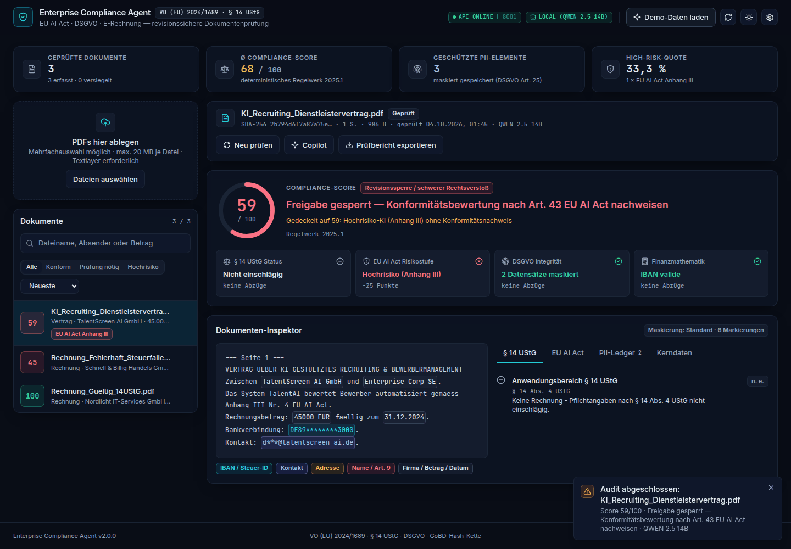
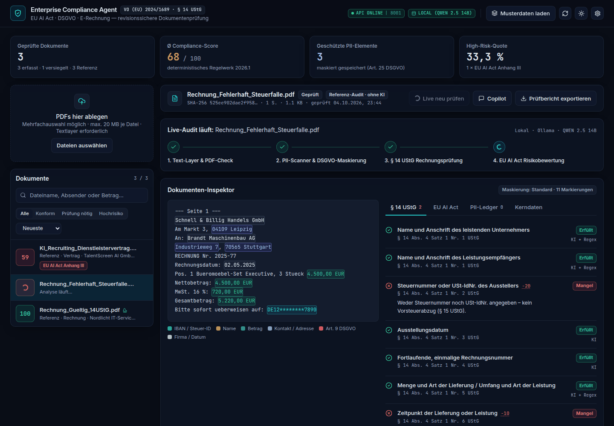
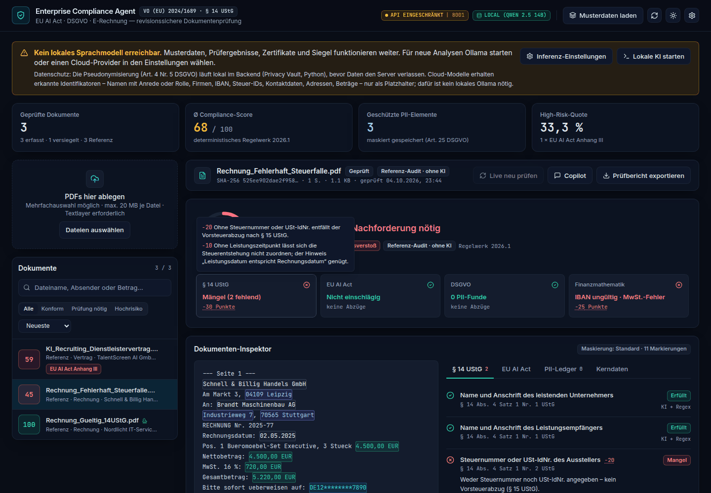
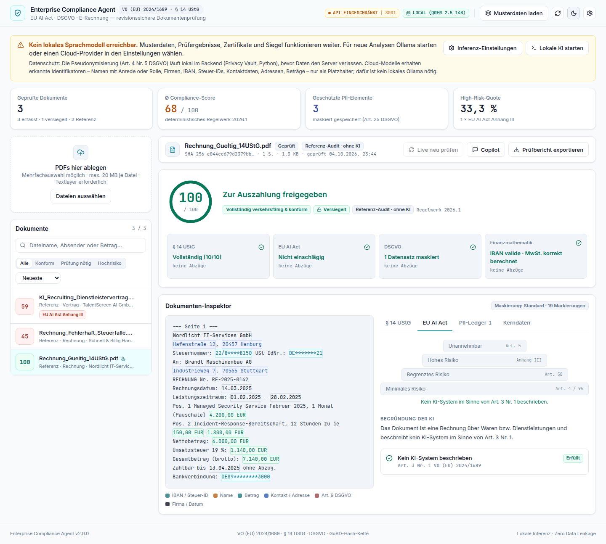

# Enterprise Compliance Agent

Revisionssichere Vorprüfung von Rechnungen und Verträgen: **§ 14 UStG**,
**EU AI Act (VO (EU) 2024/1689)** und **DSGVO** – mit deterministischem
Compliance-Score, hash-verkettetem Prüfprotokoll und Prüfer-Siegel.
Inferenz standardmäßig **lokal über Ollama**; optional Gemini, Claude oder GPT,
dann ausschließlich über ein **Privacy Gateway**, das identifizierende Daten vor
dem Versand pseudonymisiert.

| | |
|---|---|
| **Backend** | Python 3.12 · FastAPI · Pydantic v2 · SQLAlchemy 2.0 Core · httpx · pdfplumber · cryptography (Fernet) |
| **Frontend** | Next.js 15 · React 19 · Tailwind CSS 4 · TypeScript (strict) |
| **Inferenz** | Ollama `qwen2.5:14b-instruct` (Default) · Google Gemini · Anthropic Claude · OpenAI – reines HTTP, kein SDK, kein LangChain |
| **Persistenz** | SQLite (Default) · PostgreSQL über `DATABASE_URL` |
| **Qualität** | 155 Pytest-Tests (ca. 8 s, ohne laufendes LLM) · ESLint · `next build` · CI für Backend, Frontend, Docker |
| **Betrieb** | Docker Compose (API `:8001`, Frontend `:3001`), Non-Root-Container, Healthchecks |



> **Hinweis zu den Screenshots:** Aufgenommen mit den eingebauten Demo-Dokumenten.
> Die Modellantworten kamen bei dieser Aufnahme von einem Ollama-Stub mit
> festen Antworten; Score, Kacheln, Schwärzungen, Ledger und Zertifikat erzeugt
> das echte Backend.

---

## Inhalt

1. [Funktionsumfang](#funktionsumfang)
2. [Architektur & Datenfluss](#architektur--datenfluss)
3. [Schnellstart](#schnellstart)
4. [Oberfläche](#oberfläche)
5. [API-Referenz & cURL](#api-referenz--curl)
6. [Compliance-Scorecard](#compliance-scorecard-0100)
7. [Prüfprotokoll (Hash-Kette)](#prüfprotokoll-hash-kette)
8. [Datenschutz & Privacy Gateway](#datenschutz--privacy-gateway)
9. [Betrieb: Logging, Rate-Limiting, Konfiguration](#betrieb)
10. [Tests](#tests)
11. [Docker](#docker)
12. [Grenzen](#grenzen)


---

## Funktionsumfang

| Bereich | Umsetzung |
|---|---|
| **Extraktion** | Zwei fokussierte LLM-Läufe (Extraktion, Compliance-Audit) mit striktem Pydantic-Vertrag und Reparaturrunde bei Schemaverletzung |
| **§ 14 Abs. 4 UStG** | Alle Pflichtangaben (Nr. 1–8) einzeln geprüft, inkl. Kleinbetragsrechnung nach § 33 UStDV; Hinweis zur E-Rechnungspflicht (EN 16931, Erkennung eingebetteter ZUGFeRD/XRechnung-XML) |
| **Finanzmathematik** | IBAN-Prüfziffer (ISO 13616, MOD-97-10), zulässiger Steuersatz (inkl. Corona-Sätze 07–12/2020), Netto + USt = Brutto, USt = Netto × Satz |
| **EU AI Act** | Risikostufe (Art. 5 / Anhang III / Art. 50 / minimal), automatische Eskalation bei belegter Anhang-III-Kategorie, Artikel-Pflichtenliste |
| **DSGVO** | LLM-Befund + Regex-Zweitmeinung, Art.-9/10-Erkennung, Maskierungszwang vor dem Speichern, drei Schwärzungsstufen für die Textansicht |
| **Compliance-Score** | Deterministisch 0–100, vier Kacheln, Deckelung bei Hochrisiko, Freigabeempfehlung |
| **Prüfprotokoll** | Append-only-Tabelle `audit_trails` mit SHA-256-Hash-Kette, DB-Trigger gegen UPDATE/DELETE, Kettenprüfung per API |
| **Human Oversight** | Prüfer-Siegel (Art. 14 EU AI Act) als eigener Ledger-Eintrag; erneute Analyse hebt das Siegel auf |
| **Prüfzertifikat** | A4-HTML (druckfertig, CSP-gehärtet), Markdown-Memo, JSON für ERP-Archivierung |
| **Multi-Provider** | Ollama / Gemini / Claude / GPT zur Laufzeit umschaltbar; API-Keys Fernet-verschlüsselt gespeichert, nur maskiert ausgeliefert |
| **Compliance Copilot** | Dokumentbezogene Fragen, geerdet auf nummeriertem Text und Prüfergebnis, mit Zeilen- und Normverweisen |
| **Betrieb** | JSON-Logs mit `request_id`, PII-Filter im Log, Token-Bucket-Rate-Limit, Batch-Upload, Demo-Daten, KPI-Endpunkt |

---

## Architektur & Datenfluss

```mermaid
flowchart LR
    U[PDF-Upload<br/>einzeln / Batch] --> V[Validierung<br/>Typ · Größe · Textlayer]
    V --> DB[(SQLite / PostgreSQL<br/>documents)]
    DB --> P1[1 Text-Layer-Check]
    P1 --> P2[2 Regex-PII-Scan]
    P2 --> R{Inferenz-Modus}
    R -- lokal --> O[Ollama<br/>qwen2.5:14b]
    R -- Cloud --> PV[Privacy Vault<br/>Pseudonymisierung]
    PV --> C[Gemini / Claude / GPT]
    C --> RI[Lokale<br/>Re-Identifizierung]
    O --> P3[3 Extraktion + § 14 UStG]
    RI --> P3
    P3 --> P4[4 AI-Act- & DSGVO-Audit<br/>Eskalationsregeln]
    P4 --> S[Deterministische<br/>Scorecard 0–100]
    S --> L[(audit_trails<br/>Hash-Kette)]
    S --> UI[Dashboard · Inspektor · Copilot]
    UI --> H[Prüfer-Siegel<br/>Art. 14]
    H --> L
    L --> Z[Prüfzertifikat<br/>HTML · MD · JSON]
```



```
app/
  main.py            FastAPI: Endpunkte, Auth, Fehlerformat, Request-Tracing
  services.py        Pipeline (4 Stufen), Sign-off, KPIs, Copilot, Demo-Seed
  scoring.py         Deterministische Scorecard (Regelwerk 2026.1)
  audit_ledger.py    Append-only-Ledger mit SHA-256-Hash-Kette
  inference.py       InferenceRouter: lokal oder Cloud (immer mit Vault)
  llm.py             Basisclient (JSON-Vertrag, Reparatur), Ollama, Prompts
  providers.py       Gemini-, Claude-, OpenAI-Transport (httpx)
  privacy_vault.py   Pseudonymisierung / Re-Identifizierung, flüchtiges Mapping
  redaction.py       Maskierungszwang, Regex-PII-Scan, Schwärzungsstufen
  runtime_settings.py Laufzeit-Einstellungen, Fernet-verschlüsselte Keys
  reporting.py       Prüfzertifikat (HTML/A4, Markdown, JSON)
  logging_config.py  JSON-Logging, request_id (ContextVar), PII-Filter
  rate_limit.py      Token-Bucket je Client-IP
  demo.py            Drei Referenzdokumente (grün / rot / Hochrisiko)
  db.py · schemas.py · config.py · pdf_reader.py
frontend/src/
  app/page.tsx       Dashboard-Orchestrierung (kein Mock-Fallback)
  components/        Header, KpiStrip, Scorecard, AuditStepper, DocumentList,
                     DocumentInspector, ExportModal, SettingsModal, CopilotDrawer
  lib/api.ts         Typisierter Client, Backend-Erkennung, Fehlerobjekte
```

**Bewusst kein LangChain/CrewAI.** Der Weg vom Dokument zur Datenbank ist ein
lesbarer HTTP-Aufruf plus Schemavalidierung – das kann ein IT-Auditor
nachvollziehen.

---

## Schnellstart

### Lokal (empfohlen für Entwicklung)

```bash
ollama pull qwen2.5:14b-instruct

python -m venv .venv
source .venv/bin/activate            # Windows: .venv\Scripts\activate
pip install -r requirements-dev.txt
cp .env.example .env                 # Windows: copy .env.example .env

uvicorn app.main:app --port 8001     # API + Swagger: http://localhost:8001/docs
```

```bash
cd frontend
npm ci
npm run dev                          # http://localhost:3001
```

Im Dashboard **„Demo-Daten laden“** klicken: Drei Referenzdokumente werden
angelegt und nacheinander mit Live-Stepper geprüft.

### Docker

```bash
docker compose up --build            # API :8001, Frontend :3001, Ollama auf dem Host
docker compose --profile full up --build   # zusätzlich Ollama-Container
```

### Inferenzstrecke prüfen

```bash
python scripts/smoke_test_ollama.py  # Erreichbarkeit, Modell, echter Inferenzlauf
```

---

## Oberfläche

| | |
|---|---|
|  | **Live-Audit-Stepper** – zeigt die echten Pipeline-Stufen des Backends (`GET /documents/{id}/progress`), keine simulierte Animation. Links die Textansicht mit farbcodierten PII-Markierungen. |
|  | **Fehlerhafte Rechnung (45/100)** – fehlende USt-IdNr. (−20), fehlendes Leistungsdatum (−10), ungültige IBAN (−15), Steuersatz 16 % (−10). Jede Zeile zeigt Norm, Abzug und Herkunft des Nachweises (KI, Regex oder beides). |
|  | **Light Mode, gültige Rechnung (100/100)** – „Zur Auszahlung freigegeben“, versiegelt. Der E-Rechnungs-Hinweis (reines PDF) erscheint als Info ohne Punktabzug. |
|  | **Compliance Copilot** – Antworten mit Zeilenverweisen `[Z. n]` und Normzitaten. |
|  | **Export-Center & Siegel** – Zertifikat drucken, JSON, Markdown-Memo; Prüfer-Siegel als Ledger-Eintrag. |
|  | **Einstellungen** – Provider, Modell, API-Key (maskiert), Privacy-Gateway-Hinweis, PII-Strenge, Toggles, X-API-Key. |
|  | **Prüfzertifikat (A4)** – SHA-256, Ledger- und Vorgänger-Hash, Prompt-Hash, § 14-Matrix, Siegel. |

Designprinzipien: semantische Farbtokens (Grün = konform, Bernstein = Prüfung,
Rose = Verstoß/Hochrisiko, Indigo = Datenschutz), WCAG-AA-Kontraste in beiden
Themes, keine Hover-Lifts oder pulsierenden Effekte, `prefers-reduced-motion`
wird respektiert. Ist das Backend nicht erreichbar, erscheint ein Hinweisbanner
– **es werden nie Ersatzdaten angezeigt.**

---

## API-Referenz & cURL

| Methode | Pfad | Zweck |
|---|---|---|
| `GET` | `/health` | DB, Ollama, aktiver Inferenz-Modus |
| `POST` | `/documents/upload` | Einzelupload mit Validierung |
| `POST` | `/documents/upload-batch` | Mehrere PDFs; Fehler je Datei, kein Abbruch |
| `POST` | `/documents/{id}/extract` | Pipeline + Scorecard + Ledger-Eintrag |
| `GET` | `/documents/{id}/progress` | Aktuelle Pipeline-Stufe |
| `GET` | `/documents` · `/documents/{id}` | Liste (Pins zuerst) · Detail inkl. geschwärzter Textansicht |
| `PUT` | `/documents/{id}/pin` | Anpinnen |
| `POST` | `/documents/{id}/sign-off` | Prüfer-Siegel (Art. 14) |
| `GET` | `/documents/{id}/report?format=html\|markdown\|json` | Prüfzertifikat |
| `POST` | `/documents/{id}/copilot` | Frage zum Dokument |
| `GET` | `/api/audit/trail` · `/api/audit/verify` · `/api/audit/head` | Ledger lesen, Kette prüfen, Kopf-Hash zur Verankerung |
| `GET`/`POST` | `/api/settings` · `/api/settings/test-connection` | Laufzeit-Einstellungen (Keys maskiert), Verbindungstest |
| `GET` | `/api/dashboard/kpis` | Portfolio-Kennzahlen |
| `POST` | `/api/demo/seed` | Drei Referenzdokumente (idempotent) |

```bash
API=http://localhost:8001

curl -s $API/health | jq .inference
curl -s -X POST $API/api/demo/seed | jq '.items[] | {id, filename}'

ID=$(curl -s -X POST $API/documents/upload -F "file=@rechnung.pdf;type=application/pdf" | jq -r .id)
curl -s -X POST $API/documents/$ID/extract | jq '.scorecard | {score, band, release_recommendation}'

curl -s -X POST $API/documents/upload-batch -F "files=@a.pdf" -F "files=@b.pdf" | jq '{succeeded, failed}'

curl -s -X POST $API/documents/$ID/sign-off -H "Content-Type: application/json" \
     -d '{"auditor_name":"Lutz Zarske","note":"USt-IdNr. nachgefordert","decision":"SEALED_APPROVED"}' | jq .sign_off

curl -s "$API/documents/$ID/report?format=html" -o zertifikat.html
curl -s "$API/documents/$ID/report?format=markdown"

curl -s $API/api/audit/verify          # {"valid": true, "entries": ..., "head_hash": ...}

curl -s -X POST $API/api/settings -H "Content-Type: application/json" \
     -d '{"inference_mode":"gemini","api_keys":{"gemini":"<KEY>"},"pii_strictness":"strict"}' | jq .masked_keys

curl -s -X POST $API/documents/$ID/copilot -H "Content-Type: application/json" \
     -d '{"question":"Welche Pflichtangaben fehlen?"}' | jq -r .answer
```

Ist `API_KEY` gesetzt, verlangen alle Endpunkte außer `/health` den Header
`X-API-Key`. **Ohne `API_KEY` kann jeder im Netz auch die Einstellungen ändern**
– produktiv immer setzen.

Fehlerformat (einheitlich): `{"error": {"code", "message", "hint"}}`. Wichtige
Codes: `invalid_upload` 415 · `file_too_large` 413 · `no_text_layer` 422 ·
`document_not_analyzed` 409 · `rate_limited` 429 (+ `Retry-After`) ·
`provider_not_configured` 400 · `provider_auth_failed` 502 ·
`ollama_unavailable`/`provider_unavailable` 503 · `provider_timeout` 504.

---

## Compliance-Scorecard (0–100)

Der Score entsteht **nicht im LLM**, sondern in `app/scoring.py` aus festen,
versionierten Regeln. Jede Pflichtangabe wird doppelt belegt: aus der
LLM-Extraktion und per Regex im Dokumenttext (`evidence_source`).

| Kachel | Regel | Abzug |
|---|---|---|
| **Formelle Gültigkeit** (§ 14 Abs. 4 UStG) | Steuernummer/USt-IdNr. fehlt (Nr. 2) | −20 |
| | jede weitere fehlende Pflichtangabe (Nr. 1, 3–8) | −10 |
| | Kleinbetragsrechnung ≤ 250 € brutto: Nr. 1 (Empfänger), 2, 4, 6, 7, 8 (Betrag) entbehrlich (§ 33 UStDV) | – |
| | Reines PDF statt E-Rechnung (EN 16931): Hinweis | 0 |
| **Mathematische Validität** | IBAN-Prüfziffer ungültig | −15 |
| | Netto + USt ≠ Brutto | −15 |
| | USt ≠ Netto × Satz | −10 |
| | Steuersatz nicht 19/7/0 % (07–12/2020 zusätzlich 16/5 %) | −10 |
| **Regulatorisches Risiko** (EU AI Act) | Hochrisiko ohne Konformitätsnachweis | −25, **Deckel 59** |
| | Hochrisiko mit Hinweis auf Konformitätsbewertung | −10 |
| | Begrenztes Risiko (Art. 50) | −5 |
| | Verbotene Praktik (Art. 5) | **Deckel 20** |
| **Datenschutz** (DSGVO) | Besondere Kategorien (Art. 9/10) | −10 |
| | Amtliche Kennnummern natürlicher Personen | −5 |

Bänder: **≥ 85 grün** (verkehrsfähig) · **60–84 gelb** (Nachbesserung) ·
**< 60 rot** (Revisionssperre). Freigabeempfehlung: „Zur Auszahlung
freigegeben“, „Freigabe unter Vorbehalt“, „Freigabe gesperrt — Nachforderung
nötig“ oder „Freigabe gesperrt — Konformitätsbewertung nach Art. 43 nachweisen“.

Demo-Dokumente bei vollständiger Extraktion: gültige Rechnung **100**,
Steuerfalle **45**, KI-Recruiting-Vertrag **59** (gedeckelt). Ein schwächeres
Modell kann einzelne Felder verfehlen; die Regex-Gegenprobe fängt die meisten
Fälle ab (getestet in `tests/test_scoring.py`).

---

## Prüfprotokoll (Hash-Kette)

Jede Analyse und jedes Siegel schreibt einen Eintrag in `audit_trails`:
`document_id`, `sha256_hash` (Dokument), `model_name`, `prompt_hash`
(Fingerabdruck der Prompt-Version), `timestamp_utc`, `result_summary`,
`compliance_score`, `risk_tier`, `details`, `previous_hash`, `entry_hash`.

* `entry_hash = SHA-256(kanonisches JSON aller Felder inkl. previous_hash)`
* Erster Eintrag verweist auf `0000…` (Genesis).
* `GET /api/audit/verify` rechnet die gesamte Kette nach und meldet
  Sequenzlücken (gelöschte Einträge), Verkettungsbrüche und Inhaltsänderungen
  mit Sequenznummer.
* DB-Trigger (SQLite und PostgreSQL) verweigern `UPDATE` und `DELETE`.
* Bei PostgreSQL serialisiert `pg_advisory_xact_lock` das Anhängen auch über
  mehrere Prozesse.

Ehrliche Einordnung: Das ist eine **lineare Hash-Kette**, kein Merkle-Baum.
Gegen jemanden mit Vollzugriff auf die Datenbank hilft kein Trigger; wer die
jüngsten Einträge abschneidet, erzeugt eine in sich gültige kürzere Kette.
Deshalb gibt es `GET /api/audit/head`: Den Kopf-Hash regelmäßig außerhalb des
Systems ablegen (Ticket, WORM-Speicher, qualifizierter Zeitstempel nach eIDAS).

---

## Datenschutz & Privacy Gateway

* **Lokal als Standard.** Im Modus `local` verlässt kein Dokumentinhalt den Rechner.
* **Cloud nur mit Vault.** `InferenceRouter` umhüllt jeden Cloud-Client mit
  `VaultedClient`; ein Cloud-Aufruf ohne Pseudonymisierung ist im Code nicht
  vorgesehen. Ersetzt werden Personen (mit Anrede/Rolle), Firmen (über
  Rechtsform), IBAN, USt-IdNr., Steuernummer, E-Mail, Telefon, Adressen und
  Beträge. Das Mapping lebt nur im Speicher und nur für einen Auftrag; im
  Ergebnis steht lediglich die Anzahl je Kategorie (`privacy_gateway`).
* **Rechtlich nüchtern:** Pseudonymisierte Daten bleiben personenbezogen
  (Art. 4 Nr. 5, ErwG 26 DSGVO). Der Vault senkt das Übermittlungsrisiko
  (Art. 25, 32; ergänzende Maßnahme i. S. d. EDSA-Empfehlungen 01/2020),
  ersetzt aber weder AV-Vertrag noch Transfergrundlage. Die Erkennung ist
  regelbasiert: Namen ohne Anrede oder Rolle und Freitext-Merkmale werden nicht
  erfasst.
* **Maskierte Persistenz.** PII-Befunde werden nur maskiert gespeichert. Die
  Textansicht folgt der Stufe `strict` / `standard` / `audit_only`.
* **Volltext gespeichert.** Für erneute Analysen liegt der extrahierte Text in
  der Datenbank (`raw_text`); produktiv gehören Festplattenverschlüsselung und
  ein Löschkonzept (Art. 17 DSGVO) dazu.
* **API-Keys.** Fernet-verschlüsselt in `app_settings`; Schlüssel aus
  `SETTINGS_ENCRYPTION_KEY` oder `data/.settings.key` (0600, gitignored).
  Liegt der Schlüssel neben der DB, schützt das ein geleaktes DB-Backup, nicht
  einen kompromittierten Server – produktiv gehört er in einen Secret-Store.

---

## Betrieb

**Strukturiertes Logging.** Jede Logzeile ist ein JSON-Objekt mit `timestamp`,
`level`, `logger`, `message`, `request_id` und Zusatzfeldern (`http_status`,
`duration_ms`, …). Die `request_id` kommt aus einer ContextVar, wird als
`X-Request-ID` zurückgegeben und von Clients nur übernommen, wenn sie dem
Zeichensatz `[A-Za-z0-9._:-]{1,128}` entspricht (Schutz vor Log-Injection). Ein
Filter schwärzt IBANs, E-Mails, Telefonnummern, lange Ziffernfolgen und
API-Keys; Felder wie `raw_text` werden grundsätzlich ersetzt.

**Rate-Limiting.** Token-Bucket je Client-IP und Routengruppe (Upload 30/min,
Extraktion 10/min, Copilot 20/min, Einstellungen 30/min); Antwort 429 mit
`Retry-After`. Der Zustand liegt im Prozessspeicher – bei mehreren Workern
gehört das Limit in Redis oder an das API-Gateway.

**Wichtige Variablen** (vollständig in `.env.example`):

| Variable | Default | Zweck |
|---|---|---|
| `API_KEY` | leer | Aktiviert `X-API-Key`-Prüfung |
| `DATABASE_URL` | `sqlite:///data/agent.db` | PostgreSQL: `postgresql+psycopg://…` |
| `INFERENCE_MODE` | `local` | Startwert; zur Laufzeit änderbar |
| `GEMINI_/ANTHROPIC_/OPENAI_API_KEY` | leer | Startwerte für Cloud-Provider |
| `ANTHROPIC_MODEL` | `claude-sonnet-5-5` | `claude-3-5-sonnet-20241022` ist seit Oktober 2025 abgekündigt |
| `PII_STRICTNESS` | `standard` | `strict` · `standard` · `audit_only` |
| `LOG_JSON` | `true` | `false` für lesbare Textlogs |
| `RATE_LIMIT_*` | siehe oben | `0` = unbegrenzt |
| `SETTINGS_ENCRYPTION_KEY` | leer | Fernet-Schlüssel für gespeicherte Provider-Keys |
| `CORS_ORIGINS` | `*` | Produktiv auf die Frontend-Origin beschränken |

**PostgreSQL:** `pip install "psycopg[binary]"` und `DATABASE_URL` setzen. Neue
Spalten werden beim Start additiv ergänzt; für echte Schemaänderungen gehört
Alembic dazu.

---

## Tests

```bash
python -m pytest            # 155 Tests, ca. 8 s, kein LLM nötig
cd frontend && npm run lint && npm run build
```

Ollama und die Cloud-Provider werden auf HTTP-Ebene über `httpx.MockTransport`
nachgestellt; Payload-Aufbau, JSON-Reparatur, Vault und Validierung laufen real.

| Datei | Tests | Schwerpunkt |
|---|---:|---|
| `test_api.py` | 22 | Kernendpunkte, Fehlerformat, Auth, Eskalation |
| `test_schemas.py` | 22 | Deutsche Formate, Toleranz gegenüber LLM-Ausgaben |
| `test_workflow.py` | 22 | Scorecard in der API, Zertifikat (inkl. XSS-Escaping), Siegel, Batch, Seed, KPIs, Pins, Fortschritt, Copilot, Schwärzungsstufen |
| `test_privacy_and_providers.py` | 26 | Vault, Provider-Payloads, Fehlerabbildung, verschlüsselte Keys, Cloud-Pipeline ohne Klartext-PII |
| `test_scoring.py` | 18 | Regelwerk, Demo-Scores, Kleinbetrag, Corona-Sätze, Deckelung |
| `test_observability.py` | 13 | JSON-Logs, PII-Filter, Request-ID, Token-Bucket, 429 |
| `test_audit_ledger.py` | 7 | Verkettung, Trigger, Manipulations- und Löschnachweis, Migration |
| `test_llm.py` · `test_redaction.py` · `test_pdf_reader.py` | 25 | Client, Regex-Scan, PDF-Fehlerklassen |

---

## Docker

```bash
docker compose up --build
```

| Dienst | Port | Details |
|---|---|---|
| `api` | 8001 → 8000 | Python 3.12-slim, UID 10001, Healthcheck auf `/health`, Volume `app-data` |
| `frontend` | 3001 | Next.js Standalone auf node:22-alpine, UID 10001, startet erst bei gesunder API |
| `ollama` | 11434 | nur mit `--profile full`; danach `docker compose exec ollama ollama pull qwen2.5:14b-instruct` |

`PUBLIC_API_URL` legt fest, unter welcher Adresse der **Browser** die API
erreicht (wird zur Build-Zeit eingebettet, Default `http://localhost:8001`).

Datensicherung:

```bash
docker run --rm -v enterprise-compliance-agent_app-data:/data -v "$PWD":/backup \
  alpine tar czf /backup/app-data.tgz -C /data .
```

---

## Grenzen

Das System liefert eine **technische Vorprüfung**, keine Rechts- oder
Steuerberatung. Maßgeblich bleibt die Freigabe durch die Prüfperson.

* **Kein OCR.** Scans ohne Textlayer werden mit Handlungshinweis abgelehnt.
* **Keine strukturierte E-Rechnung.** Eingebettetes XML wird erkannt, aber
  nicht gegen EN 16931/KoSIT validiert – der nächste sinnvolle Ausbauschritt.
* **Synchrone Analyse.** Ein `POST /extract` blockiert für beide LLM-Läufe; für
  hohe Last wäre eine Queue (z. B. Arq, Celery) nötig.
* **Prüfer-Identität.** Der Name im Siegel ist selbst erklärt. Produktiv
  gehören SSO (OIDC) und ggf. eine qualifizierte elektronische Signatur dazu.
* **Prozesslokale Zustände.** Rate-Limit und Pipeline-Fortschritt gelten je
  Prozess.

## Lizenz

MIT.
