# Enterprise Compliance Agent

Revisionssichere Vorprüfung von Rechnungen und Verträgen: **§ 14 UStG**,
**E-Rechnung nach EN 16931** (ZUGFeRD, Factur-X, XRechnung), **EU AI Act
(VO (EU) 2024/1689)** und **DSGVO** – mit deterministischem Compliance-Score,
hash-verkettetem Prüfprotokoll, Prüfer-Siegel und signiertem Prüfdatenpaket.
Inferenz standardmäßig **lokal über Ollama**; optional Gemini, Claude oder GPT,
dann ausschließlich über ein **Privacy Gateway**, das identifizierende Daten vor
dem Versand pseudonymisiert. Prüfpersonen können die KI-Einstufung begründet
übersteuern (Art. 14 AI Act, Ed25519-signiert im Ledger); das System erzeugt
einen Entwurf der **GoBD-Verfahrensdokumentation** aus seinem tatsächlichen
Zustand.

| | |
|---|---|
| **Backend** | Python 3.12 · FastAPI · Pydantic v2 · SQLAlchemy 2.0 Core · httpx · pdfplumber/pypdfium2 · defusedxml · cryptography (Fernet, Ed25519) |
| **Frontend** | Next.js 15 · React 19 · Tailwind CSS 4 · TypeScript (strict) |
| **Inferenz** | Ollama `qwen2.5:14b-instruct` (Default) · Google Gemini · Anthropic Claude · OpenAI – reines HTTP, kein SDK, kein LangChain |
| **Persistenz** | SQLite (Default) · PostgreSQL über `DATABASE_URL` |
| **Qualität** | 296 Pytest-Tests (ca. 20 s, ohne laufendes LLM, ohne Netz) · ESLint · `next build` · CI für Backend, Frontend, Docker |
| **Betrieb** | Ein-Klick-Start für Windows · Docker Compose (API `:8001`, Frontend `:3001`) · Non-Root-Container, Healthchecks |

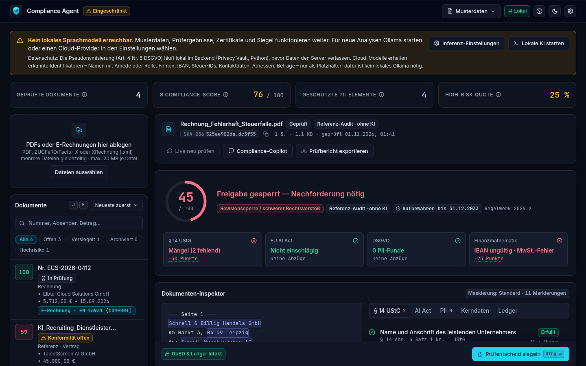

| Prüfzertifikat (A4, druckfertig) | Compliance-Copilot |
|---|---|
| 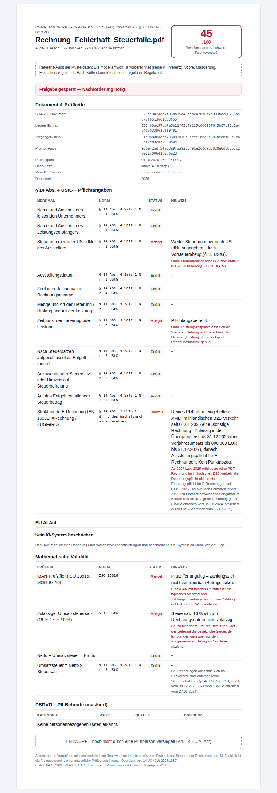 |  |
| **E-Rechnung: XML-Datensatz (EN 16931)** | **Export-Center mit Prüfdatenpaket (ZIP)** |
|  | 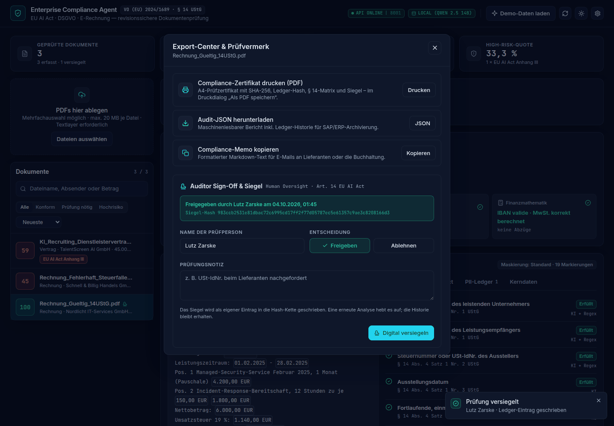 |
| **Übersteuerung durch die Prüfperson (Art. 14)** | **Ledger-Historie mit Ed25519-Status** |
| 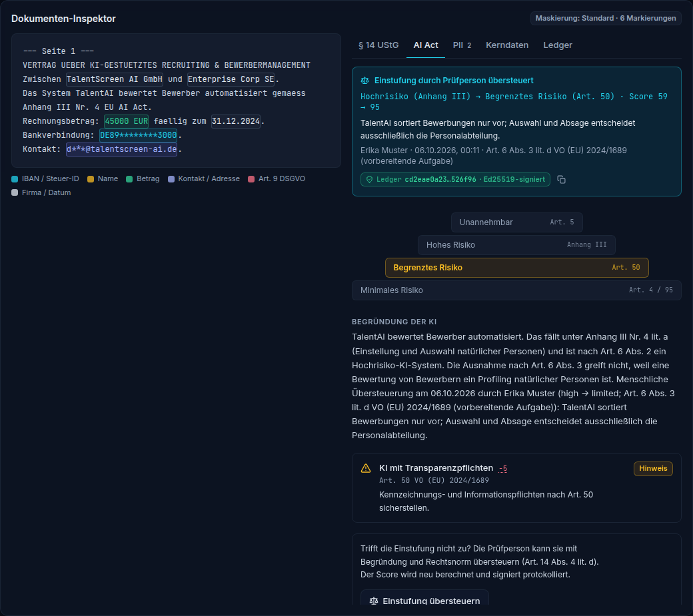 | 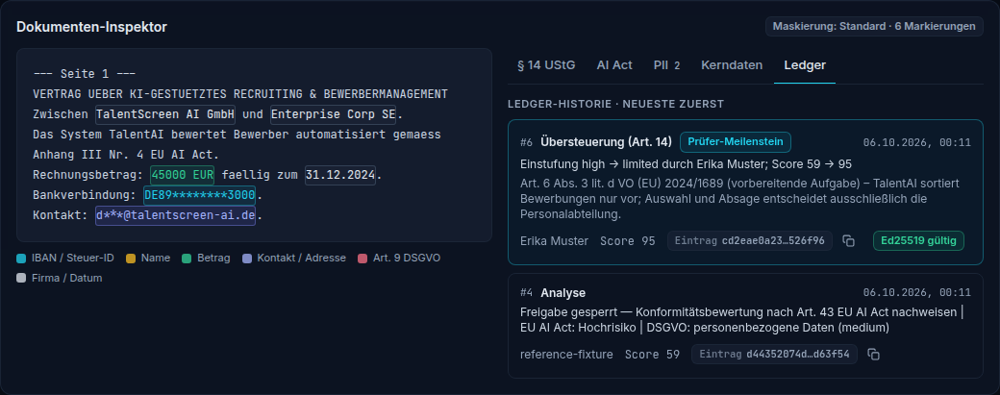 |

> **Zu den Screenshots:** Alle Prüfergebnisse stammen aus den eingebauten
> **Musterdaten** und laufen ohne Sprachmodell. Bei den drei PDF-Belegen ist nur
> die KI-Antwort vorberechnet und überall als „Referenz-Audit · ohne KI“
> gekennzeichnet; Score, Maskierung, Eskalationsregeln, Hash-Kette und
> Zertifikat erzeugt das echte Backend. Die ZUGFeRD-Rechnung braucht gar keine
> Vorberechnung: Sie wird live und deterministisch aus ihrem XML geprüft
> („XML-Prüfung · ohne KI“). Einzige Ausnahme ist der Live-Stepper weiter unten:
> Er wurde mit einem Ollama-Stub aufgenommen, der feste Antworten liefert.

## Ein-Klick-Start

**Windows:** `Start_Compliance_Agent.bat` doppelklicken (ruft
`Start_Compliance_Agent.ps1` auf). Der Starter legt bei Bedarf die
Python-Umgebung an, hält Python- und npm-Abhängigkeiten über Datei-Hashes
aktuell, startet Backend (`:8001`) und Frontend (`:3001`) im Hintergrund und
öffnet den Browser erst, wenn beide antworten. Er meldet, ob Ollama läuft.
Logs unter `.run/logs`, beenden mit `Stop_Compliance_Agent.bat`.
Voraussetzung: Python 3.11+ und Node.js 20+.

**Docker:** `docker compose up --build` → <http://localhost:3001>

Beim ersten Start begrüßt ein Willkommens-Dialog mit einer einminütigen Tour
(jederzeit erneut über `?` oben rechts). Dann oben rechts **„Musterdaten“**
öffnen und einen Beleg oder alle vier laden. Das Dashboard ist sofort
vollständig – **auch ohne installiertes Sprachmodell**. Mit laufendem Ollama
oder hinterlegtem Cloud-Key lässt sich jedes Musterdokument über
„Live neu prüfen“ echt analysieren.

## Rechtsnormen im Überblick

| Rechtsgrundlage | Was das System prüft bzw. umsetzt | Stand |
|---|---|---|
| **EU AI Act** – VO (EU) 2024/1689 | Risikoklassen (Art. 5, Art. 6 Abs. 2 i. V. m. Anhang III, Art. 50), Anhang-III-Eskalation, Hinweis auf Art. 6 Abs. 3, Betreiberpflichten (Art. 26), Logging (Art. 12), menschliche Aufsicht (Art. 14) inkl. begründeter Übersteuerung der KI-Einstufung (Art. 14 Abs. 4 lit. d) | Anhang-III-Pflichten ab **02.12.2027**, Anhang I ab 02.08.2028 nach **VO (EU) 2026/1744** (Digital Omnibus, in Kraft seit 27.07.2026) |
| **§ 14 Abs. 4 UStG** | Pflichtangaben Nr. 1–8 einzeln, Kleinbetragsrechnung (§ 33 UStDV), Vorsteuerrisiko (§ 15 UStG) | gültig |
| **USt-IdNr.** – VIES, § 18e UStG | Live-Abfrage der USt-IdNr. des Ausstellers (BT-31) bei VIES der EU-Kommission auf Klick; Momentaufnahme ohne Score-Einfluss. Die qualifizierte Bestätigung nach § 18e UStG erteilt weiterhin das BZSt | VIES-REST-Schnittstelle, ohne API-Key |
| **E-Rechnung** – § 14 Abs. 1 UStG, EN 16931 | XML aus ZUGFeRD/Factur-X-PDFs und reine XRechnung (CII/UBL) werden gelesen; Profil aus BT-24; MINIMUM/BASIC WL sind keine E-Rechnung; Pflichtfelder und Summenregeln (BR-CO-10/13/14/15, BR-DE-15) | Empfangspflicht seit 01.01.2025; Ausstellungspflicht 2027/2028 |
| **XML-Vorrang** – BMF-Schreiben vom 15.10.2024, Rz. 36 | Bei hybriden Rechnungen ist der XML-Teil maßgeblich; Abgleich von acht Kernwerten mit dem PDF-Bildteil, Abweichungen −10 | präzisiert durch BMF-Schreiben vom 15.10.2025 |
| **B2G** – § 5 Abs. 1 Nr. 1 ERechV, BR-DE-15 | Leitweg-ID bei öffentlichen Auftraggebern: Aufbau und Prüfziffer (ISO/IEC 7064, MOD 97-10) nach KoSIT-Formatspezifikation 2.0.2 | Bund; Länder und Kommunen nach Landesrecht |
| **§ 12 / § 14c UStG** | Zulässige Steuersätze, Steuerberechnung, Hinweis auf EuGH C-378/21 (Endverbraucher) | BMF-Schreiben vom 27.02.2024 |
| **DSGVO** – Art. 4 Nr. 5, 9, 25, 32 | Pseudonymisierung vor Cloud-Aufrufen, Art.-9/10-Erkennung, maskierte Speicherung, drei Schwärzungsstufen | – |
| **GoBD / § 147 AO, § 14b UStG** | Unveränderbares, hash-verkettetes Prüfprotokoll; Prüfdatenpaket je Beleg mit Original, XML, Ledger-Auszug, Verfahrensdokumentation und signiertem Manifest; Aufbewahrungsende je Rechnung | Rechnungen/Buchungsbelege 8 Jahre (BEG IV, Finanzsektor 10); Bücher, Abschlüsse, Verfahrensdokumentation 10 Jahre |
| **GoBD Rz. 151–155** | Verfahrensdokumentation in vier Teilen (Rz. 153) als Entwurf aus dem Systemzustand, Platzhalter für Organisatorisches | BMF-Schreiben vom 28.11.2019 in der jeweils geltenden Fassung |

Quellen und Prüfmethode: [`docs/RECHTSQUELLEN.md`](docs/RECHTSQUELLEN.md).

---

## Inhalt

1. [Funktionsumfang](#funktionsumfang)
2. [Architektur & Datenfluss](#architektur--datenfluss)
3. [Schnellstart](#schnellstart)
4. [Oberfläche](#oberfläche)
5. [API-Referenz & cURL](#api-referenz--curl)
6. [Compliance-Scorecard](#compliance-scorecard-0100)
7. [E-Rechnung (EN 16931)](#e-rechnung-en-16931) · [Prüfdatenpaket (ZIP)](#prüfdatenpaket-zip)
8. [Verfahrensdokumentation & Aufbewahrung](#verfahrensdokumentation--aufbewahrung)
9. [Prüfprotokoll (Hash-Kette)](#prüfprotokoll-hash-kette)
10. [Datenschutz & Privacy Gateway](#datenschutz--privacy-gateway)
11. [Betrieb: Logging, Rate-Limiting, Konfiguration](#betrieb)
12. [Tests](#tests)
13. [Docker](#docker)
14. [Grenzen](#grenzen)


Rechtsquellen: [`docs/RECHTSQUELLEN.md`](docs/RECHTSQUELLEN.md).

---

## Funktionsumfang

| Bereich | Umsetzung |
|---|---|
| **Extraktion** | Zwei fokussierte LLM-Läufe (Extraktion, Compliance-Audit) mit striktem Pydantic-Vertrag und Reparaturrunde bei Schemaverletzung |
| **§ 14 Abs. 4 UStG** | Alle Pflichtangaben (Nr. 1–8) einzeln geprüft, inkl. Kleinbetragsrechnung nach § 33 UStDV |
| **USt-IdNr. (VIES)** | `POST /api/vat/verify`: Abfrage bei VIES (EU-Kommission) mit 3-s-Timeout; übertragen werden nur Ländercode und Nummer. Gültigkeit, Name (sofern der Mitgliedstaat ihn liefert – Deutschland nicht) und Behördenzeitstempel; nicht gespeichert, ohne Score-Einfluss. In Tests vollständig gemockt |
| **Prüf-Workbench** | Fundstellen-Kopplung im Inspektor: Hover auf ein Kriterium hebt die belegende Zeile hervor, Klick scrollt dorthin; Klick auf eine Belegzeile öffnet das Kriterium. 4-Farben-Schema, `J`/`K`-Navigation, Action-Leiste mit Ledger-Status und Siegel per `Strg`/`⌘` + `Enter` |
| **E-Rechnung (EN 16931)** | ZUGFeRD-/Factur-X-Anhang aus dem PDF und reine XRechnung (.xml) in CII- und UBL-Syntax; Profil-Erkennung (EN 16931, EXTENDED, BASIC, XRECHNUNG 3.0, Peppol, MINIMUM/BASIC WL); zentrale Business Terms; Abgleich XML ↔ Bildteil; Leitweg-ID bei Behörden. **Deterministisch, ohne Sprachmodell** |
| **Finanzmathematik** | IBAN-Prüfziffer (ISO 13616, MOD-97-10), zulässiger Steuersatz (inkl. Corona-Sätze 07–12/2020), Netto + USt = Brutto, USt = Netto × Satz |
| **EU AI Act** | Risikostufe (Art. 5 / Anhang III / Art. 50 / minimal), automatische Eskalation bei belegter Anhang-III-Kategorie, Artikel-Pflichtenliste |
| **DSGVO** | LLM-Befund + Regex-Zweitmeinung, Art.-9/10-Erkennung, Maskierungszwang vor dem Speichern, drei Schwärzungsstufen für die Textansicht |
| **Compliance-Score** | Deterministisch 0–100, vier Kacheln, Deckelung bei Hochrisiko, Freigabeempfehlung, Ein-Satz-Risikoerklärung je Abzug |
| **Musterdaten** | Drei PDF-Referenzdokumente mit vorberechneter KI-Antwort plus eine hybride ZUGFeRD-Rechnung an eine Kommune, die live aus dem XML geprüft wird – einzeln oder alle vier, mit Rechtsfakten-Vorschau, sofort nutzbar ohne Modell |
| **Prüfprotokoll** | Append-only-Tabelle `audit_trails` mit SHA-256-Hash-Kette, DB-Trigger gegen UPDATE/DELETE, Kettenprüfung per API |
| **Human Oversight** | Prüfer-Siegel und **Übersteuerung der KI-Einstufung** (Art. 14 Abs. 4 lit. d AI Act) mit Begründung, Rechtsnorm und Score vorher/nachher; beide als Ed25519-signierte Ledger-Einträge. Eine Übersteuerung hebt ein bestehendes Siegel auf, eine erneute Analyse verwirft Übersteuerung und Siegel |
| **Verfahrensdokumentation** | Entwurf nach GoBD Rz. 153 in vier Teilen aus dem echten Systemzustand (Version, Regelwerk, Prompt-Hash, Schlüssel-Fingerabdruck, Kettenstatus) plus Anhang je Beleg; HTML (A4) und Markdown, auch im Prüfdatenpaket |
| **Aufbewahrung** | Aufbewahrungsende je Rechnung nach BEG IV (8 Jahre ab Ende des Kalenderjahres, Finanzsektor 10 Jahre) in Scorecard, Zertifikat und Tooltip |
| **Prüfzertifikat** | A4-HTML (druckfertig, CSP-gehärtet), Markdown-Memo, JSON für ERP-Archivierung; Übersteuerungen als Prüfer-Meilenstein und vollständiger Ledger-Auszug |
| **Prüfdatenpaket (ZIP)** | Originalbeleg, XML-Datensatz, Ledger-Auszug, Zertifikat, Verfahrensdokumentation und `manifest.json` mit SHA-256 je Datei und Ed25519-Systemsignatur; Offline-Prüfung mit `scripts/verify_pruefpaket.py` |
| **Multi-Provider** | Ollama / Gemini / Claude / GPT zur Laufzeit umschaltbar; API-Keys Fernet-verschlüsselt gespeichert, nur maskiert ausgeliefert. **Ausweich-Kaskade** (Primär → Backup → Lokal) bei 429, Serverfehler oder Zeitüberschreitung, jeder Wechsel im Ledger. Modell-Liste über die API des Anbieters mit Upgrade-Vorschlag – nie stiller Wechsel |
| **Compliance-Copilot** | Dokumentbezogene Fragen, geerdet auf nummeriertem Text und Prüfergebnis, mit Zeilen- und Normverweisen; **Korrekturanforderung** an den Lieferanten als editierbarer Entwurf aus den Mängeln nach § 14 UStG |
| **Archiv** | Belege ausblenden statt löschen (GoBD), Filter „Archiviert“, jeder Wechsel als signierter Ledger-Eintrag |
| **DLP-Gateway** | `POST /api/v1/redact`: endgültige Schwärzung von Zugangsdaten, vertraulichen Dateinamen, geschützten Parametern, Sperrbegriffen und PII – für andere Anwendungen vor jedem Cloud-LLM-Aufruf |
| **Release-Assistent** | Neue Version über `git fetch --tags` prüfen, Einspielen nur nach Bestätigung des Commit-Hashes als Fast-Forward, mit Datenbanksicherung und Ledger-Eintrag |
| **Betrieb** | JSON-Logs mit `request_id`, PII-Filter im Log, Token-Bucket-Rate-Limit, Mehrfach-Upload per Drag & Drop, Ledger-Integritätsanzeige, KPI-Endpunkt |

---

## Architektur & Datenfluss

```mermaid
flowchart LR
    U[Upload PDF / XML<br/>einzeln / Batch] --> V[Validierung<br/>Typ · Größe · Textlayer]
    V --> X[EN-16931-Parser<br/>ZUGFeRD · XRechnung]
    X --> DB[(SQLite / PostgreSQL<br/>documents)]
    DB -- E-Rechnung --> XP[XML-Pfad<br/>deterministisch, ohne LLM]
    XP --> S
    DB --> P1[1 Text-Layer-Check]
    P1 --> P2[2 Regex-PII-Scan]
    P2 --> R{Inferenz-Modus}
    R -- lokal --> O[Ollama<br/>qwen2.5:14b]
    R -- Cloud --> PV[Privacy Vault<br/>Pseudonymisierung]
    PV --> C[Gemini / Claude / GPT]
    C --> RI[Lokale<br/>Re-Identifizierung]
    O --> P3[3 Extraktion + § 14 UStG]
    RI --> P3
    P3 --> P4[4 AI-Act- & DSGVO-Audit<br/>Eskalationsregeln]
    P4 --> S[Deterministische<br/>Scorecard 0–100]
    S --> L[(audit_trails<br/>Hash-Kette)]
    S --> UI[Dashboard · Inspektor · Copilot]
    UI --> H[Prüfer-Siegel · Übersteuerung<br/>Art. 14, Ed25519-signiert]
    H -- neuer Score --> S
    H --> L
    L --> Z[Prüfzertifikat<br/>HTML · MD · JSON]
    L --> VD[Verfahrensdokumentation<br/>GoBD Rz. 153]
    L --> ZIP[Prüfdatenpaket<br/>ZIP + Ed25519-Manifest]
    VD --> ZIP
```

```
app/
  main.py            FastAPI: Endpunkte, Auth, Fehlerformat, Request-Tracing
  services.py        Pipeline (4 Stufen), Sign-off, Übersteuerung, KPIs, Copilot, Demo-Seed
  scoring.py         Deterministische Scorecard (Regelwerk 2026.2)
  retention.py       Aufbewahrungsfristen nach § 147 AO / BEG IV
  extractors/        EN-16931-Parser (CII/UBL), PDF-Anhänge, Leitweg-ID, Abgleich XML ↔ PDF
  gobd_export.py     Prüfdatenpaket (ZIP) mit Manifest und Prüffunktion
  procedural_doc.py  GoBD-Verfahrensdokumentation (Rz. 153) als HTML und Markdown
  signing.py         Ed25519-Systemsignatur (Schlüssel unter data/.signing.key)
  audit_ledger.py    Append-only-Ledger mit SHA-256-Hash-Kette, signierte Prüfer-Einträge
  inference.py       InferenceRouter: lokal oder Cloud (immer mit Vault)
  llm.py             Basisclient (JSON-Vertrag, Reparatur), Ollama, Prompts
  providers.py       Gemini-, Claude-, OpenAI-Transport (httpx)
  privacy_vault.py   Pseudonymisierung / Re-Identifizierung, flüchtiges Mapping
  redaction.py       Maskierungszwang, Regex-PII-Scan, Schwärzungsstufen
  runtime_settings.py Laufzeit-Einstellungen, Fernet-verschlüsselte Keys
  reporting.py       Prüfzertifikat (HTML/A4, Markdown, JSON)
  logging_config.py  JSON-Logging, request_id (ContextVar), PII-Filter
  rate_limit.py      Token-Bucket je Client-IP
  demo.py            Vier Referenzdokumente (grün / rot / Hochrisiko / ZUGFeRD-Hybrid)
  db.py · schemas.py · config.py · pdf_reader.py
frontend/src/
  app/page.tsx       Dashboard-Orchestrierung (kein Mock-Fallback)
  components/        Header, KpiStrip, Scorecard, AuditStepper, DocumentList,
                     DocumentInspector, ExportModal, OverrideModal, SettingsModal,
                     CopilotDrawer, ui (CopyButton, HashBadge, Modal, Tabs)
  lib/api.ts         Typisierter Client, Backend-Erkennung, Fehlerobjekte
```

**Bewusst kein LangChain/CrewAI.** Der Weg vom Dokument zur Datenbank ist ein
lesbarer HTTP-Aufruf plus Schemavalidierung – das kann ein IT-Auditor
nachvollziehen.

---

## Schnellstart

### Lokal (empfohlen für Entwicklung)

```bash
ollama pull qwen2.5:14b-instruct

python -m venv .venv
source .venv/bin/activate            # Windows: .venv\Scripts\activate
pip install -r requirements-dev.txt
cp .env.example .env                 # Windows: copy .env.example .env

uvicorn app.main:app --port 8001     # API + Swagger: http://localhost:8001/docs
```

```bash
cd frontend
npm ci
npm run dev                          # http://localhost:3001
```

Im Dashboard **„Musterdaten laden“** klicken: Drei Referenzdokumente werden
angelegt und sind sofort geprüft (Referenz-Audits, ohne Inferenz). „Live neu
prüfen“ analysiert sie mit dem aktiven Modell neu.

### Docker

```bash
docker compose up --build            # API :8001, Frontend :3001, Ollama auf dem Host
docker compose --profile full up --build   # zusätzlich Ollama-Container
```

### Inferenzstrecke prüfen

```bash
python scripts/smoke_test_ollama.py  # Erreichbarkeit, Modell, echter Inferenzlauf
```

---

## Oberfläche

| | |
|---|---|
| 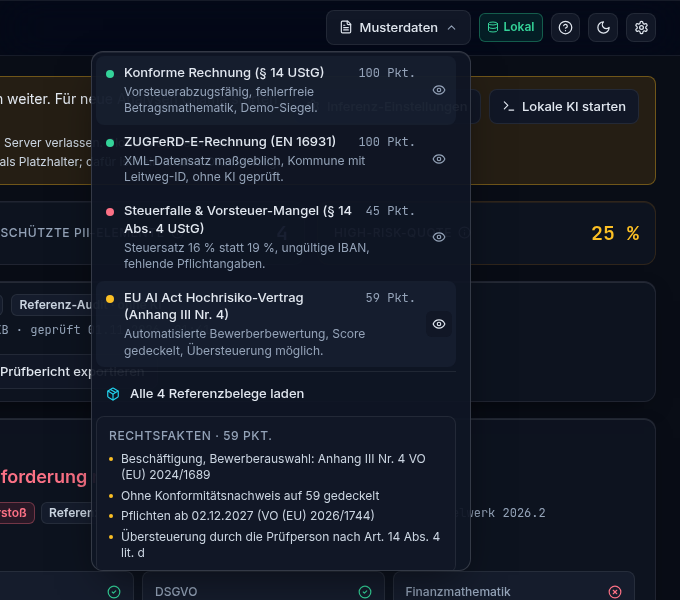 | **Musterdaten-Menü (v2.4)** – jeder Referenzbeleg einzeln oder alle vier; das Auge zeigt vorab die Rechtsfakten (hier: Anhang III Nr. 4, Deckel 59, Stichtag 02.12.2027). |
| 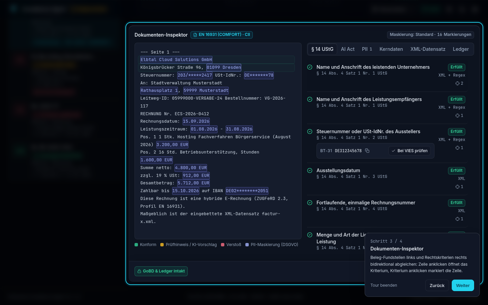 | **Spotlight-Tour (v2.4)** – vier Schritte (Upload, Musterdaten, Inspektor, Action-Leiste), abgedunkelter, weichgezeichneter Hintergrund mit Aussparung; `Esc` oder Klick ins Dunkle beendet. |
| 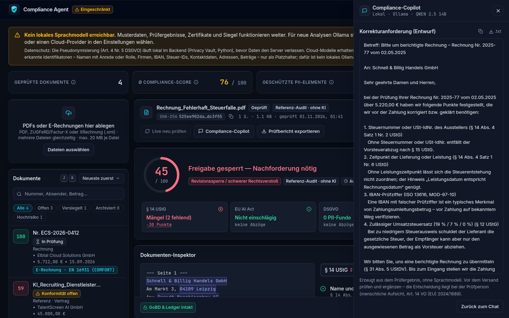 | **Korrekturanforderung (v2.4)** – der Compliance-Copilot erzeugt aus den Mängeln einen editierbaren Entwurf an den Lieferanten, ohne Sprachmodell; kopieren oder als `.txt` speichern. |
| 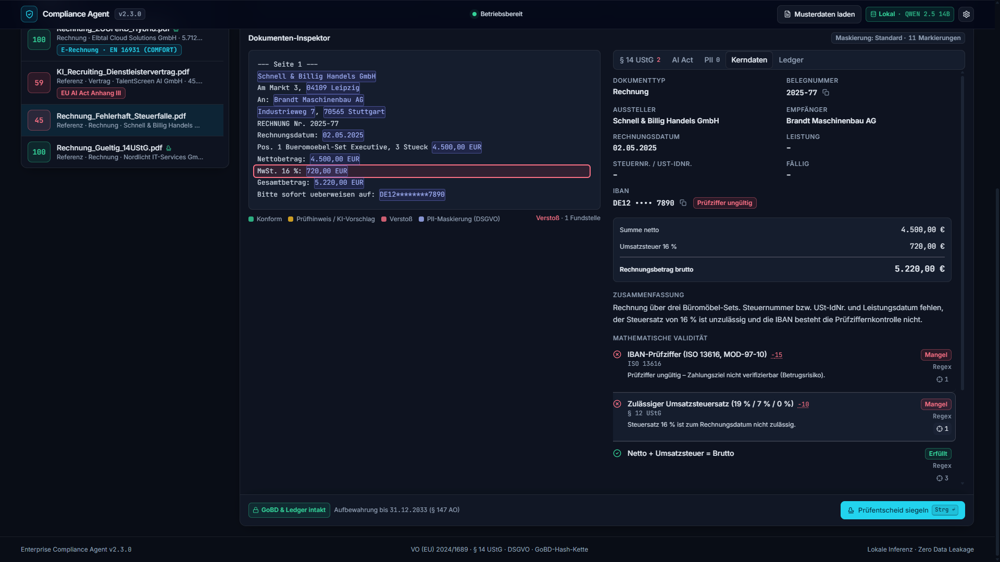 | **Prüf-Workbench (v2.3)** – Kriterium „Zulässiger Umsatzsteuersatz“ angeklickt: Die Zeile „MwSt. 16 %“ ist im Beleg rot umrandet (Verstoß), alle PII-Fundstellen einheitlich Indigo. Unten die Action-Leiste mit „GoBD & Ledger intakt“, Aufbewahrungsende und „Prüfentscheid siegeln“ (`Strg` + `Enter`). |
|  | **Start ohne Sprachmodell** – das Banner bietet direkt die Inferenz-Einstellungen und den Befehl `ollama serve` an und erklärt, dass die Pseudonymisierung lokal im Backend läuft. |
|  | **Fehlerhafte Rechnung (45/100)** – fehlende USt-IdNr. (−20), fehlendes Leistungsdatum (−10), ungültige IBAN (−15), Steuersatz 16 % (−10). Der Tooltip an der Kachel erklärt jeden Abzug in einem Satz. |
|  | **Light Mode, gültige Rechnung (100/100)** – „Zur Auszahlung freigegeben“, mit Demo-Siegel versiegelt. Farbcodierte PII-Markierungen im Text. |
|  | **Live-Audit-Stepper** (Aufnahme mit Ollama-Stub) – zeigt die echten Pipeline-Stufen des Backends (`GET /documents/{id}/progress`), keine simulierte Animation. |
|  | **E-Rechnung (100/100)** – Profil-Badge, Tab „XML-Datensatz“ mit den Business Terms, Abgleich je Wert mit dem PDF-Bildteil, B2G-Erkennung mit gültiger Leitweg-ID. |
|  | **Export-Center & Siegel** – Prüfdatenpaket (ZIP), Zertifikat drucken, JSON, Markdown-Memo, GoBD-Verfahrensdokumentation; Prüfer-Siegel als Ledger-Eintrag (Art. 14 EU AI Act). |
|  | **Übersteuerung der KI-Einstufung** – Tab „AI Act“, Schaltfläche „Einstufung übersteuern“: neue Risikostufe, Rechtsnorm (Vorschläge zu Art. 6 Abs. 3 lit. a–d), Begründung ab 20 Zeichen, Prüfperson. Der Score wird neu berechnet (hier 59 → 95), der Hinweis oben im Tab zeigt den Hash des signierten Ledger-Eintrags. |
|  | **Ledger-Historie** – alle Einträge des Belegs, Prüfer-Meilensteine hervorgehoben, Ed25519-Status je Prüfer-Eintrag („Ed25519 gültig“ bzw. „Signatur ungültig“; maschinelle Einträge sind unsigniert), Hashes mit Kopierschaltfläche. |
| 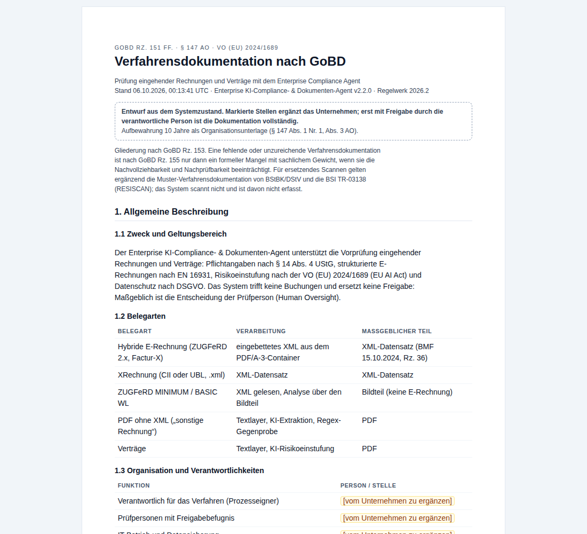 | **GoBD-Verfahrensdokumentation** – Entwurf in vier Teilen; vom Unternehmen zu ergänzende Stellen sind markiert. A4-druckfertig, als PDF speicherbar. |
|  | **Einstellungen (v2.4)** – Lokal/Cloud, Anbieter, Hauptmodell aus der Modell-Liste des Anbieters, API-Key mit `(i)`-Hinweis, einklappbares Privacy Gateway, Ausweich-Kaskade mit „Weiteren Schlüssel / Fallback hinzufügen“. Weitere Reiter: Compliance & Audit-Strenge, System & Verbindung, Über & Regulatorik (Version, Release-Assistent). |
|  | **Mobil (390 px)** – ohne horizontales Scrollen. |

### Prüf-Workbench (v2.3)

* **Kopfzeile** (seit v2.4 siehe unten). Daten laden beim Zurückkehren ins
  Fenster neu – einen Aktualisieren-Knopf gibt es nicht.
* **Breitbild:** Inhalt bis 1920 px, ab 2xl bis 2400 px; die Dokument-Queue ist
  340 bzw. 400 px breit, der Rest gehört der Workbench. Auf WQHD hat jede
  Inspektor-Spalte über 900 px.
* **Fundstellen-Kopplung (Rossum-Muster):** Hover auf ein Kriterium (§ 14 UStG,
  Finanzmathematik, AI Act) hebt die belegende Zeile im Belegtext hervor, das
  Fadenkreuz scrollt dorthin. Umgekehrt öffnet ein Klick auf eine belegte Zeile
  das zugehörige Kriterium. Die Zuordnung ist deterministisch
  (`frontend/src/lib/evidence.ts`, gleiche Muster wie das Regelwerk) und
  funktioniert auch auf geschwärztem Text.
* **4-Farben-Schema:** Grün = konform, Gelb = Prüfhinweis oder Nachweis allein
  durch das KI-Modell, Rot = Verstoß, Indigo = PII-Maskierung (DSGVO;
  Art.-9-Fundstellen kräftig umrandet).
* **Action-Leiste** am Fuß des Inspektors: Revisionssicherheits-Status
  („GoBD & Ledger intakt“), Siegel des Belegs, Aufbewahrungsende und die
  Primäraktion „Beleg freigeben & siegeln“.
* **USt-IdNr. bei VIES prüfen** direkt an der Pflichtangabe Nr. 2 (BT-31).
* Scrollbereiche reservieren ihre Scrollbalken-Spur (`scrollbar-gutter: stable`),
  der Balken überdeckt nie Status-Chips oder Text.

### Enterprise Refinement (v2.4)

* **Logo & Kaltstart-Splash:** eigenes Siegel-Logo (`frontend/public/compliance-logo*.png|svg`)
  in Kopfzeile, Favicon und Splash. Der Splash steht im Server-HTML, deckt den
  ersten Paint ab und blendet weich aus, sobald die Startdaten da sind
  (spätestens nach 2,5 s) – kein Springen beim Kaltstart.
* **Kopfzeile (Liquid Glass):** `backdrop-blur-xl backdrop-saturate-150` auf
  Slate-950/60; Belegtext schimmert beim Scrollen weichgezeichnet durch. Status
  nur bei Bedarf (Analyse läuft, Eingeschränkt, Offline, Ledger-Befund), sonst
  Ruhe. Rechts: Release-Pille (nur bei neuer Version), Musterdaten-Menü,
  Modell-Pille, `?` (Tour), Sonne/Mond, Einstellungen. Die Versionsnummer steht
  unter Einstellungen › Über & Regulatorik.
* **Feste Workbench-Höhe:** Inspektor-Spalten `h-[560px]` bzw.
  `calc(100vh − 320px)`; die Action-Leiste bleibt beim Reiterwechsel stehen
  (gemessen: identische Position für alle Reiter).
* **KPI-Leiste 64 px:** Zahl und Titel, Kontext im `(i)`-Tooltip.
* **Dokumentliste:** Glas-Dropdown für die Sortierung (Portal, Pfeiltasten,
  Enter, Escape), Filter `Alle` · `Offen` · `Versiegelt` · `Archiviert`
  (+ `Hochrisiko`) mit Zählern, Archivieren neben dem Pin, Status-Badges
  „Versiegelt (Ed25519)“, „In Prüfung“, „Vorsteuer gefährdet“ (Rechnung mit
  Revisionssperre), „Konformität offen“ (Anhang III). Zeile 1 Belegnummer,
  Zeile 2 Belegart · Lieferant · Betrag · Datum – ganze Angaben brechen um,
  nichts wird mitten im Wort abgeschnitten.
* **Toasts** oben rechts, Erfolg/Hinweis 3 s, Warnung/Fehler 6 s, Überfahren
  pausiert; bei Ausweich-Wechsel: „Fallback auf Modell … ausgelöst“.
* **Dialoge** mit `backdrop-blur-md`, neutrale Platzhalter („Prüferkürzel oder
  Name eingeben…“).

| Taste | Wirkung |
|---|---|
| `J` / `K`, `↓` / `↑` | Nächstes / vorheriges Dokument (in Filter- und Sortierreihenfolge; Pfeiltasten, solange kein anderes Bedienelement den Fokus hat) |
| `1` – `6` | Reiter § 14 UStG · AI Act · PII · Kerndaten · XML (nur E-Rechnung) · Ledger |
| `Strg` + `Enter` (macOS `⌘` + `Enter`) | Siegel-Dialog öffnen; im Dialog versiegeln |
| `?` | Übersicht der Tastaturkürzel |
| `Esc` | Dialog, Menü, Tour, Copilot oder gepinnte Fundstelle schließen |

Kürzel greifen nie, solange ein Eingabefeld den Fokus hat oder ein Dialog offen ist.

Designprinzipien: semantische Farbtokens (Grün = konform, Bernstein = Prüfung,
Rose = Verstoß/Hochrisiko, Indigo = Datenschutz), WCAG-AA-Kontraste in beiden
Themes. Dunkles Theme „Obsidian & Slate“: Canvas `#090d16`, gefrostete Flächen,
Konturen in Weiß 8 %, feine Lichtkante oben an jeder Karte; KPI-Karten tragen
ihren Status als Innenkante. Keine Hover-Lifts oder Deko-Icons; einzige
Animation in Ruhe ist der Betriebsstatus-Punkt, `prefers-reduced-motion` stellt
ihn still. Zahlen, Beträge, Hashes und
Normzitate in JetBrains Mono mit gleich breiten Ziffern; Beträge
rechtsbündig, Summenblöcke (Netto, USt, Brutto, Zahlbetrag) auf die
Dezimalstelle ausgerichtet. Rechnungsnummern, Leitweg-IDs, IBANs und SHA-256
lassen sich mit einem Klick kopieren (1,5 s Häkchen). Hashes erscheinen
gekürzt mit Prüfstatus. Tabs und Dialoge blenden in 150 ms ein, `Esc`
schließt jeden Dialog. Der XML-Tab nutzt auf WQHD (2560 × 1440) die volle
Höhe statt intern zu scrollen. Barrierefreiheit nach
den Vercel Web Interface Guidelines: Skip-Link, echte Buttons, Tooltips per
Tastaturfokus erreichbar, Formularfelder mit `name`/`autocomplete`. Ist das
Backend nicht erreichbar, erscheint ein Hinweisbanner – **es werden nie
Ersatzdaten angezeigt.**

---

## API-Referenz & cURL

| Methode | Pfad | Zweck |
|---|---|---|
| `GET` | `/health` | DB, Ollama, aktiver Inferenz-Modus |
| `POST` | `/documents/upload` | Einzelupload (PDF oder XML) mit Validierung; liest eingebettetes ZUGFeRD-XML |
| `POST` | `/documents/upload-batch` | Mehrere PDFs/XMLs; Fehler je Datei, kein Abbruch |
| `POST` | `/documents/{id}/extract` | Pipeline + Scorecard + Ledger-Eintrag |
| `GET` | `/documents/{id}/progress` | Aktuelle Pipeline-Stufe |
| `GET` | `/documents` · `/documents/{id}` | Liste (Pins zuerst) · Detail inkl. geschwärzter Textansicht |
| `PUT` | `/documents/{id}/pin` | Anpinnen |
| `PUT` | `/documents/{id}/archive` | Archivieren bzw. zurückholen (nur ausblenden, signierter Ledger-Eintrag) |
| `POST` | `/documents/{id}/sign-off` | Prüfer-Siegel (Art. 14), Ed25519-signierter Ledger-Eintrag |
| `POST` | `/api/documents/{id}/override` | Übersteuerung der KI-Einstufung (Art. 14 Abs. 4 lit. d): Score neu, signierter Ledger-Eintrag |
| `GET` | `/documents/{id}/report?format=html\|markdown\|json` | Prüfzertifikat |
| `GET` | `/api/documents/{id}/export/gobd` | Prüfdatenpaket (ZIP): Original, XML, Ledger-Auszug, Zertifikat, Verfahrensdokumentation, signiertes Manifest |
| `GET` | `/api/documents/{id}/export/procedural-doc?format=html\|markdown` | GoBD-Verfahrensdokumentation (Entwurf) mit Anhang zum Beleg |
| `POST` | `/documents/{id}/copilot` | Frage zum Dokument |
| `POST` | `/api/vat/verify` | USt-IdNr. live bei VIES (EU-Kommission) prüfen: `valid`, Name, Behördenzeitstempel; nicht gespeichert |
| `GET` | `/api/audit/trail` · `/api/audit/verify` · `/api/audit/head` | Ledger lesen (mit `signature_status` je Eintrag), Kette und Signaturen prüfen, Kopf-Hash zur Verankerung |
| `GET` | `/api/audit/signing-key` | Öffentlicher Schlüssel und Fingerabdruck der Systemsignatur |
| `GET`/`POST` | `/api/settings` · `/api/settings/test-connection` | Laufzeit-Einstellungen inkl. Ausweich-Kaskade (`fallbacks`), Keys maskiert; Verbindungstest |
| `GET` | `/api/settings/models?provider=…` | Modell-Liste des Anbieters (neueste zuerst) und Upgrade-Vorschlag derselben Klasse |
| `GET` · `POST` | `/api/system/release` · `/api/system/release/apply` | Neue Version prüfen (git fetch --tags, Signatur, Änderungen) · einspielen (Commit-Hash bestätigen, Fast-Forward, DB-Sicherung, nur localhost) |
| `POST` | `/api/v1/redact` | DLP-Gateway: Text vor einem Cloud-LLM-Aufruf endgültig schwärzen |
| `GET` | `/api/dashboard/kpis` | Portfolio-Kennzahlen |
| `POST` | `/api/demo/seed?only=<Datei>` | Vier Musterdokumente (oder eines), ohne Inferenz analysiert (idempotent, überschreibt keine Live-Audits) |

```bash
API=http://localhost:8001

curl -s $API/health | jq .inference
curl -s -X POST $API/api/demo/seed | jq '.items[] | {id, filename}'

ID=$(curl -s -X POST $API/documents/upload -F "file=@rechnung.pdf;type=application/pdf" | jq -r .id)
curl -s -X POST $API/documents/$ID/extract | jq '.scorecard | {score, band, release_recommendation}'

curl -s -X POST $API/documents/upload-batch -F "files=@a.pdf" -F "files=@b.pdf" | jq '{succeeded, failed}'

# Reine XRechnung: Prüfung ohne Sprachmodell
XR=$(curl -s -X POST $API/documents/upload -F "file=@xrechnung.xml;type=application/xml" | jq -r .id)
curl -s -X POST $API/documents/$XR/extract | jq '{provider, score: .scorecard.score}'
curl -s $API/documents/$XR | jq '.einvoice.business_terms'

# Prüfdatenpaket herunterladen und offline prüfen
curl -s $API/api/documents/$XR/export/gobd -o paket.zip
python scripts/verify_pruefpaket.py paket.zip --fingerprint "$(curl -s $API/api/audit/signing-key | jq -r .fingerprint)"

curl -s -X POST $API/documents/$ID/sign-off -H "Content-Type: application/json" \
     -d '{"auditor_name":"Lutz Zarske","note":"USt-IdNr. nachgefordert","decision":"SEALED_APPROVED"}' | jq .sign_off

curl -s "$API/documents/$ID/report?format=html" -o zertifikat.html
curl -s "$API/documents/$ID/report?format=markdown"

# Übersteuerung der KI-Einstufung durch die Prüfperson (Art. 14 Abs. 4 lit. d AI Act)
curl -s -X POST $API/api/documents/$ID/override -H "Content-Type: application/json" \
     -d '{"auditor_name":"Erika Muster","risk_level":"limited",
          "legal_basis":"Art. 6 Abs. 3 lit. d VO (EU) 2024/1689",
          "reason":"Das System sortiert nur vor; die Auswahl trifft die Personalabteilung."}' \
     | jq .scorecard.human_override

curl -s "$API/api/documents/$ID/export/procedural-doc?format=html" -o verfahrensdokumentation.html

curl -s $API/api/audit/verify          # {"valid": true, "entries": ..., "signed_entries": ..., "head_hash": ...}

# USt-IdNr. bei VIES prüfen (nur Ländercode und Nummer verlassen den Server)
curl -s -X POST $API/api/vat/verify -H "Content-Type: application/json" \
     -d '{"country_code":"DE","vat_number":"312345678"}' | jq '{valid, name, request_date}'

curl -s -X POST $API/api/settings -H "Content-Type: application/json" \
     -d '{"inference_mode":"gemini","api_keys":{"gemini":"<KEY>"},"pii_strictness":"strict"}' | jq .masked_keys

curl -s -X POST $API/documents/$ID/copilot -H "Content-Type: application/json" \
     -d '{"question":"Welche Pflichtangaben fehlen?"}' | jq -r .answer

# Ausweich-Kaskade: Gemini primär, bei Ausfall Claude, zuletzt lokal
curl -s -X POST $API/api/settings -H "Content-Type: application/json" \
     -d '{"inference_mode":"gemini","fallbacks":["anthropic","local"]}' | jq .fallbacks

# DLP-Gateway (z. B. vor einem Cloud-Aufruf)
curl -s -X POST $API/api/v1/redact -H "Content-Type: application/json" \
     -d '{"text":"Siehe pricing_algorithm.py, threshold=0.73, Projekt Nordlicht","extra_terms":["Nordlicht"]}' \
     | jq '{redacted_text, counts}'

curl -s "$API/api/system/release?fetch=true" | jq '{current_version, update_available, latest: .latest.tag}'
```

Ist `API_KEY` gesetzt, verlangen alle Endpunkte außer `/health` den Header
`X-API-Key`. **Ohne `API_KEY` kann jeder im Netz auch die Einstellungen ändern**
– produktiv immer setzen.

Fehlerformat (einheitlich): `{"error": {"code", "message", "hint"}}`. Wichtige
Codes: `invalid_upload` 415 · `file_too_large` 413 · `no_text_layer` 422 ·
`invalid_einvoice` 422 · `override_without_change` 422 · `document_not_analyzed` 409 · `original_missing` 410 · `rate_limited` 429 (+ `Retry-After`) ·
`provider_not_configured` 400 · `provider_auth_failed` 502 ·
`ollama_unavailable`/`provider_unavailable` 503 · `provider_timeout` 504 ·
`release_update_running` 409. Der Release-Assistent meldet zusätzlich
`local_only` 403, `hash_mismatch`, `dirty_worktree`, `not_fast_forward`,
`analysis_running`, `signature_invalid` (je 409).

---

## Compliance-Scorecard (0–100)

Der Score entsteht **nicht im LLM**, sondern in `app/scoring.py` aus festen,
versionierten Regeln. Jede Pflichtangabe wird doppelt belegt: aus der
LLM-Extraktion – bei E-Rechnungen aus dem XML-Datensatz – und per Regex im
Dokumenttext (`evidence_source`: `llm`, `xml`, `rule_based`, `both`, `xml_rule`).

| Kachel | Regel | Abzug |
|---|---|---|
| **Formelle Gültigkeit** (§ 14 Abs. 4 UStG, EN 16931, Regelwerk 2026.2) | Steuernummer/USt-IdNr. fehlt (Nr. 2) | −20 |
| | jede weitere fehlende Pflichtangabe (Nr. 1, 3–8) | −10 |
| | Kleinbetragsrechnung ≤ 250 € brutto: Nr. 1 (Empfänger), 2, 4, 6, 7, 8 (Betrag) entbehrlich (§ 33 UStDV) | – |
| | Hybride Rechnung: Bildteil weicht vom maßgeblichen XML ab (BMF 15.10.2024, Rz. 36) | −10 |
| | Öffentlicher Auftraggeber ohne gültige Leitweg-ID (§ 5 ERechV) | −10 |
| | Reines PDF, Profil MINIMUM/BASIC WL oder Verstoß gegen EN-16931-Geschäftsregeln: Hinweis | 0 |
| **Mathematische Validität** | IBAN-Prüfziffer ungültig | −15 |
| | Netto + USt ≠ Brutto | −15 |
| | USt ≠ Netto × Satz | −10 |
| | Steuersatz nicht 19/7/0 % (07–12/2020 zusätzlich 16/5 %) | −10 |
| **Regulatorisches Risiko** (EU AI Act) | Hochrisiko ohne Konformitätsnachweis | −25, **Deckel 59** |
| | Hochrisiko mit Hinweis auf Konformitätsbewertung | −10 |
| | Begrenztes Risiko (Art. 50) | −5 |
| | Verbotene Praktik (Art. 5) | **Deckel 20** |
| **Datenschutz** (DSGVO) | Besondere Kategorien (Art. 9/10) | −10 |
| | Amtliche Kennnummern natürlicher Personen | −5 |

Bänder: **≥ 85 grün** (verkehrsfähig) · **60–84 gelb** (Nachbesserung) ·
**< 60 rot** (Revisionssperre). Freigabeempfehlung: „Zur Auszahlung
freigegeben“, „Freigabe unter Vorbehalt“, „Freigabe gesperrt — Nachforderung
nötig“ oder „Freigabe gesperrt — Konformitätsbewertung nach Art. 43 nachweisen“.

Jeder Abzug trägt eine Ein-Satz-Risikoerklärung (`risk_note`, z. B. „Ohne
Steuernummer oder USt-IdNr. entfällt der Vorsteuerabzug nach § 15 UStG.“) und
bei Bedarf rechtlichen Kontext (`note`). Beides erscheint als Tooltip im
Dashboard und im Zertifikat.

Musterdaten: gültige Rechnung **100**, Steuerfalle **45**, KI-Recruiting-Vertrag
**59** (gedeckelt) – als Referenz-Audit ohne Modell und, bei vollständiger
Extraktion, auch live; ZUGFeRD-Rechnung **100**, live aus dem XML. Ein schwächeres Modell kann einzelne Felder verfehlen;
die Regex-Gegenprobe fängt die meisten Fälle ab (getestet in
`tests/test_scoring.py` und `tests/test_reference_demo.py`).

---

## E-Rechnung (EN 16931)

| Quelle | Erkennung |
|---|---|
| Hybride PDF (ZUGFeRD 2.x, Factur-X) | Dateianhang `factur-x.xml`, `zugferd-invoice.xml` oder `xrechnung.xml` (sonst jedes XML mit passender Wurzel) |
| Reines XML (XRechnung 3.0) | Upload als `.xml`, CII (`CrossIndustryInvoice`) oder UBL (`Invoice`/`CreditNote`) |
| ZUGFeRD 1.0 | erkannt und abgelehnt bzw. als „nicht auswertbar“ vermerkt – kein EN-16931-Format |

* **Sicherheit:** geparst mit `defusedxml` und `forbid_dtd=True` – keine DTDs,
  keine Entitäten, keine externen Referenzen (XXE, „Billion Laughs“).
* **Profil** aus BT-24: EN 16931 (COMFORT), EXTENDED, BASIC, XRECHNUNG 3.0,
  Peppol BIS 3.0; MINIMUM und BASIC WL sind keine E-Rechnung – bei hybriden
  Belegen gilt dann der Bildteil, und die Analyse läuft über den Text.
* **Business Terms** im Inspektor: BT-1, BT-2, BT-10, BT-27 (Name Verkäufer),
  BT-31 (USt-IdNr. Verkäufer), BT-34/BT-49 (elektronische Adressen),
  BT-44, BT-109, BT-110, BT-112, BT-115.
* **XML-Vorrang:** Acht Kernwerte (BT-1, BT-2, BT-31, BT-84, BT-109, BT-110,
  BT-112, BT-119) werden im PDF-Text wiedergesucht. Steht an der beschrifteten
  Stelle ein anderer Wert, meldet die Scorecard „Diskrepanz zwischen visuellem
  PDF und maßgeblichem XML-Datensatz (BMF 15.10.2024: XML hat Vorrang)“.
* **B2G:** Behördenbegriff im Käufernamen, Leitweg-ID als elektronische Adresse
  (Peppol-Schema 0204) oder in BT-10 – dann wird die Leitweg-ID samt Prüfziffer
  verlangt. Im B2B-Verkehr entfällt die Prüfung.
* **Ohne Sprachmodell:** Rechnungsdaten kommen aus dem XML, PII aus dem
  Regex-Scanner; eine AI-Act-Einstufung findet nicht statt (eine Rechnung
  begründet keine Pflichten nach der KI-VO). Ledger und Zertifikat weisen das
  aus (`model=en16931-parser`, `provider=structured`).

## Prüfdatenpaket (ZIP)

`GET /api/documents/{id}/export/gobd` bzw. „GoBD-Prüfdatenpaket exportieren“ im
Export-Center:

```
original/<Dateiname>          Originalbeleg, bitgenau (SHA-256 = Datenbank)
factur-x.xml                  eingebetteter XML-Datensatz (nur hybride PDFs)
ledger_audit_trail.json       alle Ledger-Einträge des Belegs, je Eintrag nachgerechnet
audit_certificate.html        A4-Prüfzertifikat
verfahrensdokumentation.html  Verfahrensdokumentation (Entwurf) mit Anhang zum Beleg
manifest.json                 SHA-256 je Datei, Prüfzeitpunkt, Score, Siegel,
                              Kopf-Hash der Kette, Ed25519-Signatur
```

`python scripts/verify_pruefpaket.py paket.zip --fingerprint <fp>` prüft
Datei-Hashes und Signatur ohne Server. Den Fingerabdruck liefert
`GET /api/audit/signing-key`; er gehört in die Verfahrensdokumentation – ein im
Paket mitgelieferter Schlüssel allein beweist nichts.

## Verfahrensdokumentation & Aufbewahrung

`GET /api/documents/{id}/export/procedural-doc?format=html|markdown` bzw.
„GoBD-Verfahrensdokumentation“ im Export-Center erzeugt einen **Entwurf** nach
GoBD Rz. 153:

| Teil | Inhalt aus dem System | Vom Unternehmen zu ergänzen |
|---|---|---|
| 1. Allgemeine Beschreibung | Zweck, Belegarten und maßgeblicher Teil, Rechtsgrundlagen, Fristen | Prozesseigner, Prüfpersonen, IT-Betrieb, Datenschutz, Freigabe der Dokumentation |
| 2. Anwenderdokumentation | Belegfluss, Vier-Augen-Prinzip, Rollen, Eskalationsmatrix der Scorecard | Posteingang, Übergabe an ERP/Archiv, Anmeldung (SSO), Rollenzuordnung |
| 3. Technische Systemdokumentation | Version, Regelwerk, Prompt-Hash, Modell, Schnittstellen, Hash-Kette, Signaturschlüssel (Fingerabdruck), Kettenstatus, XML-Härtung, KI-Komponente | ERP-/Archivanbindung, externe Verankerung des Kopf-Hashes |
| 4. Betriebsdokumentation | Datensicherung des Schlüssels, WORM-Prinzip, Protokollierung, Zugriffsschutz | Sicherungsintervall, Archivsystem, Änderungshistorie, Netzwerk und Patch-Management |

Platzhalter sind als „[vom Unternehmen zu ergänzen]“ markiert. Ein Anhang
dokumentiert den gewählten Beleg (SHA-256, Analysepfad, Score, Siegel,
Vier-Augen-Prüfung, Aufbewahrungsende) und seine Ledger-Einträge. Das
Dokument ersetzt keine eigene Verfahrensdokumentation: Erst die Freigabe durch
die verantwortliche Person macht sie vollständig. Eine fehlende
Verfahrensdokumentation ist nach Rz. 155 nur dann ein formeller Mangel mit
sachlichem Gewicht, wenn die Nachvollziehbarkeit beeinträchtigt ist; in
Betriebsprüfungen wird sie trotzdem regelmäßig angefordert.

**Aufbewahrungsfristen** (`app/retention.py`, Fristbeginn mit Ablauf des
Kalenderjahres, § 147 Abs. 4 AO):

| Unterlage | Frist | Grundlage |
|---|---|---|
| Rechnungen, Buchungsbelege | **8 Jahre** | § 147 Abs. 1 Nr. 4, Abs. 3 AO, § 14b Abs. 1 UStG, § 257 Abs. 4 HGB (BEG IV, seit 01.01.2025) |
| dieselben bei Kreditinstituten, Versicherungsunternehmen und Wertpapierinstituten | 10 Jahre | Rückausnahme für den Finanzsektor (Gesetz zur Modernisierung und Digitalisierung der Schwarzarbeitsbekämpfung) |
| Bücher, Jahresabschlüsse, Organisationsunterlagen inkl. Verfahrensdokumentation | 10 Jahre | § 147 Abs. 1 Nr. 1, Abs. 3 AO |
| Handels- und Geschäftsbriefe | 6 Jahre | § 147 Abs. 1 Nr. 2, 3, Abs. 3 AO |

Die Scorecard weist für Rechnungen mit Rechnungsdatum das Aufbewahrungsende aus
(Rechnung vom 15.09.2026 → aufbewahren bis 31.12.2034); Zertifikat und Tooltip
nennen die Ausnahmen. Die Ablaufhemmung nach § 147 Abs. 3 S. 5 AO (laufende
Außenprüfung, offene Festsetzungsfrist) prüft das System nicht.

## Prüfprotokoll (Hash-Kette)

Jede Analyse, jedes Siegel und jede Übersteuerung schreibt einen Eintrag in `audit_trails`:
`document_id`, `sha256_hash` (Dokument), `model_name`, `prompt_hash`
(Fingerabdruck der Prompt-Version), `timestamp_utc`, `result_summary`,
`compliance_score`, `risk_tier`, `details`, `previous_hash`, `entry_hash`.

* `entry_hash = SHA-256(kanonisches JSON aller Felder inkl. previous_hash)`
* Erster Eintrag verweist auf `0000…` (Genesis).
* `GET /api/audit/verify` rechnet die gesamte Kette nach und meldet
  Sequenzlücken (gelöschte Einträge), Verkettungsbrüche und Inhaltsänderungen
  mit Sequenznummer.
* DB-Trigger (SQLite und PostgreSQL) verweigern `UPDATE` und `DELETE`.
* Bei PostgreSQL serialisiert `pg_advisory_xact_lock` das Anhängen auch über
  mehrere Prozesse.
* **Prüfer-Einträge sind signiert.** Siegel (`sign_off`) und Übersteuerung
  (`human_override`) tragen in `details.signature` eine Ed25519-Signatur des
  Systemschlüssels über den Eintragsinhalt inklusive `previous_hash`; der
  `entry_hash` deckt die Signatur mit ab. `verify` prüft jede Signatur gegen
  den aktuellen Systemschlüssel und zählt sie (`signed_entries`). Wer einen
  Prüfer-Eintrag ändert und alle Hashes neu berechnet, fällt damit trotzdem
  auf – es sei denn, er hat auch den privaten Schlüssel. Maschinelle Einträge
  (`analysis`) bleiben unsigniert.

Seit v2.4 kommen hinzu: `provider_failover` (maschinell, je Wechsel der
Ausweich-Kaskade mit Grund), `model_change` (Provider, Modell oder Kaskade
geändert; Vorher/Nachher und Prompt-Hash), `archive`/`unarchive` und
`release_update` (Tag, Commit, Tag-Signatur, Datenbanksicherung, freigebende
Person). Die vier von Personen ausgelösten Ereignisse sind Ed25519-signiert;
Ereignisse ohne Beleg tragen `document_id = "system"`
(`GET /api/audit/trail?document_id=system`).

Die Übersteuerung speichert Prüfperson, alte und neue Risikostufe, Score
vorher/nachher, Begründung, Rechtsnorm, Zeitpunkt (ISO 8601) und den Verweis
auf Art. 14 Abs. 4 lit. d AI Act. Der Score wird nicht von Hand gesetzt,
sondern aus der geänderten Einstufung mit demselben Regelwerk neu berechnet.

Ehrliche Einordnung: Das ist eine **lineare Hash-Kette**, kein Merkle-Baum.
Gegen jemanden mit Vollzugriff auf die Datenbank hilft kein Trigger; wer die
jüngsten Einträge abschneidet, erzeugt eine in sich gültige kürzere Kette.
Deshalb gibt es `GET /api/audit/head`: Den Kopf-Hash regelmäßig außerhalb des
Systems ablegen (Ticket, WORM-Speicher, qualifizierter Zeitstempel nach eIDAS).

---

## Datenschutz & Privacy Gateway

* **Lokal als Standard.** Im Modus `local` verlässt kein Dokumentinhalt den Rechner.
* **Cloud nur mit Vault.** `InferenceRouter` umhüllt jeden Cloud-Client mit
  `VaultedClient`; ein Cloud-Aufruf ohne Pseudonymisierung ist im Code nicht
  vorgesehen. Ersetzt werden Personen (mit Anrede/Rolle), Firmen (über
  Rechtsform), IBAN, USt-IdNr., Steuernummer, E-Mail, Telefon, Adressen und
  Beträge. Das Mapping lebt nur im Speicher und nur für einen Auftrag; im
  Ergebnis steht lediglich die Anzahl je Kategorie (`privacy_gateway`).
* **Rechtlich nüchtern:** Pseudonymisierte Daten bleiben personenbezogen
  (Art. 4 Nr. 5, ErwG 26 DSGVO). Der Vault senkt das Übermittlungsrisiko
  (Art. 25, 32; ergänzende Maßnahme i. S. d. EDSA-Empfehlungen 01/2020),
  ersetzt aber weder AV-Vertrag noch Transfergrundlage. Die Erkennung ist
  regelbasiert: Namen ohne Anrede oder Rolle und Freitext-Merkmale werden nicht
  erfasst.
* **Maskierte Persistenz.** PII-Befunde werden nur maskiert gespeichert. Die
  Textansicht folgt der Stufe `strict` / `standard` / `audit_only`.
* **Volltext gespeichert.** Für erneute Analysen liegt der extrahierte Text in
  der Datenbank (`raw_text`); produktiv gehören Festplattenverschlüsselung und
  ein Löschkonzept (Art. 17 DSGVO) dazu.
* **API-Keys.** Fernet-verschlüsselt in `app_settings`; Schlüssel aus
  `SETTINGS_ENCRYPTION_KEY` oder `data/.settings.key` (0600, gitignored).
  Liegt der Schlüssel neben der DB, schützt das ein geleaktes DB-Backup, nicht
  einen kompromittierten Server – produktiv gehört er in einen Secret-Store.

### Data-Loss-Prevention-Gateway (`/api/v1/redact`)

Externe Anwendungen schicken Text **vor** einem
Cloud-LLM-Aufruf an das Gateway. Anders als der Privacy Vault schwärzt es
**endgültig**: kein Mapping, keine Re-Identifizierung, die Antwort enthält nur
den geschwärzten Text und Zähler je Kategorie – nie die gefundenen Werte. Der
Text wird weder gespeichert noch geloggt.

| Regel | Beispiel | Ersatz |
|---|---|---|
| Zugangsdaten | `sk-ant-…`, `AIza…`, `ghp_…`, `password=…`, private Schlüssel | `[REDACTED_SECRET]` |
| Vertrauliche Dateinamen | `internal_audit_memo.md`, `pricing_algorithm.py` | `[REDACTED_CONFIDENTIAL]` |
| Geschützte Parameter (nur der Wert) | `threshold=0.73`, `stop_loss: 4.5%`, `lookback = 20` | `threshold=[REDACTED_CONFIDENTIAL]` |
| Sperrbegriffe | `DLP_TERMS` (Umgebung, kommagetrennt) plus `extra_terms` je Anfrage | `[REDACTED_CONFIDENTIAL]` |
| Personenbezogene Daten | E-Mail, IBAN, USt-IdNr., Telefon, Adresse, Firma, Person (Muster des Privacy Gateways); Beträge nur mit `redact_amounts=true` | `[REDACTED_<KATEGORIE>]` |

Parameter: `text` (1–200 000 Zeichen), `extra_terms` (bis 50), `redact_pii`
(Standard `true`), `redact_amounts` (Standard `false`). Antwort:
`redacted_text`, `counts`, `total`, `ruleset_version`. Rate-Limit
`RATE_LIMIT_REDACT_PER_MINUTE` (120). Auch als CLI:
`python -m app.redact < eingabe.txt`.

### Release-Assistent

Kein Auto-Pulling. Die Pille „Release v… verfügbar (Changelog prüfen)“
erscheint nur, wenn `git fetch --tags` einen höheren SemVer-Tag als die
laufende Version findet (mit den Git-Zugangsdaten des Rechners, kein Token
nötig). Das Update-Fenster zeigt Commit-Hash, Tag-Signatur (gültig, ungültig
oder unsigniert) und die Änderungen. Eingespielt wird nur, wenn die
Administration Namen und Commit-Hash bestätigt, der Stand per Fast-Forward
erreichbar ist, keine lokalen Änderungen und keine laufenden Analysen
vorliegen – standardmäßig nur von `localhost`
(`RELEASE_UPDATE_LOCAL_ONLY`). Vorher entsteht eine konsistente Kopie von
`data/agent.db` unter `data/backups/`; der Wechsel landet als
`release_update` im Ledger. Abhängigkeiten und Frontend-Build aktualisiert der
anschließende Neustart über `Start_Compliance_Agent.bat`.

---

## Betrieb

**Strukturiertes Logging.** Jede Logzeile ist ein JSON-Objekt mit `timestamp`,
`level`, `logger`, `message`, `request_id` und Zusatzfeldern (`http_status`,
`duration_ms`, …). Die `request_id` kommt aus einer ContextVar, wird als
`X-Request-ID` zurückgegeben und von Clients nur übernommen, wenn sie dem
Zeichensatz `[A-Za-z0-9._:-]{1,128}` entspricht (Schutz vor Log-Injection). Ein
Filter schwärzt IBANs, E-Mails, Telefonnummern, lange Ziffernfolgen und
API-Keys; Felder wie `raw_text` werden grundsätzlich ersetzt.

**Rate-Limiting.** Token-Bucket je Client-IP und Routengruppe (Upload 30/min,
Extraktion 10/min, Copilot 20/min, Einstellungen 30/min, VIES 30/min); Antwort 429 mit
`Retry-After`. Der Zustand liegt im Prozessspeicher – bei mehreren Workern
gehört das Limit in Redis oder an das API-Gateway.

**Wichtige Variablen** (vollständig in `.env.example`):

| Variable | Default | Zweck |
|---|---|---|
| `API_KEY` | leer | Aktiviert `X-API-Key`-Prüfung |
| `DATABASE_URL` | `sqlite:///data/agent.db` | PostgreSQL: `postgresql+psycopg://…` |
| `INFERENCE_MODE` | `local` | Startwert; zur Laufzeit änderbar |
| `GEMINI_/ANTHROPIC_/OPENAI_API_KEY` | leer | Startwerte für Cloud-Provider |
| `ANTHROPIC_MODEL` | `claude-sonnet-5-5` | `claude-3-5-sonnet-20241022` ist seit Oktober 2025 abgekündigt |
| `PII_STRICTNESS` | `standard` | `strict` · `standard` · `audit_only` |
| `LOG_JSON` | `true` | `false` für lesbare Textlogs |
| `RATE_LIMIT_*` | siehe oben | `0` = unbegrenzt |
| `VIES_TIMEOUT_SECONDS` | `3` | Kurzes Timeout für die VIES-Abfrage; danach 503 mit Hinweis |
| `SETTINGS_ENCRYPTION_KEY` | leer | Fernet-Schlüssel für gespeicherte Provider-Keys |
| `CORS_ORIGINS` | `*` | Produktiv auf die Frontend-Origin beschränken |
| `DLP_TERMS` | leer | Kommagetrennte Sperrbegriffe für `/api/v1/redact` |
| `RELEASE_REPO_DIR` | Projektwurzel | Git-Arbeitskopie für den Release-Assistenten |
| `RELEASE_UPDATE_LOCAL_ONLY` | `true` | Updates nur von `localhost` einspielen |

**PostgreSQL:** `pip install "psycopg[binary]"` und `DATABASE_URL` setzen. Neue
Spalten werden beim Start additiv ergänzt; für echte Schemaänderungen gehört
Alembic dazu.

---

## Tests

```bash
python -m pytest            # 296 Tests, ca. 20 s, kein LLM und kein Netz nötig
cd frontend && npm run lint && npm run build
```

Ollama, die Cloud-Provider und VIES werden auf HTTP-Ebene über
`httpx.MockTransport` nachgestellt; Payload-Aufbau, JSON-Reparatur, Vault,
Fehlerabbildung und Validierung laufen real. Jede Test-App bekommt den
VIES-Mock, und eine lokale `.env` (etwa mit Cloud-Keys) wird in Tests ignoriert.

| Datei | Tests | Schwerpunkt |
|---|---:|---|
| `test_api.py` | 22 | Kernendpunkte, Fehlerformat, Auth, Eskalation |
| `test_schemas.py` | 22 | Deutsche Formate, Toleranz gegenüber LLM-Ausgaben |
| `test_workflow.py` | 22 | Scorecard in der API, Zertifikat (inkl. XSS-Escaping), Siegel, Batch, Seed, KPIs, Pins, Fortschritt, Copilot, Schwärzungsstufen |
| `test_privacy_and_providers.py` | 26 | Vault, Provider-Payloads, Fehlerabbildung, verschlüsselte Keys, Cloud-Pipeline ohne Klartext-PII |
| `test_scoring.py` | 22 | Regelwerk, Demo-Scores, Kleinbetrag, Corona-Sätze, Deckelung, Risikoerklärungen, XML-Vorrang, § 14c-Hinweis |
| `test_einvoice.py` | 38 | CII/UBL-Mapping, Profile, XXE/DTD-Abwehr, ZUGFeRD 1.0, Geschäftsregeln, Leitweg-ID (KoSIT-Beispiele), PDF-Anhang, Diskrepanzen, Mischsteuersatz, B2G/B2B |
| `test_einvoice_api.py` | 18 | XML-Upload ohne Modell, hybride PDF, Batch mit PDF und XML, Zertifikat, ZIP-Paket inkl. Manipulations- und Fremdschlüsselnachweis, fehlende Originaldatei, Copilot-Musterantwort nur bei exakter SHA-256 |
| `test_procedural_doc.py` | 14 | Vier Teile nach Rz. 153, Systemstand, Platzhalter, HTML-Escaping, Endpunkt HTML/Markdown, Vier-Augen-Prüfung im Anhang, BEG-IV-Fristen inkl. Finanzsektor, Fristende in Scorecard und Zertifikat, Verfahrensdokumentation im ZIP |
| `test_human_override.py` | 12 | Neuberechnung 59 → 95, Ledger-Verkettung und Ed25519-Signatur, Siegel aufgehoben, neue Analyse verwirft Übersteuerung, 422/409-Fälle, Prüfer-Meilenstein im Zertifikat, neu gehashte Kette und fremder Schlüssel werden erkannt |
| `test_reference_demo.py` | 12 | Musterdaten ohne Modell (100/45/59 + ZUGFeRD 100), Demo-Siegel, Ledger-Kennzeichnung, kein Überschreiben von Live-Audits, Copilot-Musterantworten |
| `test_v24_backend.py` | 9 | Archiv mit signierten Ledger-Einträgen, einzelner Musterbeleg, Ausweich-Kaskade bei 429 (inkl. übersprungener Stufe ohne Key), Fehler ohne Kaskade, `model_change` im Ledger, Modell-Liste mit Upgrade-Vorschlag, Katalog-Heuristik |
| `test_dlp_release.py` | 8 | DLP-Schwärzung (Dateinamen, Parameter, Zugangsdaten, PII, Sperrbegriffe aus Umgebung, Settings und Anfrage, kein Mapping), Endpunkt und OpenAPI; Release-Status ohne Netz, nur localhost, Hash-Abgleich, lokale Änderungen, Fast-Forward mit DB-Sicherung und signiertem Ledger-Eintrag, Betrieb ohne Git |
| `test_vies.py` | 23 | VIES-Abfrage: gültig/ungültig, fehlender Name bei DE, Normalisierung (Präfix, Trennzeichen, GR → EL), Eingabefehler ohne Netzaufruf, Ausfall des Mitgliedstaats, Timeout, Offline, Auth, Rate-Limit |
| `test_observability.py` | 13 | JSON-Logs, PII-Filter, Request-ID, Token-Bucket, 429 |
| `test_audit_ledger.py` | 7 | Verkettung, Trigger, Manipulations- und Löschnachweis, Migration |
| `test_llm.py` · `test_redaction.py` · `test_pdf_reader.py` | 28 | Client, Regex-Scan (u. a. „Softwarehaus“ ≠ Reha, Leitweg-ID ≠ Telefon), PDF-Fehlerklassen |

---

## Docker

```bash
docker compose up --build
```

| Dienst | Port | Details |
|---|---|---|
| `api` | 8001 → 8000 | Python 3.12-slim, UID 10001, Healthcheck auf `/health`, Volume `app-data` |
| `frontend` | 3001 | Next.js Standalone auf node:22-alpine, UID 10001, startet erst bei gesunder API |
| `ollama` | 11434 | nur mit `--profile full`; danach `docker compose exec ollama ollama pull qwen2.5:14b-instruct` |

`PUBLIC_API_URL` legt fest, unter welcher Adresse der **Browser** die API
erreicht (wird zur Build-Zeit eingebettet, Default `http://localhost:8001`).

Datensicherung:

```bash
docker run --rm -v enterprise-compliance-agent_app-data:/data -v "$PWD":/backup \
  alpine tar czf /backup/app-data.tgz -C /data .
```

---

## Grenzen

Das System liefert eine **technische Vorprüfung**, keine Rechts- oder
Steuerberatung. Maßgeblich bleibt die Freigabe durch die Prüfperson.

* **Kein OCR.** Scans ohne Textlayer werden mit Handlungshinweis abgelehnt.
* **Keine vollständige EN-16931-Validierung.** Geprüft werden Profil,
  Pflichtfelder und Summenregeln (BR-CO-10/13/14/15, BR-DE-15), nicht XSD und
  Schematron. Für die formale Annahme beim Empfänger zählt der KoSIT-Validator.
* **Abgleich XML ↔ Bildteil ist textbasiert.** Werte werden im extrahierten
  PDF-Text gesucht; ein Bildteil ohne Textlayer oder mit exotischer
  Formatierung führt zu „nicht gefunden“ (Hinweis ohne Abzug).
* **B2G-Erkennung ist eine Heuristik** (Behördenbegriffe, Schema 0204,
  Leitweg-Format). Unbekannte Bezeichnungen öffentlicher Stellen bleiben unerkannt.
* **Musterbeleg kein PDF/A-3.** Die ZUGFeRD-Musterrechnung bettet das XML
  normgerecht ein (`/EmbeddedFiles`, `/AF`), ist aber kein validiertes PDF/A-3
  (Schriften nicht eingebettet, kein OutputIntent).
* **Prüfdatenpaket ≠ Datenträgerüberlassung.** Das ZIP dokumentiert einen
  Beleg; es folgt nicht dem Beschreibungsstandard (`index.xml`) und ersetzt
  keine revisionssichere Archivierung. Die Ed25519-Signatur ist kein
  qualifiziertes Siegel und kein qualifizierter Zeitstempel nach eIDAS.
* **Art. 6 Abs. 3 AI Act.** Die Ausnahme für rein vorbereitende Tätigkeiten
  wird nicht automatisch geprüft; das System eskaliert konservativ und weist
  darauf hin. Greift sie, übersteuert die Prüfperson die Einstufung mit
  Begründung. Nach Art. 6 Abs. 4 ist diese Bewertung vor dem Inverkehrbringen
  zu dokumentieren – das ist Sache des Anbieters, nicht dieses Systems.
* **Verfahrensdokumentation ist ein Entwurf.** Sie beschreibt nur, was das
  System über sich weiß; Organisation, Archiv und IT-Betrieb ergänzt das
  Unternehmen. Modell- und Provider-Wechsel stehen seit v2.4 im Ledger
  (`model_change`); PII-Strenge und Prüfschalter nur in den Anwendungslogs.
* **Schlüsselwechsel.** Wird `data/.signing.key` ersetzt, meldet `verify` alle
  bisher signierten Prüfer-Einträge als „fremder Schlüssel“. Eine Rotation mit
  Schlüsselhistorie ist nicht umgesetzt – den Schlüssel sichern.
* **Synchrone Analyse.** Ein `POST /extract` blockiert für beide LLM-Läufe; für
  hohe Last wäre eine Queue (z. B. Arq, Celery) nötig.
* **Prüfer-Identität.** Der Name in Siegel und Übersteuerung ist selbst
  erklärt; die Ed25519-Signatur stammt vom System, nicht von der Person. Sie
  belegt Integrität, nicht Identität. Das Vier-Augen-Prinzip wird im Anhang der
  Verfahrensdokumentation geprüft, aber nicht erzwungen. Produktiv gehören SSO
  (OIDC) und ggf. eine qualifizierte elektronische Signatur dazu.
* **Prozesslokale Zustände.** Rate-Limit und Pipeline-Fortschritt gelten je
  Prozess.
* **VIES ist eine Momentaufnahme.** Die Abfrage bestätigt nur, dass die
  USt-IdNr. zum Zeitpunkt gültig war; Deutschland übermittelt keinen Namen,
  ein Abgleich mit dem Aussteller findet also nicht statt. Das Ergebnis wird
  weder gespeichert noch im Ledger protokolliert und ersetzt nicht die
  qualifizierte Bestätigungsabfrage beim BZSt (§ 18e UStG).
* **Fundstellen-Kopplung ist textbasiert.** Die Zuordnung Kriterium ↔ Zeile
  folgt Feldbezeichnern und markierten Werten im Textlayer; bei ungewöhnlichen
  Layouts kann eine Zeile fehlen. Fehlende Pflichtangaben haben naturgemäß
  keine Fundstelle.

* **DLP-Gateway ist regelbasiert.** Geheimnisse ohne erkennbares Muster
  (Freitext, ungewöhnliche Parameternamen) bleiben stehen; das Gateway senkt das
  Abflussrisiko, garantiert aber keine Vertraulichkeit. Namen ohne Anrede oder
  Rolle erkennt es wie der Privacy Vault nicht.
* **Ausweich-Kaskade und Datenschutz.** Springt eine Analyse auf einen zweiten
  Cloud-Anbieter, gehen pseudonymisierte Daten auch dorthin – für jeden
  Anbieter der Kaskade sind AV-Vertrag und Transfergrundlage nötig.
* **Release-Assistent nur mit Git-Arbeitskopie.** Docker-Installationen
  aktualisieren über ein neues Image. Die Release-Tags sind bisher annotiert,
  aber nicht GPG-signiert; die Oberfläche zeigt das als „unsigniert“ und
  verlangt den Abgleich des Commit-Hashes. Neustart und Abhängigkeiten
  übernimmt der Starter, nicht die Weboberfläche.
* **Einzeltasten-Kürzel** (`J`, `K`, `1`–`6`, `?`) lassen sich nicht
  abschalten (WCAG 2.1.4 verlangt das, wenn sie global greifen); sie wirken nie
  in Eingabefeldern oder Dialogen.

## Lizenz

MIT.
