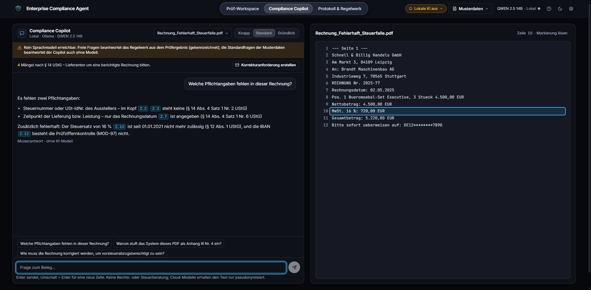
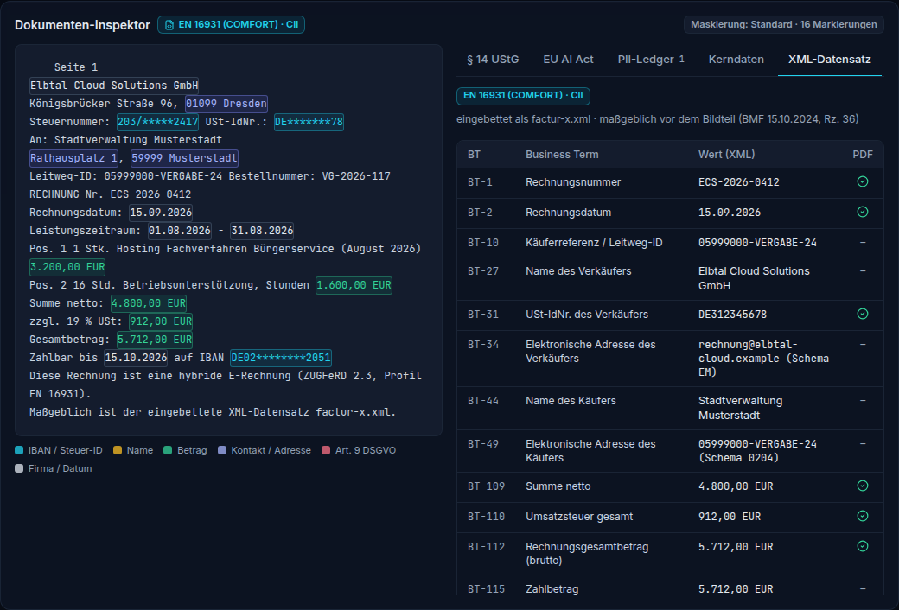
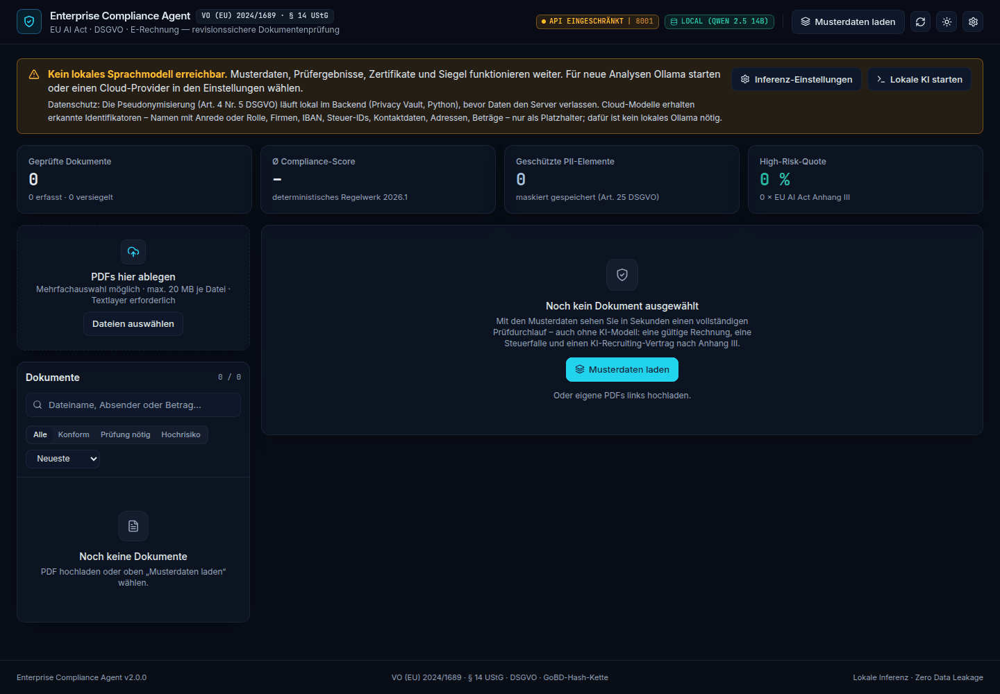
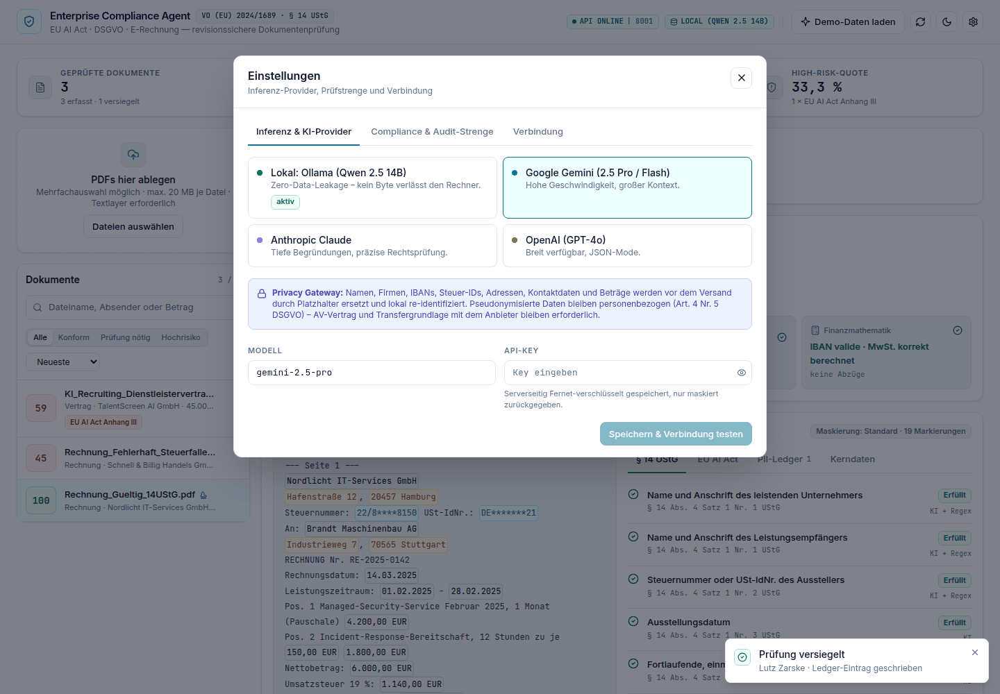
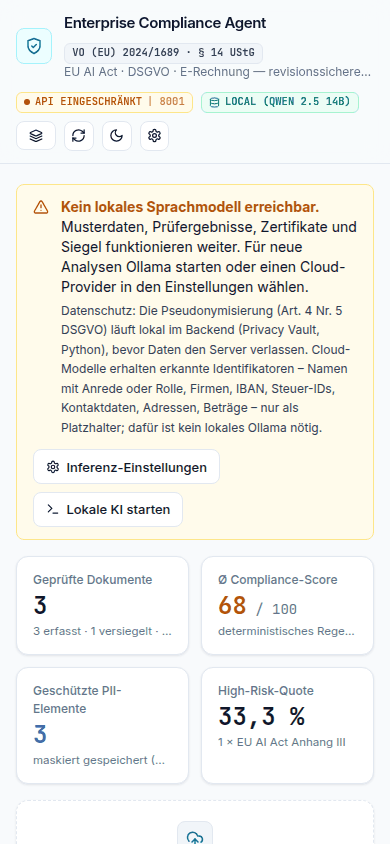

# Enterprise Compliance Agent

Revisionssichere Vorprüfung von Rechnungen und Verträgen: **§ 14 UStG**,
**E-Rechnung nach EN 16931** (ZUGFeRD, Factur-X, XRechnung), **EU AI Act
(VO (EU) 2024/1689)** und **DSGVO** – mit deterministischem Compliance-Score,
hash-verkettetem Prüfprotokoll, Prüfer-Siegel und signiertem Prüfdatenpaket.
Inferenz standardmäßig **lokal über Ollama**; optional Gemini, Claude oder GPT,
dann ausschließlich über ein **Privacy Gateway**, das identifizierende Daten vor
dem Versand pseudonymisiert.

| | |
|---|---|
| **Backend** | Python 3.12 · FastAPI · Pydantic v2 · SQLAlchemy 2.0 Core · httpx · pdfplumber/pypdfium2 · defusedxml · cryptography (Fernet, Ed25519) |
| **Frontend** | Next.js 15 · React 19 · Tailwind CSS 4 · TypeScript (strict) |
| **Inferenz** | Ollama `qwen2.5:14b-instruct` (Default) · Google Gemini · Anthropic Claude · OpenAI – reines HTTP, kein SDK, kein LangChain |
| **Persistenz** | SQLite (Default) · PostgreSQL über `DATABASE_URL` |
| **Qualität** | 230 Pytest-Tests (ca. 13 s, ohne laufendes LLM) · ESLint · `next build` · CI für Backend, Frontend, Docker |
| **Betrieb** | Ein-Klick-Start für Windows · Docker Compose (API `:8001`, Frontend `:3001`) · Non-Root-Container, Healthchecks |


| Prüfzertifikat (A4, druckfertig) | Compliance Copilot |
|---|---|
|  |  |
| **E-Rechnung: XML-Datensatz (EN 16931)** | **Export-Center mit Prüfdatenpaket (ZIP)** |
|  |  |

> **Zu den Screenshots:** Alle Prüfergebnisse stammen aus den eingebauten
> **Musterdaten** und laufen ohne Sprachmodell. Bei den drei PDF-Belegen ist nur
> die KI-Antwort vorberechnet und überall als „Referenz-Audit · ohne KI“
> gekennzeichnet; Score, Maskierung, Eskalationsregeln, Hash-Kette und
> Zertifikat erzeugt das echte Backend. Die ZUGFeRD-Rechnung braucht gar keine
> Vorberechnung: Sie wird live und deterministisch aus ihrem XML geprüft
> („XML-Prüfung · ohne KI“). Einzige Ausnahme ist der Live-Stepper weiter unten:
> Er wurde mit einem Ollama-Stub aufgenommen, der feste Antworten liefert.

## Ein-Klick-Start

**Windows:** `Start_Compliance_Agent.bat` doppelklicken (ruft
`Start_Compliance_Agent.ps1` auf). Der Starter legt bei Bedarf die
Python-Umgebung an, hält Python- und npm-Abhängigkeiten über Datei-Hashes
aktuell, startet Backend (`:8001`) und Frontend (`:3001`) im Hintergrund und
öffnet den Browser erst, wenn beide antworten. Er meldet, ob Ollama läuft.
Logs unter `.run/logs`, beenden mit `Stop_Compliance_Agent.bat`.
Voraussetzung: Python 3.11+ und Node.js 20+.

**Docker:** `docker compose up --build` → <http://localhost:3001>

Dann oben rechts **„Musterdaten laden“** klicken. Das Dashboard ist sofort
vollständig – **auch ohne installiertes Sprachmodell**. Mit laufendem Ollama
oder hinterlegtem Cloud-Key lässt sich jedes Musterdokument über
„Live neu prüfen“ echt analysieren.

## Rechtsnormen im Überblick

| Rechtsgrundlage | Was das System prüft bzw. umsetzt | Stand |
|---|---|---|
| **EU AI Act** – VO (EU) 2024/1689 | Risikoklassen (Art. 5, Art. 6 Abs. 2 i. V. m. Anhang III, Art. 50), Anhang-III-Eskalation, Hinweis auf Art. 6 Abs. 3, Betreiberpflichten (Art. 26), Logging (Art. 12), menschliche Aufsicht (Art. 14) | Anhang-III-Pflichten ab **02.12.2027**, Anhang I ab 02.08.2028 nach **VO (EU) 2026/1744** (Digital Omnibus, in Kraft seit 27.07.2026) |
| **§ 14 Abs. 4 UStG** | Pflichtangaben Nr. 1–8 einzeln, Kleinbetragsrechnung (§ 33 UStDV), Vorsteuerrisiko (§ 15 UStG) | gültig |
| **E-Rechnung** – § 14 Abs. 1 UStG, EN 16931 | XML aus ZUGFeRD/Factur-X-PDFs und reine XRechnung (CII/UBL) werden gelesen; Profil aus BT-24; MINIMUM/BASIC WL sind keine E-Rechnung; Pflichtfelder und Summenregeln (BR-CO-10/13/14/15, BR-DE-15) | Empfangspflicht seit 01.01.2025; Ausstellungspflicht 2027/2028 |
| **XML-Vorrang** – BMF-Schreiben vom 15.10.2024, Rz. 36 | Bei hybriden Rechnungen ist der XML-Teil maßgeblich; Abgleich von acht Kernwerten mit dem PDF-Bildteil, Abweichungen −10 | präzisiert durch BMF-Schreiben vom 15.10.2025 |
| **B2G** – § 5 Abs. 1 Nr. 1 ERechV, BR-DE-15 | Leitweg-ID bei öffentlichen Auftraggebern: Aufbau und Prüfziffer (ISO/IEC 7064, MOD 97-10) nach KoSIT-Formatspezifikation 2.0.2 | Bund; Länder und Kommunen nach Landesrecht |
| **§ 12 / § 14c UStG** | Zulässige Steuersätze, Steuerberechnung, Hinweis auf EuGH C-378/21 (Endverbraucher) | BMF-Schreiben vom 27.02.2024 |
| **DSGVO** – Art. 4 Nr. 5, 9, 25, 32 | Pseudonymisierung vor Cloud-Aufrufen, Art.-9/10-Erkennung, maskierte Speicherung, drei Schwärzungsstufen | – |
| **GoBD / § 147 AO, § 14b UStG** | Unveränderbares, hash-verkettetes Prüfprotokoll; Prüfdatenpaket je Beleg mit Original, XML, Ledger-Auszug und signiertem Manifest | Buchungsbelege 8 Jahre (BEG IV) |

Quellen und Prüfmethode: [`docs/RECHTSQUELLEN.md`](docs/RECHTSQUELLEN.md).

---

## Inhalt

1. [Funktionsumfang](#funktionsumfang)
2. [Architektur & Datenfluss](#architektur--datenfluss)
3. [Schnellstart](#schnellstart)
4. [Oberfläche](#oberfläche)
5. [API-Referenz & cURL](#api-referenz--curl)
6. [Compliance-Scorecard](#compliance-scorecard-0100)
7. [Prüfprotokoll (Hash-Kette)](#prüfprotokoll-hash-kette)
8. [Datenschutz & Privacy Gateway](#datenschutz--privacy-gateway)
9. [Betrieb: Logging, Rate-Limiting, Konfiguration](#betrieb)
10. [Tests](#tests)
11. [Docker](#docker)
12. [Grenzen](#grenzen)


Rechtsquellen: [`docs/RECHTSQUELLEN.md`](docs/RECHTSQUELLEN.md).

---

## Funktionsumfang

| Bereich | Umsetzung |
|---|---|
| **Extraktion** | Zwei fokussierte LLM-Läufe (Extraktion, Compliance-Audit) mit striktem Pydantic-Vertrag und Reparaturrunde bei Schemaverletzung |
| **§ 14 Abs. 4 UStG** | Alle Pflichtangaben (Nr. 1–8) einzeln geprüft, inkl. Kleinbetragsrechnung nach § 33 UStDV |
| **E-Rechnung (EN 16931)** | ZUGFeRD-/Factur-X-Anhang aus dem PDF und reine XRechnung (.xml) in CII- und UBL-Syntax; Profil-Erkennung (EN 16931, EXTENDED, BASIC, XRECHNUNG 3.0, Peppol, MINIMUM/BASIC WL); zentrale Business Terms; Abgleich XML ↔ Bildteil; Leitweg-ID bei Behörden. **Deterministisch, ohne Sprachmodell** |
| **Finanzmathematik** | IBAN-Prüfziffer (ISO 13616, MOD-97-10), zulässiger Steuersatz (inkl. Corona-Sätze 07–12/2020), Netto + USt = Brutto, USt = Netto × Satz |
| **EU AI Act** | Risikostufe (Art. 5 / Anhang III / Art. 50 / minimal), automatische Eskalation bei belegter Anhang-III-Kategorie, Artikel-Pflichtenliste |
| **DSGVO** | LLM-Befund + Regex-Zweitmeinung, Art.-9/10-Erkennung, Maskierungszwang vor dem Speichern, drei Schwärzungsstufen für die Textansicht |
| **Compliance-Score** | Deterministisch 0–100, vier Kacheln, Deckelung bei Hochrisiko, Freigabeempfehlung, Ein-Satz-Risikoerklärung je Abzug |
| **Musterdaten** | Drei PDF-Referenzdokumente mit vorberechneter KI-Antwort plus eine hybride ZUGFeRD-Rechnung an eine Kommune, die live aus dem XML geprüft wird – sofort nutzbar ohne Modell |
| **Prüfprotokoll** | Append-only-Tabelle `audit_trails` mit SHA-256-Hash-Kette, DB-Trigger gegen UPDATE/DELETE, Kettenprüfung per API |
| **Human Oversight** | Prüfer-Siegel (Art. 14 EU AI Act) als eigener Ledger-Eintrag; erneute Analyse hebt das Siegel auf |
| **Prüfzertifikat** | A4-HTML (druckfertig, CSP-gehärtet), Markdown-Memo, JSON für ERP-Archivierung |
| **Prüfdatenpaket (ZIP)** | Originalbeleg, XML-Datensatz, Ledger-Auszug, Zertifikat und `manifest.json` mit SHA-256 je Datei und Ed25519-Systemsignatur; Offline-Prüfung mit `scripts/verify_pruefpaket.py` |
| **Multi-Provider** | Ollama / Gemini / Claude / GPT zur Laufzeit umschaltbar; API-Keys Fernet-verschlüsselt gespeichert, nur maskiert ausgeliefert |
| **Compliance Copilot** | Dokumentbezogene Fragen, geerdet auf nummeriertem Text und Prüfergebnis, mit Zeilen- und Normverweisen |
| **Betrieb** | JSON-Logs mit `request_id`, PII-Filter im Log, Token-Bucket-Rate-Limit, Mehrfach-Upload per Drag & Drop, Ledger-Integritätsanzeige, KPI-Endpunkt |

---

## Architektur & Datenfluss

```mermaid
flowchart LR
    U[Upload PDF / XML<br/>einzeln / Batch] --> V[Validierung<br/>Typ · Größe · Textlayer]
    V --> X[EN-16931-Parser<br/>ZUGFeRD · XRechnung]
    X --> DB[(SQLite / PostgreSQL<br/>documents)]
    DB -- E-Rechnung --> XP[XML-Pfad<br/>deterministisch, ohne LLM]
    XP --> S
    DB --> P1[1 Text-Layer-Check]
    P1 --> P2[2 Regex-PII-Scan]
    P2 --> R{Inferenz-Modus}
    R -- lokal --> O[Ollama<br/>qwen2.5:14b]
    R -- Cloud --> PV[Privacy Vault<br/>Pseudonymisierung]
    PV --> C[Gemini / Claude / GPT]
    C --> RI[Lokale<br/>Re-Identifizierung]
    O --> P3[3 Extraktion + § 14 UStG]
    RI --> P3
    P3 --> P4[4 AI-Act- & DSGVO-Audit<br/>Eskalationsregeln]
    P4 --> S[Deterministische<br/>Scorecard 0–100]
    S --> L[(audit_trails<br/>Hash-Kette)]
    S --> UI[Dashboard · Inspektor · Copilot]
    UI --> H[Prüfer-Siegel<br/>Art. 14]
    H --> L
    L --> Z[Prüfzertifikat<br/>HTML · MD · JSON]
    L --> ZIP[Prüfdatenpaket<br/>ZIP + Ed25519-Manifest]
```



```
app/
  main.py            FastAPI: Endpunkte, Auth, Fehlerformat, Request-Tracing
  services.py        Pipeline (4 Stufen), Sign-off, KPIs, Copilot, Demo-Seed
  scoring.py         Deterministische Scorecard (Regelwerk 2026.2)
  extractors/        EN-16931-Parser (CII/UBL), PDF-Anhänge, Leitweg-ID, Abgleich XML ↔ PDF
  gobd_export.py     Prüfdatenpaket (ZIP) mit Manifest und Prüffunktion
  signing.py         Ed25519-Systemsignatur (Schlüssel unter data/.signing.key)
  audit_ledger.py    Append-only-Ledger mit SHA-256-Hash-Kette
  inference.py       InferenceRouter: lokal oder Cloud (immer mit Vault)
  llm.py             Basisclient (JSON-Vertrag, Reparatur), Ollama, Prompts
  providers.py       Gemini-, Claude-, OpenAI-Transport (httpx)
  privacy_vault.py   Pseudonymisierung / Re-Identifizierung, flüchtiges Mapping
  redaction.py       Maskierungszwang, Regex-PII-Scan, Schwärzungsstufen
  runtime_settings.py Laufzeit-Einstellungen, Fernet-verschlüsselte Keys
  reporting.py       Prüfzertifikat (HTML/A4, Markdown, JSON)
  logging_config.py  JSON-Logging, request_id (ContextVar), PII-Filter
  rate_limit.py      Token-Bucket je Client-IP
  demo.py            Vier Referenzdokumente (grün / rot / Hochrisiko / ZUGFeRD-Hybrid)
  db.py · schemas.py · config.py · pdf_reader.py
frontend/src/
  app/page.tsx       Dashboard-Orchestrierung (kein Mock-Fallback)
  components/        Header, KpiStrip, Scorecard, AuditStepper, DocumentList,
                     DocumentInspector, ExportModal, SettingsModal, CopilotDrawer
  lib/api.ts         Typisierter Client, Backend-Erkennung, Fehlerobjekte
```

**Bewusst kein LangChain/CrewAI.** Der Weg vom Dokument zur Datenbank ist ein
lesbarer HTTP-Aufruf plus Schemavalidierung – das kann ein IT-Auditor
nachvollziehen.

---

## Schnellstart

### Lokal (empfohlen für Entwicklung)

```bash
ollama pull qwen2.5:14b-instruct

python -m venv .venv
source .venv/bin/activate            # Windows: .venv\Scripts\activate
pip install -r requirements-dev.txt
cp .env.example .env                 # Windows: copy .env.example .env

uvicorn app.main:app --port 8001     # API + Swagger: http://localhost:8001/docs
```

```bash
cd frontend
npm ci
npm run dev                          # http://localhost:3001
```

Im Dashboard **„Musterdaten laden“** klicken: Drei Referenzdokumente werden
angelegt und sind sofort geprüft (Referenz-Audits, ohne Inferenz). „Live neu
prüfen“ analysiert sie mit dem aktiven Modell neu.

### Docker

```bash
docker compose up --build            # API :8001, Frontend :3001, Ollama auf dem Host
docker compose --profile full up --build   # zusätzlich Ollama-Container
```

### Inferenzstrecke prüfen

```bash
python scripts/smoke_test_ollama.py  # Erreichbarkeit, Modell, echter Inferenzlauf
```

---

## Oberfläche

| | |
|---|---|
|  | **Start ohne Sprachmodell** – das Banner bietet direkt die Inferenz-Einstellungen und den Befehl `ollama serve` an und erklärt, dass die Pseudonymisierung lokal im Backend läuft. |
|  | **Fehlerhafte Rechnung (45/100)** – fehlende USt-IdNr. (−20), fehlendes Leistungsdatum (−10), ungültige IBAN (−15), Steuersatz 16 % (−10). Der Tooltip an der Kachel erklärt jeden Abzug in einem Satz. |
|  | **Light Mode, gültige Rechnung (100/100)** – „Zur Auszahlung freigegeben“, mit Demo-Siegel versiegelt. Farbcodierte PII-Markierungen im Text. |
|  | **Live-Audit-Stepper** (Aufnahme mit Ollama-Stub) – zeigt die echten Pipeline-Stufen des Backends (`GET /documents/{id}/progress`), keine simulierte Animation. |
|  | **E-Rechnung (100/100)** – Profil-Badge, Tab „XML-Datensatz“ mit den Business Terms, Abgleich je Wert mit dem PDF-Bildteil, B2G-Erkennung mit gültiger Leitweg-ID. |
|  | **Export-Center & Siegel** – Prüfdatenpaket (ZIP), Zertifikat drucken, JSON, Markdown-Memo; Prüfer-Siegel als Ledger-Eintrag (Art. 14 EU AI Act). |
|  | **Einstellungen** – Provider, Modell, API-Key (maskiert), Privacy-Gateway-Hinweis, PII-Strenge, Toggles, X-API-Key. |
|  | **Mobil (390 px)** – ohne horizontales Scrollen. |

Designprinzipien: semantische Farbtokens (Grün = konform, Bernstein = Prüfung,
Rose = Verstoß/Hochrisiko, Indigo = Datenschutz), WCAG-AA-Kontraste in beiden
Themes, keine Hover-Lifts, pulsierenden Effekte oder Deko-Icons,
`prefers-reduced-motion` wird respektiert. Zahlen, Beträge, Hashes und
Normzitate in JetBrains Mono mit gleich breiten Ziffern. Barrierefreiheit nach
den Vercel Web Interface Guidelines: Skip-Link, echte Buttons, Tooltips per
Tastaturfokus erreichbar, Formularfelder mit `name`/`autocomplete`. Ist das
Backend nicht erreichbar, erscheint ein Hinweisbanner – **es werden nie
Ersatzdaten angezeigt.**

---

## API-Referenz & cURL

| Methode | Pfad | Zweck |
|---|---|---|
| `GET` | `/health` | DB, Ollama, aktiver Inferenz-Modus |
| `POST` | `/documents/upload` | Einzelupload (PDF oder XML) mit Validierung; liest eingebettetes ZUGFeRD-XML |
| `POST` | `/documents/upload-batch` | Mehrere PDFs/XMLs; Fehler je Datei, kein Abbruch |
| `POST` | `/documents/{id}/extract` | Pipeline + Scorecard + Ledger-Eintrag |
| `GET` | `/documents/{id}/progress` | Aktuelle Pipeline-Stufe |
| `GET` | `/documents` · `/documents/{id}` | Liste (Pins zuerst) · Detail inkl. geschwärzter Textansicht |
| `PUT` | `/documents/{id}/pin` | Anpinnen |
| `POST` | `/documents/{id}/sign-off` | Prüfer-Siegel (Art. 14) |
| `GET` | `/documents/{id}/report?format=html\|markdown\|json` | Prüfzertifikat |
| `GET` | `/api/documents/{id}/export/gobd` | Prüfdatenpaket (ZIP): Original, XML, Ledger-Auszug, Zertifikat, signiertes Manifest |
| `POST` | `/documents/{id}/copilot` | Frage zum Dokument |
| `GET` | `/api/audit/trail` · `/api/audit/verify` · `/api/audit/head` | Ledger lesen, Kette prüfen, Kopf-Hash zur Verankerung |
| `GET` | `/api/audit/signing-key` | Öffentlicher Schlüssel und Fingerabdruck der Systemsignatur |
| `GET`/`POST` | `/api/settings` · `/api/settings/test-connection` | Laufzeit-Einstellungen (Keys maskiert), Verbindungstest |
| `GET` | `/api/dashboard/kpis` | Portfolio-Kennzahlen |
| `POST` | `/api/demo/seed` | Vier Musterdokumente, ohne Inferenz analysiert (idempotent, überschreibt keine Live-Audits) |

```bash
API=http://localhost:8001

curl -s $API/health | jq .inference
curl -s -X POST $API/api/demo/seed | jq '.items[] | {id, filename}'

ID=$(curl -s -X POST $API/documents/upload -F "file=@rechnung.pdf;type=application/pdf" | jq -r .id)
curl -s -X POST $API/documents/$ID/extract | jq '.scorecard | {score, band, release_recommendation}'

curl -s -X POST $API/documents/upload-batch -F "files=@a.pdf" -F "files=@b.pdf" | jq '{succeeded, failed}'

# Reine XRechnung: Prüfung ohne Sprachmodell
XR=$(curl -s -X POST $API/documents/upload -F "file=@xrechnung.xml;type=application/xml" | jq -r .id)
curl -s -X POST $API/documents/$XR/extract | jq '{provider, score: .scorecard.score}'
curl -s $API/documents/$XR | jq '.einvoice.business_terms'

# Prüfdatenpaket herunterladen und offline prüfen
curl -s $API/api/documents/$XR/export/gobd -o paket.zip
python scripts/verify_pruefpaket.py paket.zip --fingerprint "$(curl -s $API/api/audit/signing-key | jq -r .fingerprint)"

curl -s -X POST $API/documents/$ID/sign-off -H "Content-Type: application/json" \
     -d '{"auditor_name":"Lutz Zarske","note":"USt-IdNr. nachgefordert","decision":"SEALED_APPROVED"}' | jq .sign_off

curl -s "$API/documents/$ID/report?format=html" -o zertifikat.html
curl -s "$API/documents/$ID/report?format=markdown"

curl -s $API/api/audit/verify          # {"valid": true, "entries": ..., "head_hash": ...}

curl -s -X POST $API/api/settings -H "Content-Type: application/json" \
     -d '{"inference_mode":"gemini","api_keys":{"gemini":"<KEY>"},"pii_strictness":"strict"}' | jq .masked_keys

curl -s -X POST $API/documents/$ID/copilot -H "Content-Type: application/json" \
     -d '{"question":"Welche Pflichtangaben fehlen?"}' | jq -r .answer
```

Ist `API_KEY` gesetzt, verlangen alle Endpunkte außer `/health` den Header
`X-API-Key`. **Ohne `API_KEY` kann jeder im Netz auch die Einstellungen ändern**
– produktiv immer setzen.

Fehlerformat (einheitlich): `{"error": {"code", "message", "hint"}}`. Wichtige
Codes: `invalid_upload` 415 · `file_too_large` 413 · `no_text_layer` 422 ·
`invalid_einvoice` 422 · `document_not_analyzed` 409 · `original_missing` 410 · `rate_limited` 429 (+ `Retry-After`) ·
`provider_not_configured` 400 · `provider_auth_failed` 502 ·
`ollama_unavailable`/`provider_unavailable` 503 · `provider_timeout` 504.

---

## Compliance-Scorecard (0–100)

Der Score entsteht **nicht im LLM**, sondern in `app/scoring.py` aus festen,
versionierten Regeln. Jede Pflichtangabe wird doppelt belegt: aus der
LLM-Extraktion – bei E-Rechnungen aus dem XML-Datensatz – und per Regex im
Dokumenttext (`evidence_source`: `llm`, `xml`, `rule_based`, `both`, `xml_rule`).

| Kachel | Regel | Abzug |
|---|---|---|
| **Formelle Gültigkeit** (§ 14 Abs. 4 UStG, EN 16931, Regelwerk 2026.2) | Steuernummer/USt-IdNr. fehlt (Nr. 2) | −20 |
| | jede weitere fehlende Pflichtangabe (Nr. 1, 3–8) | −10 |
| | Kleinbetragsrechnung ≤ 250 € brutto: Nr. 1 (Empfänger), 2, 4, 6, 7, 8 (Betrag) entbehrlich (§ 33 UStDV) | – |
| | Hybride Rechnung: Bildteil weicht vom maßgeblichen XML ab (BMF 15.10.2024, Rz. 36) | −10 |
| | Öffentlicher Auftraggeber ohne gültige Leitweg-ID (§ 5 ERechV) | −10 |
| | Reines PDF, Profil MINIMUM/BASIC WL oder Verstoß gegen EN-16931-Geschäftsregeln: Hinweis | 0 |
| **Mathematische Validität** | IBAN-Prüfziffer ungültig | −15 |
| | Netto + USt ≠ Brutto | −15 |
| | USt ≠ Netto × Satz | −10 |
| | Steuersatz nicht 19/7/0 % (07–12/2020 zusätzlich 16/5 %) | −10 |
| **Regulatorisches Risiko** (EU AI Act) | Hochrisiko ohne Konformitätsnachweis | −25, **Deckel 59** |
| | Hochrisiko mit Hinweis auf Konformitätsbewertung | −10 |
| | Begrenztes Risiko (Art. 50) | −5 |
| | Verbotene Praktik (Art. 5) | **Deckel 20** |
| **Datenschutz** (DSGVO) | Besondere Kategorien (Art. 9/10) | −10 |
| | Amtliche Kennnummern natürlicher Personen | −5 |

Bänder: **≥ 85 grün** (verkehrsfähig) · **60–84 gelb** (Nachbesserung) ·
**< 60 rot** (Revisionssperre). Freigabeempfehlung: „Zur Auszahlung
freigegeben“, „Freigabe unter Vorbehalt“, „Freigabe gesperrt — Nachforderung
nötig“ oder „Freigabe gesperrt — Konformitätsbewertung nach Art. 43 nachweisen“.

Jeder Abzug trägt eine Ein-Satz-Risikoerklärung (`risk_note`, z. B. „Ohne
Steuernummer oder USt-IdNr. entfällt der Vorsteuerabzug nach § 15 UStG.“) und
bei Bedarf rechtlichen Kontext (`note`). Beides erscheint als Tooltip im
Dashboard und im Zertifikat.

Musterdaten: gültige Rechnung **100**, Steuerfalle **45**, KI-Recruiting-Vertrag
**59** (gedeckelt) – als Referenz-Audit ohne Modell und, bei vollständiger
Extraktion, auch live; ZUGFeRD-Rechnung **100**, live aus dem XML. Ein schwächeres Modell kann einzelne Felder verfehlen;
die Regex-Gegenprobe fängt die meisten Fälle ab (getestet in
`tests/test_scoring.py` und `tests/test_reference_demo.py`).

---

## E-Rechnung (EN 16931)

| Quelle | Erkennung |
|---|---|
| Hybride PDF (ZUGFeRD 2.x, Factur-X) | Dateianhang `factur-x.xml`, `zugferd-invoice.xml` oder `xrechnung.xml` (sonst jedes XML mit passender Wurzel) |
| Reines XML (XRechnung 3.0) | Upload als `.xml`, CII (`CrossIndustryInvoice`) oder UBL (`Invoice`/`CreditNote`) |
| ZUGFeRD 1.0 | erkannt und abgelehnt bzw. als „nicht auswertbar“ vermerkt – kein EN-16931-Format |

* **Sicherheit:** geparst mit `defusedxml` und `forbid_dtd=True` – keine DTDs,
  keine Entitäten, keine externen Referenzen (XXE, „Billion Laughs“).
* **Profil** aus BT-24: EN 16931 (COMFORT), EXTENDED, BASIC, XRECHNUNG 3.0,
  Peppol BIS 3.0; MINIMUM und BASIC WL sind keine E-Rechnung – bei hybriden
  Belegen gilt dann der Bildteil, und die Analyse läuft über den Text.
* **Business Terms** im Inspektor: BT-1, BT-2, BT-10, BT-27 (Name Verkäufer),
  BT-31 (USt-IdNr. Verkäufer), BT-34/BT-49 (elektronische Adressen),
  BT-44, BT-109, BT-110, BT-112, BT-115.
* **XML-Vorrang:** Acht Kernwerte (BT-1, BT-2, BT-31, BT-84, BT-109, BT-110,
  BT-112, BT-119) werden im PDF-Text wiedergesucht. Steht an der beschrifteten
  Stelle ein anderer Wert, meldet die Scorecard „Diskrepanz zwischen visuellem
  PDF und maßgeblichem XML-Datensatz (BMF 15.10.2024: XML hat Vorrang)“.
* **B2G:** Behördenbegriff im Käufernamen, Leitweg-ID als elektronische Adresse
  (Peppol-Schema 0204) oder in BT-10 – dann wird die Leitweg-ID samt Prüfziffer
  verlangt. Im B2B-Verkehr entfällt die Prüfung.
* **Ohne Sprachmodell:** Rechnungsdaten kommen aus dem XML, PII aus dem
  Regex-Scanner; eine AI-Act-Einstufung findet nicht statt (eine Rechnung
  begründet keine Pflichten nach der KI-VO). Ledger und Zertifikat weisen das
  aus (`model=en16931-parser`, `provider=structured`).

## Prüfdatenpaket (ZIP)

`GET /api/documents/{id}/export/gobd` bzw. „GoBD-Prüfdatenpaket exportieren“ im
Export-Center:

```
original/<Dateiname>          Originalbeleg, bitgenau (SHA-256 = Datenbank)
factur-x.xml                  eingebetteter XML-Datensatz (nur hybride PDFs)
ledger_audit_trail.json       alle Ledger-Einträge des Belegs, je Eintrag nachgerechnet
audit_certificate.html        A4-Prüfzertifikat
manifest.json                 SHA-256 je Datei, Prüfzeitpunkt, Score, Siegel,
                              Kopf-Hash der Kette, Ed25519-Signatur
```

`python scripts/verify_pruefpaket.py paket.zip --fingerprint <fp>` prüft
Datei-Hashes und Signatur ohne Server. Den Fingerabdruck liefert
`GET /api/audit/signing-key`; er gehört in die Verfahrensdokumentation – ein im
Paket mitgelieferter Schlüssel allein beweist nichts.

## Prüfprotokoll (Hash-Kette)

Jede Analyse und jedes Siegel schreibt einen Eintrag in `audit_trails`:
`document_id`, `sha256_hash` (Dokument), `model_name`, `prompt_hash`
(Fingerabdruck der Prompt-Version), `timestamp_utc`, `result_summary`,
`compliance_score`, `risk_tier`, `details`, `previous_hash`, `entry_hash`.

* `entry_hash = SHA-256(kanonisches JSON aller Felder inkl. previous_hash)`
* Erster Eintrag verweist auf `0000…` (Genesis).
* `GET /api/audit/verify` rechnet die gesamte Kette nach und meldet
  Sequenzlücken (gelöschte Einträge), Verkettungsbrüche und Inhaltsänderungen
  mit Sequenznummer.
* DB-Trigger (SQLite und PostgreSQL) verweigern `UPDATE` und `DELETE`.
* Bei PostgreSQL serialisiert `pg_advisory_xact_lock` das Anhängen auch über
  mehrere Prozesse.

Ehrliche Einordnung: Das ist eine **lineare Hash-Kette**, kein Merkle-Baum.
Gegen jemanden mit Vollzugriff auf die Datenbank hilft kein Trigger; wer die
jüngsten Einträge abschneidet, erzeugt eine in sich gültige kürzere Kette.
Deshalb gibt es `GET /api/audit/head`: Den Kopf-Hash regelmäßig außerhalb des
Systems ablegen (Ticket, WORM-Speicher, qualifizierter Zeitstempel nach eIDAS).

---

## Datenschutz & Privacy Gateway

* **Lokal als Standard.** Im Modus `local` verlässt kein Dokumentinhalt den Rechner.
* **Cloud nur mit Vault.** `InferenceRouter` umhüllt jeden Cloud-Client mit
  `VaultedClient`; ein Cloud-Aufruf ohne Pseudonymisierung ist im Code nicht
  vorgesehen. Ersetzt werden Personen (mit Anrede/Rolle), Firmen (über
  Rechtsform), IBAN, USt-IdNr., Steuernummer, E-Mail, Telefon, Adressen und
  Beträge. Das Mapping lebt nur im Speicher und nur für einen Auftrag; im
  Ergebnis steht lediglich die Anzahl je Kategorie (`privacy_gateway`).
* **Rechtlich nüchtern:** Pseudonymisierte Daten bleiben personenbezogen
  (Art. 4 Nr. 5, ErwG 26 DSGVO). Der Vault senkt das Übermittlungsrisiko
  (Art. 25, 32; ergänzende Maßnahme i. S. d. EDSA-Empfehlungen 01/2020),
  ersetzt aber weder AV-Vertrag noch Transfergrundlage. Die Erkennung ist
  regelbasiert: Namen ohne Anrede oder Rolle und Freitext-Merkmale werden nicht
  erfasst.
* **Maskierte Persistenz.** PII-Befunde werden nur maskiert gespeichert. Die
  Textansicht folgt der Stufe `strict` / `standard` / `audit_only`.
* **Volltext gespeichert.** Für erneute Analysen liegt der extrahierte Text in
  der Datenbank (`raw_text`); produktiv gehören Festplattenverschlüsselung und
  ein Löschkonzept (Art. 17 DSGVO) dazu.
* **API-Keys.** Fernet-verschlüsselt in `app_settings`; Schlüssel aus
  `SETTINGS_ENCRYPTION_KEY` oder `data/.settings.key` (0600, gitignored).
  Liegt der Schlüssel neben der DB, schützt das ein geleaktes DB-Backup, nicht
  einen kompromittierten Server – produktiv gehört er in einen Secret-Store.

---

## Betrieb

**Strukturiertes Logging.** Jede Logzeile ist ein JSON-Objekt mit `timestamp`,
`level`, `logger`, `message`, `request_id` und Zusatzfeldern (`http_status`,
`duration_ms`, …). Die `request_id` kommt aus einer ContextVar, wird als
`X-Request-ID` zurückgegeben und von Clients nur übernommen, wenn sie dem
Zeichensatz `[A-Za-z0-9._:-]{1,128}` entspricht (Schutz vor Log-Injection). Ein
Filter schwärzt IBANs, E-Mails, Telefonnummern, lange Ziffernfolgen und
API-Keys; Felder wie `raw_text` werden grundsätzlich ersetzt.

**Rate-Limiting.** Token-Bucket je Client-IP und Routengruppe (Upload 30/min,
Extraktion 10/min, Copilot 20/min, Einstellungen 30/min); Antwort 429 mit
`Retry-After`. Der Zustand liegt im Prozessspeicher – bei mehreren Workern
gehört das Limit in Redis oder an das API-Gateway.

**Wichtige Variablen** (vollständig in `.env.example`):

| Variable | Default | Zweck |
|---|---|---|
| `API_KEY` | leer | Aktiviert `X-API-Key`-Prüfung |
| `DATABASE_URL` | `sqlite:///data/agent.db` | PostgreSQL: `postgresql+psycopg://…` |
| `INFERENCE_MODE` | `local` | Startwert; zur Laufzeit änderbar |
| `GEMINI_/ANTHROPIC_/OPENAI_API_KEY` | leer | Startwerte für Cloud-Provider |
| `ANTHROPIC_MODEL` | `claude-sonnet-5-5` | `claude-3-5-sonnet-20241022` ist seit Oktober 2025 abgekündigt |
| `PII_STRICTNESS` | `standard` | `strict` · `standard` · `audit_only` |
| `LOG_JSON` | `true` | `false` für lesbare Textlogs |
| `RATE_LIMIT_*` | siehe oben | `0` = unbegrenzt |
| `SETTINGS_ENCRYPTION_KEY` | leer | Fernet-Schlüssel für gespeicherte Provider-Keys |
| `CORS_ORIGINS` | `*` | Produktiv auf die Frontend-Origin beschränken |

**PostgreSQL:** `pip install "psycopg[binary]"` und `DATABASE_URL` setzen. Neue
Spalten werden beim Start additiv ergänzt; für echte Schemaänderungen gehört
Alembic dazu.

---

## Tests

```bash
python -m pytest            # 230 Tests, ca. 13 s, kein LLM nötig
cd frontend && npm run lint && npm run build
```

Ollama und die Cloud-Provider werden auf HTTP-Ebene über `httpx.MockTransport`
nachgestellt; Payload-Aufbau, JSON-Reparatur, Vault und Validierung laufen real.

| Datei | Tests | Schwerpunkt |
|---|---:|---|
| `test_api.py` | 22 | Kernendpunkte, Fehlerformat, Auth, Eskalation |
| `test_schemas.py` | 22 | Deutsche Formate, Toleranz gegenüber LLM-Ausgaben |
| `test_workflow.py` | 22 | Scorecard in der API, Zertifikat (inkl. XSS-Escaping), Siegel, Batch, Seed, KPIs, Pins, Fortschritt, Copilot, Schwärzungsstufen |
| `test_privacy_and_providers.py` | 26 | Vault, Provider-Payloads, Fehlerabbildung, verschlüsselte Keys, Cloud-Pipeline ohne Klartext-PII |
| `test_scoring.py` | 22 | Regelwerk, Demo-Scores, Kleinbetrag, Corona-Sätze, Deckelung, Risikoerklärungen, XML-Vorrang, § 14c-Hinweis |
| `test_einvoice.py` | 38 | CII/UBL-Mapping, Profile, XXE/DTD-Abwehr, ZUGFeRD 1.0, Geschäftsregeln, Leitweg-ID (KoSIT-Beispiele), PDF-Anhang, Diskrepanzen, Mischsteuersatz, B2G/B2B |
| `test_einvoice_api.py` | 18 | XML-Upload ohne Modell, hybride PDF, Batch mit PDF und XML, Zertifikat, ZIP-Paket inkl. Manipulations- und Fremdschlüsselnachweis, fehlende Originaldatei, Copilot-Musterantwort nur bei exakter SHA-256 |
| `test_reference_demo.py` | 12 | Musterdaten ohne Modell (100/45/59 + ZUGFeRD 100), Demo-Siegel, Ledger-Kennzeichnung, kein Überschreiben von Live-Audits, Copilot-Musterantworten |
| `test_observability.py` | 13 | JSON-Logs, PII-Filter, Request-ID, Token-Bucket, 429 |
| `test_audit_ledger.py` | 7 | Verkettung, Trigger, Manipulations- und Löschnachweis, Migration |
| `test_llm.py` · `test_redaction.py` · `test_pdf_reader.py` | 28 | Client, Regex-Scan (u. a. „Softwarehaus“ ≠ Reha, Leitweg-ID ≠ Telefon), PDF-Fehlerklassen |

---

## Docker

```bash
docker compose up --build
```

| Dienst | Port | Details |
|---|---|---|
| `api` | 8001 → 8000 | Python 3.12-slim, UID 10001, Healthcheck auf `/health`, Volume `app-data` |
| `frontend` | 3001 | Next.js Standalone auf node:22-alpine, UID 10001, startet erst bei gesunder API |
| `ollama` | 11434 | nur mit `--profile full`; danach `docker compose exec ollama ollama pull qwen2.5:14b-instruct` |

`PUBLIC_API_URL` legt fest, unter welcher Adresse der **Browser** die API
erreicht (wird zur Build-Zeit eingebettet, Default `http://localhost:8001`).

Datensicherung:

```bash
docker run --rm -v enterprise-compliance-agent_app-data:/data -v "$PWD":/backup \
  alpine tar czf /backup/app-data.tgz -C /data .
```

---

## Grenzen

Das System liefert eine **technische Vorprüfung**, keine Rechts- oder
Steuerberatung. Maßgeblich bleibt die Freigabe durch die Prüfperson.

* **Kein OCR.** Scans ohne Textlayer werden mit Handlungshinweis abgelehnt.
* **Keine vollständige EN-16931-Validierung.** Geprüft werden Profil,
  Pflichtfelder und Summenregeln (BR-CO-10/13/14/15, BR-DE-15), nicht XSD und
  Schematron. Für die formale Annahme beim Empfänger zählt der KoSIT-Validator.
* **Abgleich XML ↔ Bildteil ist textbasiert.** Werte werden im extrahierten
  PDF-Text gesucht; ein Bildteil ohne Textlayer oder mit exotischer
  Formatierung führt zu „nicht gefunden“ (Hinweis ohne Abzug).
* **B2G-Erkennung ist eine Heuristik** (Behördenbegriffe, Schema 0204,
  Leitweg-Format). Unbekannte Bezeichnungen öffentlicher Stellen bleiben unerkannt.
* **Musterbeleg kein PDF/A-3.** Die ZUGFeRD-Musterrechnung bettet das XML
  normgerecht ein (`/EmbeddedFiles`, `/AF`), ist aber kein validiertes PDF/A-3
  (Schriften nicht eingebettet, kein OutputIntent).
* **Prüfdatenpaket ≠ Datenträgerüberlassung.** Das ZIP dokumentiert einen
  Beleg; es folgt nicht dem Beschreibungsstandard (`index.xml`) und ersetzt
  keine revisionssichere Archivierung. Die Ed25519-Signatur ist kein
  qualifiziertes Siegel und kein qualifizierter Zeitstempel nach eIDAS.
* **Art. 6 Abs. 3 AI Act.** Die Ausnahme für rein vorbereitende Tätigkeiten
  wird nicht automatisch geprüft; das System eskaliert konservativ und weist
  darauf hin.
* **Synchrone Analyse.** Ein `POST /extract` blockiert für beide LLM-Läufe; für
  hohe Last wäre eine Queue (z. B. Arq, Celery) nötig.
* **Prüfer-Identität.** Der Name im Siegel ist selbst erklärt. Produktiv
  gehören SSO (OIDC) und ggf. eine qualifizierte elektronische Signatur dazu.
* **Prozesslokale Zustände.** Rate-Limit und Pipeline-Fortschritt gelten je
  Prozess.

## Lizenz

MIT.
