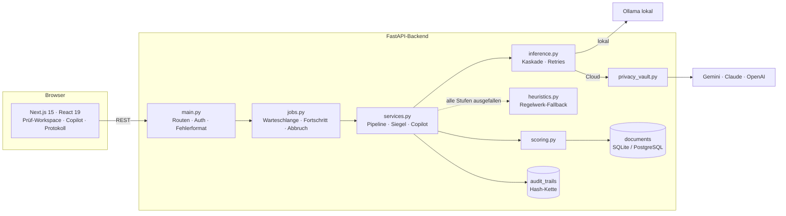
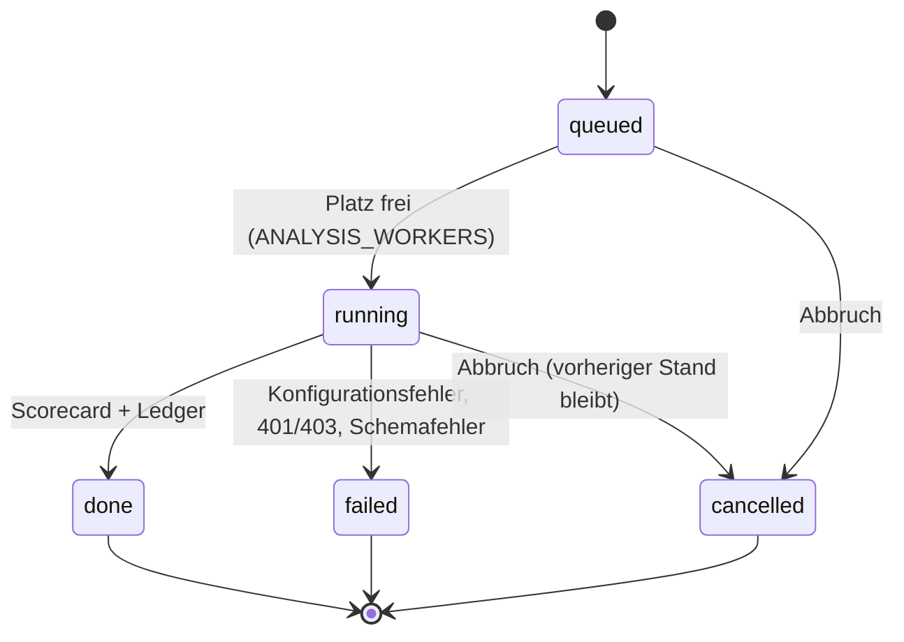
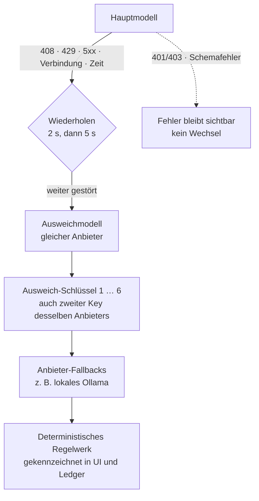

# Architektur

Technischer Überblick über den Enterprise Compliance Agent: Komponenten,
Datenfluss, Ausfallsicherheit und die Entscheidungen dahinter. Für Bedienung
und Schnellstart siehe [`README.md`](../README.md), für die Rechtsgrundlagen
[`RECHTLICHE_ANALYSE_2026.md`](RECHTLICHE_ANALYSE_2026.md).

## Leitlinien

| Prinzip | Umsetzung |
|---|---|
| **Deterministischer Kern** | Der Compliance-Score entsteht in `app/scoring.py` aus versionierten Regeln, nie im Sprachmodell. Das Modell liefert nur Eingaben (Extraktion, Einstufung); jede Pflichtangabe wird per Regex gegengeprüft. |
| **Kein Ergebnis ohne Herkunft** | Jede Analyse, jedes Siegel, jede Übersteuerung und jeder Modell- oder Stufenwechsel landet in einer SHA-256-Hash-Kette; Prüfer- und Systemereignisse sind Ed25519-signiert. |
| **Privacy by Default** | Lokale Inferenz als Standard; jeder Cloud-Aufruf läuft zwingend durch den `PrivacyVault` (Pseudonymisierung im Backend, flüchtiges Mapping). |
| **Kein Ausfall bricht eine Prüfung ab** | Wiederholung mit Backoff, Ausweichmodell, Ausweich-Schlüssel, Anbieter-Fallbacks, zuletzt ein deterministisches Regelwerk – gekennzeichnet, nie still. |
| **Keine Framework-Magie** | Reines `httpx` statt SDKs oder Agenten-Frameworks: Der Weg vom Dokument zur Datenbank ist für einen IT-Auditor lesbar. |

## Systemübersicht



## Prüfpipeline

`POST /documents/{id}/extract` nimmt den Auftrag sofort an (HTTP 202) und
reiht ihn in die Warteschlange ein; `?wait=true` wartet für Skripte und CI auf
das Ergebnis. Der Job durchläuft vier Phasen, die er live meldet:

| Phase | Schritt | Details |
|---|---|---|
| 1 | Text-Layer & XML-Vorrang | Textlayer vorhanden? E-Rechnungen mit auswertbarem XML laufen ab hier deterministisch über den EN-16931-Datensatz (BMF 15.10.2024, Rz. 36). |
| 2 | PII-Scanner & Privacy Vault | Regex-Zweitmeinung über den Volltext; bei Cloud-Inferenz Aufbau des Mappings (gleiche Platzhalter für beide Modellaufrufe). |
| 3 | § 14 UStG Extraktion & Prüfung | Strukturierte Extraktion mit Pydantic-Vertrag und einer Reparaturrunde bei Schemafehlern; regelbasierte Nachkontrollen (IBAN MOD-97, Pflichtangaben). |
| 4 | EU AI Act, Scorecard & Ledger | Einstufung nach Art. 5/6/50 mit Anhang-III-Eskalation, DSGVO-Befund mit Maskierungszwang, deterministische Scorecard, Ledger-Eintrag. |

Der Fortschritt im Job-Monitor ist ehrlich: Innerhalb einer Phase nähert sich
der Balken asymptotisch dem Phasenende, ohne es zu überschreiten; erst die
tatsächlich nächste Phase schiebt ihn weiter. Die Restzeit wird aus einer
gleitenden Erwartung je Pfad (KI, XML) geschätzt und geglättet.



* **Abbruch** beendet den Task sofort; der Beleg erhält seinen vorherigen
  Status, ein vorhandenes Ergebnis bleibt unangetastet. Bereits ausgelöste
  Stufenwechsel stehen trotzdem im Ledger.
* **Hängende Jobs:** Ohne Rückmeldung länger als das Modell-Timeout plus 60 s
  meldet der Snapshot `stalled`; die Oberfläche bietet Abbrechen an.
* **Release-Wechsel:** Während eines Updates startet kein Job, und der
  Release-Assistent spielt kein Update ein, solange Jobs offen sind.

## KI-Kaskade



* Jede Stufe wiederholt zunächst selbst (`LLM_RETRY_DELAYS`), bevor die
  nächste übernimmt. Lokale Zeitüberschreitungen werden nicht wiederholt – ein
  zu langsames Modell wird beim zweiten Versuch nicht schneller.
* **Alle Cloud-Stufen teilen sich einen `PrivacyVault`:** gleiche Platzhalter
  über die gesamte Kette, ein gemeinsamer Bericht, nie Klartext beim Anbieter.
* Jeder Stufenwechsel wird als `provider_failover` in die Hash-Kette
  geschrieben (von/zu Anbieter, Modell, Stufe, Grundcode).
* Ausweichmodell und Ausweich-Schlüssel gelten nur, wenn ein Cloud-Anbieter
  primär ist: Eine lokal eingestellte Prüfung geht nie automatisch in die Cloud.
* Abgelehnte Schlüssel (401/403) und Schemafehler lösen bewusst weder
  Wiederholung noch Wechsel aus – eine Fehlkonfiguration soll auffallen.
* Ein optionales Tagesbudget (`CLOUD_DAILY_TOKEN_LIMIT`) überspringt alle
  Cloud-Stufen, sobald es erreicht ist; lokale Stufen und das Regelwerk
  übernehmen.
* Modellwechsel sind nie still: Neuere Modelle werden aus der Modell-Liste des
  Anbieters nur *vorgeschlagen*; die Übernahme schreibt einen signierten
  `model_change`-Eintrag.

### Regelwerk-Fallback

`app/heuristics.py` liest Rechnungsfelder per Mustererkennung und stuft
konservativ ein: KI-Begriffe plus Anhang-III-Indikatoren (Bewerbung,
Bonität, kritische Infrastruktur …) ergeben „Hochrisiko“, das die Prüfperson
bestätigen oder nach Art. 14 Abs. 4 lit. d übersteuern kann. Scorecard,
Maskierung und Ledger laufen unverändert; das Ergebnis trägt
`provider = "heuristic"` und den Hinweis „Regelbasiertes Referenz-Audit – KI
temporär überlastet“. Der Copilot fällt auf eine Antwort aus dem gespeicherten
Prüfergebnis zurück. Mit `HEURISTIC_FALLBACK=false` bleibt stattdessen der
Fehler sichtbar.

## Prüfprotokoll

* Append-only-Tabelle `audit_trails`; DB-Trigger (SQLite und PostgreSQL)
  verweigern `UPDATE` und `DELETE`.
* `entry_hash = SHA-256(kanonisches JSON aller Felder inkl. previous_hash)`;
  `GET /api/audit/verify` rechnet die Kette nach und prüft jede Signatur.
* Ereignisse: `analysis`, `sign_off`, `human_override`, `provider_failover`,
  `model_change`, `archive`/`unarchive`, `release_update`. Ereignisse ohne
  Beleg tragen `document_id = "system"`.
* Das Prüfdatenpaket (ZIP) enthält Original, XML, Ledger-Auszug, Zertifikat,
  Verfahrensdokumentation und ein Ed25519-signiertes Manifest;
  `scripts/verify_pruefpaket.py` prüft es offline.

## Frontend

```
frontend/src/
  app/page.tsx            Orchestrierung: drei Ansichten mit Keep-Alive, Jobs, Toasts
  app/error.tsx           Ruhige Fehlergrenze mit „Neu laden“
  components/Header       Logo-Popover, Bereiche (PillTabs), Job-Monitor, Hinweise, Offline
  components/JobMonitor   Kopfzeilen-Pille, Phasen, Restzeit, zweistufiger Abbruch, 12-s-Nachlauf
  components/CopilotView  Gespräch mit Live-Arbeitsschritten, Belegtext mit [Z. n]-Sprung
  components/ProtocolView Hash-Kette, Exporte, Regelwerk
  components/SettingsModal Zwei Spalten: KI-Modelle, Kaskade, Compliance & DLP, Darstellung …
  components/ui           Portal-Tooltip, PillTabs, ProgressBar, AutoTextarea, HashBadge …
  lib/popover.ts          Popover-Lage im Fenster und Popover-Bus (höchstens eines offen)
  lib/useJobs.ts          Warteschlange abfragen, Abschluss genau einmal melden
```

* **Drei Ansichten statt einer überfrachteten Seite:** Prüf-Workspace
  (Belegprüfung, Scorecard, Inspektor), Compliance Copilot und Protokoll &
  Regelwerk. Alle bleiben eingehängt – ein Ansichtswechsel bricht weder eine
  Prüfung noch ein Gespräch ab.
* **Design-System „ruhig und statisch“:** Tokens in `globals.css` für Dark
  (`#07080c` / `#0f1118` / `#161924`) und Light; Karten reagieren nicht auf den
  Zeiger, Hover-Feedback nur an Bedienelementen; Inter mit Tabellenziffern für
  alle UI-Zahlen, IBM Plex Serif für große Kennzahlen, JetBrains Mono nur für
  Hashes, XML und Beleg-Rohtext. Alle Schriften lokal aus npm (`@fontsource`),
  kein CDN.
* **Keine Ersatzdaten:** Ist das Backend nicht erreichbar, zeigt die Oberfläche
  einen Hinweis mit Handlungsanweisung statt erfundener Ergebnisse.

## Tests

`pytest` deckt die Kette vom HTTP-Request bis zur Datenbank ab, ohne LLM und
ohne Netz: Ollama, Cloud-Anbieter und VIES werden auf HTTP-Ebene über
`httpx.MockTransport` nachgestellt, sodass Payload-Aufbau, Vault,
Fehlerabbildung, Kaskade und Schemavalidierung real laufen. Die
Resilienz-Tests (`tests/test_v25_resilience.py`) prüfen unter anderem
Neuversuche je HTTP-Status, Ausweichmodell, mehrere Schlüssel desselben
Anbieters durch den Vault, das Ausbleiben jedes Wechsels bei 401, den
Regelwerk-Fallback mit Ledger-Kennzeichnung, das Tagesbudget sowie
Fortschritt, Batch und Abbruch der Jobs.

## Bewusste Grenzen

* **Ein Prozess:** Warteschlange, Fortschritt und Rate-Limit leben im
  Prozessspeicher. Für mehrere Worker gehören sie in Redis oder eine
  Job-Queue wie Arq/Celery; die Job-API bliebe dabei unverändert.
* **Lineare Hash-Kette, kein Merkle-Baum:** Gegen Vollzugriff auf die
  Datenbank hilft die externe Ablage des Kopf-Hashes (`GET /api/audit/head`).
* **Regelbasierte Pseudonymisierung:** kein NER-Modell; Namen ohne Anrede oder
  Rolle bleiben unerkannt.
* **Kein OCR, keine XSD/Schematron-Validierung** – siehe Abschnitt „Grenzen“
  im README.
