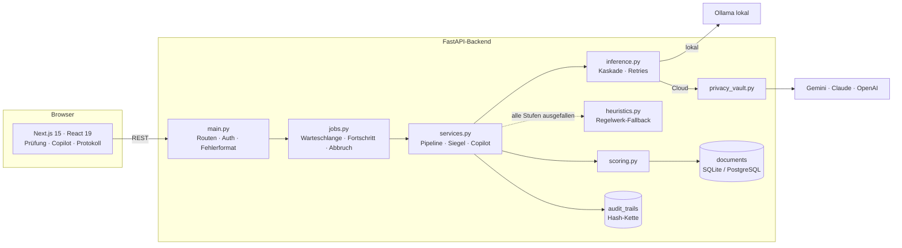
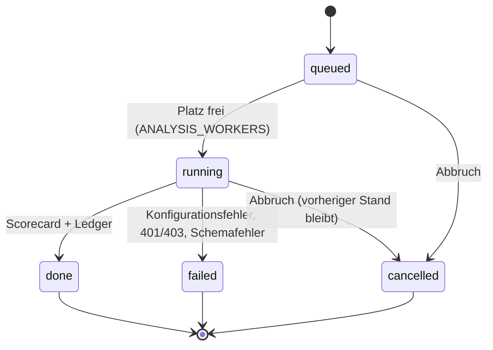
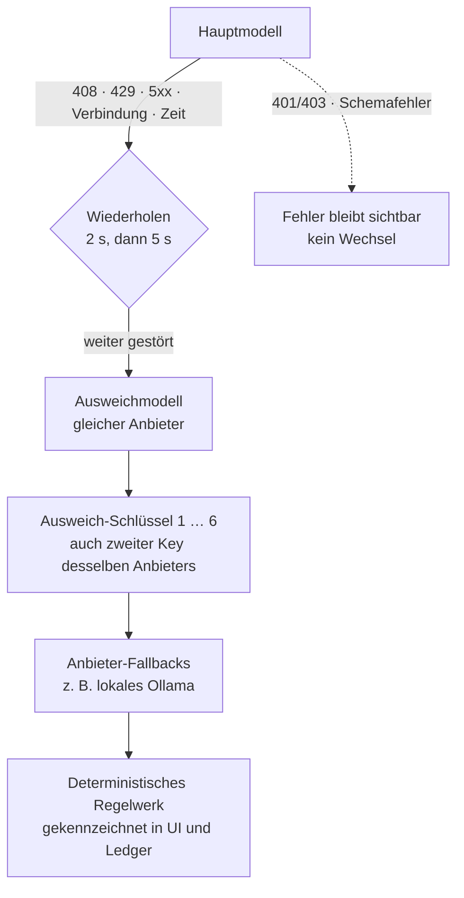

# Architektur

Technischer Überblick über den Enterprise Compliance Agent: Komponenten,
Datenfluss, Ausfallsicherheit und die Entscheidungen dahinter. Für Bedienung
und Schnellstart siehe [`README.md`](../README.md), für die Rechtsgrundlagen
[`RECHTLICHE_ANALYSE_2026.md`](RECHTLICHE_ANALYSE_2026.md).

## Leitlinien

| Prinzip | Umsetzung |
|---|---|
| **Deterministischer Kern** | Der Compliance-Score entsteht in `app/scoring.py` aus versionierten Regeln, nie im Sprachmodell. Das Modell liefert nur Eingaben (Extraktion, Einstufung); jede Pflichtangabe wird per Regex gegengeprüft. |
| **Kein Ergebnis ohne Herkunft** | Jede Analyse, jedes Siegel, jede Übersteuerung und jeder Modell- oder Stufenwechsel landet unveränderbar in einer SHA-256-Hash-Kette. Prüfer- und Steuerungsereignisse (`sign_off`, `human_override`, `model_change`, `archive`/`unarchive`, `release_update`) sind zusätzlich Ed25519-signiert; maschinelle Einträge (`analysis`, `provider_failover`) sichert die Verkettung. |
| **Privacy by Default** | Lokale Inferenz als Standard; jeder Cloud-Aufruf läuft zwingend durch den `PrivacyVault` (Pseudonymisierung im Backend, flüchtiges Mapping). |
| **Kein Ausfall bricht eine Prüfung ab** | Wiederholung mit Backoff, Ausweichmodell, Ausweich-Schlüssel, Anbieter-Fallbacks, zuletzt ein deterministisches Regelwerk – gekennzeichnet, nie still. |
| **Keine Framework-Magie** | Reines `httpx` statt SDKs oder Agenten-Frameworks: Der Weg vom Dokument zur Datenbank ist für einen IT-Auditor lesbar. |

## Systemübersicht



## Prüfpipeline

`POST /documents/{id}/extract` nimmt den Auftrag sofort an (HTTP 202) und
reiht ihn in die Warteschlange ein; `?wait=true` wartet für Skripte und CI auf
das Ergebnis. Der Job durchläuft vier Phasen, die er live meldet:

| Phase | Schritt | Details |
|---|---|---|
| 1 | Text-Layer & XML-Vorrang | Textlayer vorhanden? Das gespeicherte Original wird mit dem aktuellen Parser neu eingelesen (auch bei Belegen aus älteren Versionen; das Protokoll vermerkt `einvoice_parser` und ggf. `einvoice_reread`). E-Rechnungen mit auswertbarem XML laufen ab hier deterministisch über den EN-16931-Datensatz (BMF 15.10.2024, Rz. 36). |
| 2 | PII-Scanner & Privacy Vault | Regex-Zweitmeinung über den Volltext; bei Cloud-Inferenz Aufbau des Mappings (gleiche Platzhalter für beide Modellaufrufe). |
| 3 | § 14 UStG Extraktion & Prüfung | Strukturierte Extraktion mit Pydantic-Vertrag und einer Reparaturrunde bei Schemafehlern; regelbasierte Nachkontrollen (IBAN MOD-97, Pflichtangaben). |
| 4 | EU AI Act, Scorecard & Ledger | Einstufung nach Art. 5/6/50 mit Anhang-III-Eskalation, DSGVO-Befund mit Maskierungszwang, deterministische Scorecard, Ledger-Eintrag. |

Der Fortschritt im Job-Monitor ist ehrlich: Innerhalb einer Phase nähert sich
der Balken asymptotisch dem Phasenende, ohne es zu überschreiten; erst die
tatsächlich nächste Phase schiebt ihn weiter. Die Restzeit wird aus einer
gleitenden Erwartung je Pfad (KI, XML) geschätzt und geglättet.



* **Abbruch** beendet den Task sofort; der Beleg erhält seinen vorherigen
  Status, ein vorhandenes Ergebnis bleibt unangetastet. Bereits ausgelöste
  Stufenwechsel stehen trotzdem im Ledger.
* **Hängende Jobs:** Ohne Rückmeldung länger als das Modell-Timeout plus 60 s
  meldet der Snapshot `stalled`; die Oberfläche bietet Abbrechen an.
* **Release-Wechsel:** Während eines Updates startet kein Job, und der
  Release-Assistent spielt kein Update ein, solange Jobs offen sind.

## KI-Kaskade



* Jede Stufe wiederholt zunächst selbst (`LLM_RETRY_DELAYS`), bevor die
  nächste übernimmt. Lokale Zeitüberschreitungen werden nicht wiederholt – ein
  zu langsames Modell wird beim zweiten Versuch nicht schneller.
* **Alle Cloud-Stufen teilen sich einen `PrivacyVault`:** gleiche Platzhalter
  über die gesamte Kette, ein gemeinsamer Bericht, nie Klartext beim Anbieter.
* Jeder Stufenwechsel wird als `provider_failover` in die Hash-Kette
  geschrieben (von/zu Anbieter, Modell, Stufe, Grundcode).
* Ausweichmodell und Ausweich-Schlüssel gelten nur, wenn ein Cloud-Anbieter
  primär ist: Eine lokal eingestellte Prüfung geht nie automatisch in die Cloud.
* Abgelehnte Schlüssel (401/403) und Schemafehler lösen bewusst weder
  Wiederholung noch Wechsel aus – eine Fehlkonfiguration soll auffallen.
* Ein optionales Tagesbudget überspringt alle Cloud-Stufen, sobald es
  erreicht ist; lokale Stufen und das Regelwerk übernehmen. Eingestellt wird
  es in der Oberfläche; `CLOUD_DAILY_TOKEN_LIMIT` ist Voreinstellung und – wenn
  gesetzt – Obergrenze.
* Modellwechsel sind nie still: Neuere Modelle werden aus der Modell-Liste des
  Anbieters nur *vorgeschlagen*; die Übernahme schreibt einen signierten
  `model_change`-Eintrag.

### Regelwerk-Fallback

`app/heuristics.py` liest Rechnungsfelder per Mustererkennung und stuft
konservativ ein: KI-Begriffe plus Anhang-III-Indikatoren (Bewerbung,
Bonität, kritische Infrastruktur …) ergeben „Hochrisiko“, das die Prüfperson
bestätigen oder nach Art. 14 Abs. 4 lit. d übersteuern kann. Scorecard,
Maskierung und Ledger laufen unverändert; das Ergebnis trägt
`provider = "heuristic"` und den Hinweis „Regelbasiertes Referenz-Audit – KI
nicht verfügbar“. Der Copilot fällt auf eine Antwort aus dem gespeicherten
Prüfergebnis zurück. Mit `HEURISTIC_FALLBACK=false` bleibt stattdessen der
Fehler sichtbar.

## Prüfprotokoll

* Append-only-Tabelle `audit_trails`; DB-Trigger (SQLite und PostgreSQL)
  verweigern `UPDATE` und `DELETE`.
* `entry_hash = SHA-256(kanonisches JSON aller Felder inkl. previous_hash)`;
  `GET /api/audit/verify` rechnet die Kette nach und prüft jede Signatur.
* Ereignisse: `analysis`, `sign_off`, `human_override`, `provider_failover`,
  `model_change`, `archive`/`unarchive`, `release_update`. Ereignisse ohne
  Beleg tragen `document_id = "system"`.
* Das Prüfdatenpaket (ZIP) enthält Original, XML, Ledger-Auszug, Zertifikat,
  Verfahrensdokumentation und ein Ed25519-signiertes Manifest;
  `scripts/verify_pruefpaket.py` prüft es offline.

## Frontend

```
frontend/src/
  app/page.tsx            Orchestrierung: drei Ansichten mit Keep-Alive (Ansicht je Tab), Jobs, Toasts
  app/error.tsx           Ruhige Fehlergrenze mit „Neu laden“
  components/Header       Logo-Popover, Bereiche (PillTabs), Job-Monitor, Hinweise, Offline
  components/JobMonitor   Kopfzeilen-Pille, Phasen, Restzeit, zweistufiger Abbruch, 12-s-Nachlauf
  components/CopilotView  Gespräch mit Live-Arbeitsschritten, Belegtext mit [Z. n]-Sprung
  components/ProtocolView Hash-Kette, Exporte, Regelwerk
  components/SettingsModal Zwei Spalten: KI-Einrichtung (Modelle, Ausweich-Kaskade), Compliance, Darstellung, Verbindung, Über
  components/ui           Portal-Tooltip, PillTabs, ProgressBar, AutoTextarea, HashBadge …
  lib/popover.ts          Popover-Lage im Fenster und Popover-Bus (höchstens eines offen)
  lib/useJobs.ts          Warteschlange abfragen, Abschluss genau einmal melden
```

* **Drei Ansichten statt einer überfrachteten Seite:** Prüfung
  (Belegliste, Scorecard, Inspektor), Copilot und Protokoll (Hash-Kette,
  Exporte, Regelwerk). Alle bleiben eingehängt – ein Ansichtswechsel bricht weder eine
  Prüfung noch ein Gespräch ab.
* **Design-System „ruhig und statisch“:** Tokens in `globals.css` für Dark
  (`#07080c` / `#0f1118` / `#161924`) und Light; Karten reagieren nicht auf den
  Zeiger, Hover-Feedback nur an Bedienelementen; Inter mit Tabellenziffern für
  alle UI-Zahlen, IBM Plex Serif für große Kennzahlen, JetBrains Mono nur für
  Hashes, XML und Beleg-Rohtext. Alle Schriften lokal aus npm (`@fontsource`),
  kein CDN.
* **Keine Ersatzdaten:** Ist das Backend nicht erreichbar, zeigt die Oberfläche
  einen Hinweis mit Handlungsanweisung statt erfundener Ergebnisse.

## Verbindliche Regeln für Änderungen

Diese Invarianten tragen die Revisionssicherheit und das ruhige Erscheinungsbild.
Wer Code ändert, hält sie ein; die Tests sichern die fachlichen Regeln ab.

### Recht und Nachvollziehbarkeit

* **XML-Vorrang:** Bei hybriden E-Rechnungen ist der XML-Datensatz maßgeblich
  (BMF-Schreiben vom 15.10.2024, Rz. 36); der Bildteil wird nur abgeglichen.
* **Score nie von Hand:** Eine Übersteuerung nach Art. 14 Abs. 4 lit. d AI Act
  ändert die Eingabe (Risikostufe); der Score wird daraus neu berechnet.
* **Fristen nur über `app/retention.py`:** Rechnungen und Buchungsbelege
  8 Jahre (§ 147 Abs. 1 Nr. 4, Abs. 3 AO i. d. F. BEG IV), Kredit- und
  Wertpapierinstitute sowie Versicherungen 10 Jahre; Handelsbücher und
  Verfahrensdokumentation 10 Jahre. Die Verfahrensdokumentation
  (`app/procedural_doc.py`) gliedert nach GoBD Rz. 153; `app/docx_export.py`
  erzeugt daraus eine Word-Datei zum Ergänzen, `app/print_layout.py` das
  gemeinsame A4-Drucklayout (CSS Paged Media) beider Berichte.
* **Pseudonymisierung im Backend** vor jeder Übergabe an einen Cloud-Anbieter
  (`VaultedClient`); das Mapping bleibt flüchtig im Speicher, alle Cloud-Stufen
  der Kaskade teilen denselben Vault.
* **Ledger:** Archivieren blendet aus und löscht nie. Modellwechsel laufen nur
  über `POST /api/settings`, das `model_change` schreibt. Ein Regelwerk-Audit
  trägt `provider = "heuristic"` und `details.heuristic_fallback = true`.
* **Kaskade:** Wechsel nur bei 408, 429, 5xx, Netzwerkfehler,
  Zeitüberschreitung oder erreichtem Tagesbudget – nie bei 401/403 oder
  Schemafehlern. Eine lokal eingestellte Prüfung geht nie automatisch in die
  Cloud.
* **VIES (`POST /api/vat/verify`):** nur auf Klick der Prüfperson, nur
  Ländercode und Nummer, Timeout 3 s. Das Ergebnis ist eine Momentaufnahme:
  nicht speichern, nicht in den Score einrechnen, die Nummer nicht loggen. Das
  Badge heißt „VIES bestätigt“ – die qualifizierte Bestätigung nach § 18e UStG
  erteilt nur das BZSt.
* **DLP-Gateway (`POST /api/v1/redact`):** Request `{"text" (1–200 000 Zeichen),
  "extra_terms" (≤ 50), "redact_pii" = true, "redact_amounts" = false}`, Response
  `{"redacted_text", "counts", "total", "ruleset_version"}`. Zugangsdaten →
  `[REDACTED_SECRET]`; vertrauliche Dateinamen, Werte geschützter Parameter,
  `DLP_TERMS` und `extra_terms` → `[REDACTED_CONFIDENTIAL]`; PII →
  `[REDACTED_<KATEGORIE>]`. Kein Mapping, der Text wird nie gespeichert oder
  geloggt.
* **Release-Assistent:** kein automatisches Pullen im Hintergrund. Eingespielt
  wird per Klick auf den Ziel-Commit, ohne ungesicherte lokale Code-Änderungen
  und ohne offene Prüf-Jobs, standardmäßig nur von localhost; vorher eine
  SQLite-Sicherung nach `data/backups/`, danach `release_update` im Ledger.
* **Secrets:** keine `.env`, API-Keys oder `data/*.key` committen. Tests laufen
  ausschließlich mit `httpx.MockTransport` und ignorieren eine lokale `.env`.

### Oberfläche

* **Tokens nur aus `frontend/src/app/globals.css`:** Dark `#07080c` (Canvas),
  `#0f1118` (Surface), `#161924` (Surface 2), Konturen Weiß 10 % (Hover 18 %);
  Light `#f8fafc` / `#ffffff`. Kategorienfarben `--viz-1` … `--viz-8`
  (farbfehlsichtig validiert). Keine knalligen Verläufe, kein reines Schwarz.
* **Statische Karten:** `.card` reagiert nicht auf den Zeiger; Hover-Feedback
  nur an Bedienelementen.
* **Drei Ansichten, je ein Wort:** Prüfung, Copilot, Protokoll – alle bleiben
  eingehängt. Die Kopfzeile bleibt schlank: Logo mit Versions-Popover,
  Bereiche, Job-Monitor nur während einer Prüfung (12 s Nachlauf), Hinweise nur
  bei Handlungsbedarf, Offline-Hinweis, Release-Pille nur bei neuer Version,
  Musterdaten, Modellname mit Statuspunkt, Hilfe, Farbschema, Einstellungen.
* **Keine Emojis:** Status über die SVG-Icons aus `components/icons.tsx` und
  Farbpunkte.
* **Markierungen im Belegtext:** Grün konform, Gelb Prüfhinweis, Rot Verstoß,
  Indigo PII; Fundstellen je Kriterium nur über `lib/evidence.ts`. Jeder Abzug
  und jede Risikoklasse hat einen Tooltip mit Paragraph und Rechtsfolge.
* **Fehler ruhig formulieren:** Problem plus Handlungsanweisung, nie
  Klassennamen oder „Failed to fetch“; `app/error.tsx` fängt Abstürze ab.
* **Zahlen und Schrift:** UI-Zahlen in Inter mit `tabular-nums`, große
  Kennzahlen optional `.zahl-display`; JetBrains Mono nur für Hashes,
  Signaturen, XML-Kennungen, Code und Beleg-Rohtext; Beträge in Tabellen
  rechtsbündig. Schriften lokal über `@fontsource`, kein CDN und kein
  `next/font/google` – der Docker-Build läuft ohne Netz.
* **Menüs, Popovers, Tooltips:** nie ein natives `<select>`, sondern
  `components/Select.tsx`; schwebende Menüs über `lib/popover.ts` mit dem
  Popover-Bus (höchstens eines offen). Popovers der Kopfzeile rendern per
  Portal, weil die Kopfzeile selbst `backdrop-filter` trägt. Tooltips nur über
  `Tooltip` aus `components/ui.tsx` (Portal, `position: fixed`,
  Viewport-Clamping).
* **Barrierefreiheit & Mehrsprachigkeit (DE / EN / ES):** Modale rendern per
  Portal auf `document.body` mit Tab-Focus-Trap, Hintergrund-`inert` auf
  `#eca-app-shell` und Fokus-Rückgabe; `@media (forced-colors: active)` und
  vergrößerte Touch-Ziele (`@media (pointer: coarse)`, `@media (hover: none)`).
  Vollständige UI-, Copilot- und Export-Lokalisierung (`lib/i18n.tsx`,
  `?lang=de|en|es`) vor dem ersten Bildaufbau (`localStorage` `eca-lang`).
* **Design-Regeln:** `backdrop-filter` nur als Standard-Eigenschaft notieren
  (das `-webkit-`-Präfix ergänzt Lightning CSS beim Build). Keine Schrift unter
  `text-xs` (Ausnahme: Belegtext 13 px); mehrzeilige Eingaben über
  `AutoTextarea`, Scrollbereiche `scroll-area` plus `pr-4`.
* **Viewports:** 1920 × 945 und 2560 × 1305 ohne Seiten-Scrollen im Copilot,
  feste Inspektorhöhe (`PANEL_HEIGHT`), Inhalt `max-w-[1920px]` bzw.
  `2xl:max-w-[2400px]`.
* **Bewegung nur mit Funktion:** gleitender Tab-Indikator, Fortschritt,
  Spinner; Tabs und Modale 150 ms ease-out, `prefers-reduced-motion` wird
  respektiert; Skeleton statt Spinner im Inhalt; Toasts oben rechts (3 s,
  Warnung/Fehler 6 s, Überfahren pausiert).
* **Tastatur und Onboarding:** Modale schließen mit `Escape`; `J`/`K`
  wechseln das Dokument, `1`–`5` die Inspektor-Reiter, `?` zeigt die Kürzel,
  `Strg`/`⌘` + `Enter` versiegelt. Die Tour läuft einmalig
  (`localStorage` `eca-onboarding-done`). Platzhalter bleiben neutral, nie mit
  Personennamen.

## Tests

`pytest` (540 Tests, Stand v2.8.5) deckt die Kette vom HTTP-Request bis zur
Datenbank ab, ohne LLM und ohne Netz: Ollama, Cloud-Anbieter und VIES werden auf HTTP-Ebene über
`httpx.MockTransport` nachgestellt, sodass Payload-Aufbau, Vault,
Fehlerabbildung, Kaskade und Schemavalidierung real laufen. Die
Resilienz-Tests (`tests/test_resilience.py`) prüfen unter anderem
Neuversuche je HTTP-Status, Ausweichmodell, mehrere Schlüssel desselben
Anbieters durch den Vault, das Ausbleiben jedes Wechsels bei 401, den
Regelwerk-Fallback mit Ledger-Kennzeichnung, das Tagesbudget sowie
Fortschritt, Batch und Abbruch der Jobs.

## Bewusste Grenzen

* **Ein Prozess:** Warteschlange, Fortschritt und Rate-Limit leben im
  Prozessspeicher. Für mehrere Worker gehören sie in Redis oder eine
  Job-Queue wie Arq/Celery; die Job-API bliebe dabei unverändert.
* **Lineare Hash-Kette, kein Merkle-Baum:** Gegen Vollzugriff auf die
  Datenbank hilft die externe Ablage des Kopf-Hashes (`GET /api/audit/head`).
* **Regelbasierte Pseudonymisierung:** kein NER-Modell; Namen ohne Anrede oder
  Rolle bleiben unerkannt.
* **Kein OCR, keine XSD/Schematron-Validierung** – siehe
  [„Abgrenzung und Architektur-Scope“ im README](../README.md#abgrenzung-und-architektur-scope).
